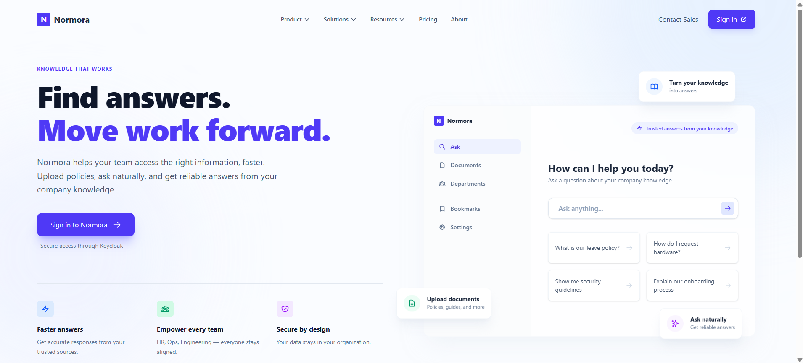
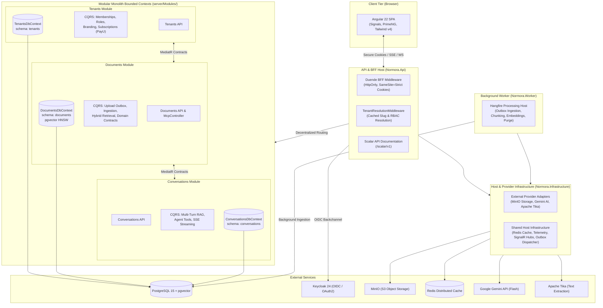

# 🚀 Normora

<div align="center">
  
  
  
  
  
  
  
  
  
  
</div>
<br>

<div align="center">
  
</div>
<br>

**Normora** is an enterprise-grade, multi-tenant knowledge management and conversational AI platform. Architected as a **.NET 10 Modular Monolith** coupled with an **Angular 22 SPA**, Normora enables organizations to securely ingest company policies, compartmentalize access via departmental RBAC, and converse with grounded AI agents using hybrid semantic retrieval and autonomous tool calling.

---

## 🏗️ System Architecture

Normora enforces a strict **Modular Monolith** boundary on the backend, complete **DbContext encapsulation**, and the **Backend-For-Frontend (BFF)** pattern for browser token immunity.



---

## 🌟 Core Architectural Principles

- **100% Modular Monolith Encapsulation**: Each module (`Tenants`, `Documents`, `Conversations`) encapsulates its own domain entities, CQRS slices, and private `DbContext`. API controllers, middleware, and other modules never directly reference another module's `DbContext`. Cross-module communication strictly traverses MediatR request/query contracts in `Normora.Shared.Contracts.*`.
- **Decoupled Background Worker (`Normora.Worker`)**: Background Hangfire workloads run in an independent generic host process that references `Normora.Infrastructure` instead of the API BFF host, preventing host coupling and deployment friction.
- **External Provider Pattern**: Business modules are 100% free of external vendor SDKs (no `Minio` packages or vendor client libraries). Modules declare domain contracts (`IDocumentStorageService`, `ITextGenerationService`, `ITextEmbeddingService`, `IDocumentTextExtractor`), while swappable third-party implementations reside in `server/Normora.Infrastructure/Providers/` (`Storage/`, `Gemini/`, `DocumentExtraction/`) wired via dedicated `ProviderServiceExtensions`.
- **Transactional Outbox for Document Ingestion**: Document uploads commit file metadata, document version, and a `DocumentProcessingOutboxMessage` within a single database transaction, backed by immediate wakeup and recurring Hangfire recovery dispatch to guarantee zero data loss.
- **Zero-Trust Security (BOLA & BFLA Mitigation)**:
  - **BOLA**: Resource enumeration is prevented by catching missing or unauthorized object access and returning generic 404 responses (`BolaException`).
  - **BFLA**: Unauthorized functional actions are blocked globally with 403 Forbidden envelopes (`BflaException`).
  - **Dynamic Multitenant Query Filters**: All database queries are automatically filtered by `TenantId` via EF Core global query filters dynamically bound to the DbContext's tenant context.
- **Backend-For-Frontend (BFF) Pattern**: Browser clients never receive, handle, or store access/refresh tokens. Sessions are anchored by encrypted `HttpOnly`, `SameSite=Strict`, `Secure` cookies with anti-CSRF protection via Duende BFF.
- **Conversational RAG with Autonomous Agent Tools & MCP**:
  - **Hybrid Search**: Combines pgvector cosine similarity (HNSW index) with full-text keyword search using Reciprocal Rank Fusion (RRF).
  - **Multi-Turn Function Calling**: Integrated Gemini Flash tool calling loop for deterministic corporate expense calculations (`calculate_policy_limit`), HR email escalations (`escalate_hr_inquiry`), and cross-module document search (`search_company_documents`).
  - **Model Context Protocol (MCP)**: Implements standard JSON-RPC 2.0 MCP endpoints (`/api/mcp`) exposing corporate knowledge resources and tools to external AI agent frameworks.
- **Provider-Neutral Abstractions**: Domain models reference neutral interfaces for payment processing (`IPaymentService`), transactional emails (`IEmailSender`), and external identity (`ExternalUserId` mapping OIDC subjects), completely decoupling business logic from third-party vendors.
- **High-Performance Distributed Caching**: Multi-tenant resolution, role checks, and branding lookups are cached in Redis with short sliding expirations (30s–5m), eliminating redundant database queries per HTTP request while ensuring immediate revocation propagation.

---

## 📚 Documentation Index

| Category | Guide | Description |
|---|---|---|
| **Architecture & System Design** | [**Backend Architecture**](./docs/architecture.md) | Deep dive into modular boundaries, CQRS folder-per-operation rules, MediatR pipeline behaviors, and parameterless entity configs. |
| | [**Conversational RAG Architecture**](./docs/conversational_rag_architecture.md) | Technical blueprint for query rewriting, token budgeting, candidate reranking, SSE streaming, and MCP tool execution. |
| | [**How Normora Works**](./docs/how_normora_works.md) | Visual explanation of document sharing, User Group isolation, and departmental RAG security boundaries. |
| **Developer Onboarding** | [**Getting Started & Setup**](./docs/getting_started.md) | Zero-friction local setup guide, Docker Compose topology, environment variables, and pre-seeded test accounts. |
| | [**Backend Onboarding & .NET Course**](./docs/backend_onboarding.md) | Crash course for engineers transitioning from Node.js, Go, or Python to modern .NET 10 CQRS development. |
| | [**Frontend Onboarding Guide**](./docs/frontend_onboarding.md) | Angular 22 architecture, reactive Signals state management, path-based routing, and PrimeNG/Tailwind v4 styling. |
| | [**Frontend Client README**](./client/README.md) | Client-specific setup, Vitest test execution, and directory breakdown. |
| **Contracts, Schema & Security** | [**API Endpoints Catalog**](./docs/api_endpoints.md) | Complete REST & RPC catalog, envelope formats, MCP methods, and authorization rules. |
| | [**Database Schema & Relationships**](./docs/database_schema.md) | PostgreSQL schemas (`tenants`, `documents`, `conversations`), pgvector HNSW indexes, and soft-delete filters. |
| | [**Security Headers & Hardening**](./docs/security_headers.md) | Defense-in-depth specifications: CSP, HSTS, frame protection, anti-CSRF, and cookie session security. |
| | [**Configuration Reference**](./docs/configuration.md) | Strongly-typed Options pattern, startup validation (`ValidateOnStart`), and environment variable overrides. |
| **Governance & Roadmaps** | [**Progress Tracker**](./progress_tracker.md) | Authoritative roadmap and changelog tracking completed phases (Phases 1–28) and upcoming milestones. |
| | [**Agent Coding Guidelines**](./AGENTS.md) | Strict engineering rules, architectural conventions, and coding patterns enforced across the repository. |

---

## ⚡ Quick Start

### 1. Launch Stack via Docker Compose
Starting the complete ecosystem locally is fully automated:

```powershell
.\start.ps1
```
*(The script provisions `.env` with secure defaults, pulls container images, runs database migrations, and boots the API, worker, and Angular client).*

> [!IMPORTANT]
> **API Keys Required for AI & Notifications:**
> - **Google Gemini API Key**: Set `GEMINI_API_KEY` in `.env` to enable Conversational AI, RAG embeddings, and tool calling.
> - **Resend Email API Key**: Set `RESEND_API_KEY` in `.env` to send invitation and escalation emails.

### 2. Graceful Shutdown
To stop all containers without losing data volumes:
```powershell
.\stop.ps1
```

---

## 🌐 Local Access Points

| Service | Local URL | Default Credentials / Purpose |
|---|---|---|
| **Client Application (Angular)** | `http://localhost:4200` | Main user and employer web portal |
| **Backend API (.NET 10)** | `http://localhost:5000` | REST API, BFF endpoints, SignalR hubs |
| **API Documentation (Scalar)** | `http://localhost:5000/scalar/v1` | Interactive OpenAPI / Scalar documentation |
| **Keycloak Admin Console** | `http://localhost:8080` | `admin` / `admin` (IAM realm management) |
| **MinIO Console** | `http://localhost:9001` | `minioadmin` / `minioadmin` (S3 object browser) |
| **pgAdmin (PostgreSQL UI)** | `http://localhost:5050` | `admin@normora.local` / `admin` |
| **Hangfire Dashboard** | `http://localhost:5000/hangfire` | Background job execution and retry monitor |
