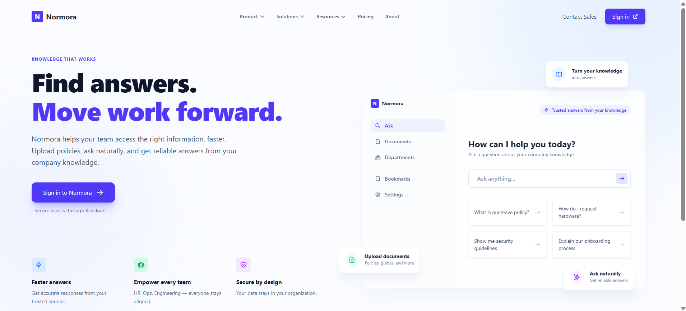

# 🚀 Normora

<div align="center">
  
  
  
  
  
  
  
  
  
  
</div>
<br>

<div align="center">
  
</div>
<br>

**Normora** is an enterprise-grade full-stack web application designed for high scalability, stringent security, and an exceptional developer experience.

## 🌟 Why Normora?
Normora is architected from the ground up to deliver a resilient and performant modern web experience:

- **Strict Modular Monolith Backend**: Built on **.NET 10**, the backend strictly enforces 100% DbContext encapsulation across bounded contexts (`Tenants`, `Documents`, `Conversations`, `Users`). Feature vertical slices reside directly in their owning modules, and the API host communicates solely via MediatR query contracts and boundary interfaces.
- **Modern SPA Frontend**: Powered by **Angular**, providing a lightning-fast, reactive, and strictly-typed user experience.
- **Enterprise-Ready Infrastructure**:
  - **Identity & Access Management**: Fully integrated with **Keycloak** via OAuth2/OpenID Connect to handle secure authentication and robust role-based access control, decoupled from domain models via `ExternalUserId`.
  - **Object Storage**: Leverages **MinIO** for S3-compatible, highly performant, and horizontally scalable file storage.
  - **Relational Data**: Powered by **PostgreSQL** for reliable ACID-compliant transactions across isolated module schemas.
- **Conversational AI & RAG**: Features an advanced Retrieval-Augmented Generation pipeline. Uses **pgvector** for hybrid vector-keyword retrieval (RRF scoring) and the **Gemini 2.0 Flash API** to answer complex queries strictly grounded in secure company documentation.
- **Autonomous Agent Tools & MCP**: Native multi-turn function calling for deterministic corporate expense calculations, automated HR email escalations, and targeted document searches, coupled with a JSON-RPC 2.0 **Model Context Protocol (MCP)** server (`/api/mcp`) for external agent tooling.
- **Enterprise Governance & Auditability**: Automatically tracks all sensitive business operations (document lifecycle, employee invitations/removals, permissions, branding) through open MediatR pipeline behaviors into immutable audit logs.
- **Subscription Tiers & Decoupled Billing**: Built-in plan tier management (`Free`, `Pro`, `Enterprise`) that proactively enforces limits on employee seats, document counts, and storage allocations. Built on an `IPaymentService` abstraction supporting PayU India Hosted Checkout, SHA-512 cryptographic verification, UPI (Google Pay, PhonePe, Paytm, QR), credit/debit cards, and tier hierarchy action locking.
- **Observability**: Fully instrumented with **OpenTelemetry (OTLP)** for distributed tracing and granular metrics (e.g. tracking LLM token consumption and DB query latencies).
- **Containerization & DevOps**: The entire application and its complex dependencies are thoroughly Dockerized. It highlights a focus on developer experience (DX)—a single script provisions the database, IAM server, object storage, API, and the Web Client from scratch.

## 📚 Documentation

For a deeper dive into the architectural decisions, database schema, and API contracts, please refer to the dedicated documentation files:

- [**General Onboarding & Setup**](./docs/getting_started.md) — Quick-start guide, local environment configuration, and test account credentials.
- [**Project Overview & Features**](./docs/overview.md) — High-level summary of features, use cases, and multi-tenant capabilities.
- [**Backend Architecture & Patterns**](./docs/architecture.md) — MediatR request lifecycles, modular monolith design, and project dependency rules.
- [**Authorization & Security Guide**](./docs/architecture.md#application-security-bola--bfla) — Comprehensive guide to BOLA and BFLA mitigation and the tenant-level RBAC enforcement.
- [**Backend Onboarding & .NET Course**](./docs/backend_onboarding.md) — In-depth C#/.NET crash course tailored for developers transitioning from JS/Go/Python.
- [**Frontend Onboarding Guide**](./docs/frontend_onboarding.md) — Angular 22 architecture, path-based workspace routing (`/app/workspaces/:slug`), Signal usage, and state management.
- [**API Endpoints Catalog**](./docs/api_endpoints.md) — A comprehensive list of routes, parameters, authorization checks, and standard envelopes.
- [**Database Schema & Entity Relationships**](./docs/database_schema.md) — Detailed mapping of module schemas, indexes, soft delete behaviors, and multi-tenant relationships.
- [**How Normora Works (Access & RAG)**](./docs/how_normora_works.md) — End-to-end guide on document sharing, User Group isolation, and secure Conversational AI retrieval.
- [**Conversational RAG Deep-Dive**](./docs/conversational_rag_architecture.md) — Technical breakdown of the multi-turn conversational AI pipeline, context resolution, and hybrid retrieval.

## ⚡ Quick Start

Starting the whole stack locally is incredibly simple:

```powershell
.\start.ps1
```
*(This script will automatically generate a `.env` file with defaults, pull necessary images, and build the .NET API & Angular client).*

> [!IMPORTANT]  
> **API Configuration Requirement:**
> - **Google Gemini API Key**: To use Conversational AI, RAG document search, and tool calling, set `GEMINI_API_KEY` in your `.env` file.
> - **Resend Email API Key**: To enable transactional notifications (invitations, document alerts, escalation emails), set `RESEND_API_KEY` in `.env`.
> - **Dev Email Override**: When testing with Resend's free tier, emails can only be delivered to your registered Resend account. Set `DEV_OVERRIDE_EMAIL=your-resend-account@email.com` in `.env` to route all outbound test emails to your inbox.

To gracefully stop the environment without destroying your data volumes:
```powershell
.\stop.ps1
```

## 🌐 Access Points

Once the Docker containers are running, you can access the ecosystem at:
- **Client Application (Angular)**: `http://localhost:4200`
- **Backend API (.NET 10)**: `http://localhost:5000`
- **API Documentation & Testing (Scalar)**: `http://localhost:5000/scalar/v1`
- **Keycloak Admin Console**: `http://localhost:8080`
- **MinIO Console**: `http://localhost:9001`
- **pgAdmin**: `http://localhost:5050`
