# Normora Agentic Enterprise Operating System (AEOS)
## Comprehensive Architectural Blueprint & .NET 10 Research Specification

---

## Executive Summary & Architectural Vision

**Normora** is evolving from a multi-tenant conversational RAG platform into a full-fledged **Agentic Enterprise Operating System (AEOS)**. In modern enterprises, generative AI cannot remain a passive chatbot; it must act as an active, autonomous workforce capable of coordinating workflows, executing complex business processes across departments, and surfacing predictive intelligence—all while operating under strict corporate governance, data privacy, and tenant isolation.

### The Core Architectural Tenet: "Agents Propose, ASP.NET Core Authorizes & Executes"
In Normora, AI agents are **never** granted direct database access, bypass mechanisms, or unconstrained execution authority. The foundational tenet of the Normora Agentic Architecture is:

> **Agents Propose, ASP.NET Core Authorizes & Executes.**
> Every tool call, action proposal, and state mutation requested by an agent is dispatched through the existing MediatR CQRS pipeline in ASP.NET Core. The application layer enforces identical Broken Object Level Authorization (BOLA), Broken Function Level Authorization (BFLA), FluentValidation, tenant isolation, and audit logging as if the authenticated user invoked the endpoint directly via the UI.

### Technology Boundaries
To maintain high performance, low total cost of ownership (TCO), and complete operational simplicity:
1. **100% .NET Native**: The entire agent orchestration runtime, tool registry, memory manager, protocol adapters, and background workers run in C# on **ASP.NET Core (.NET 10)**.
2. **Zero Secondary Language Backends**: No Python, FastAPI, Node.js, Java, LangChain, CrewAI, or AutoGen Python runtimes are introduced.
3. **No Unnecessary Microservices**: The agentic system lives inside Normora's proven **Modular Monolith** architecture, operating within existing bounded contexts (`Tenants`, `Documents`, `Conversations`) and executed asynchronously by `Normora.Worker`.

---

## 1. Technology Compatibility Matrix for ASP.NET Core

The following matrix provides an exhaustive, authoritative assessment of AI frameworks, protocols, and supporting libraries within the .NET 10 ecosystem.

### AI and Agent Frameworks

| Technology | What It Does | Integration with ASP.NET Core | Official C# SDK? | In-Process vs External | Maturity & Readiness | Advantages & Limitations | Normora Practical Use Case |
| :--- | :--- | :--- | :--- | :--- | :--- | :--- | :--- |
| **Microsoft.Extensions.AI (MEAI)** | Standardized vendor-neutral abstractions for chat completions, embeddings, and tool binding (`IChatClient`, `IEmbeddingGenerator`). | Registers directly via `IServiceCollection`. Middleware pipeline (caching, telemetry, rate-limiting) wraps clients natively. | **Yes** (Official Microsoft package `Microsoft.Extensions.AI`). | Runs 100% natively in-process in .NET. External LLM called over HTTP. | **GA / Production Ready** (Foundational standard for .NET AI). | **Pros**: Provider-agnostic; clean DI; composable pipelines; zero lock-in.<br>**Cons**: Lower-level than full agent orchestrators; requires agent loop logic. | The foundational abstraction layer across `Normora.Infrastructure` for swapping LLMs (Gemini, Azure OpenAI, Ollama) without code changes. |
| **Microsoft Semantic Kernel (SK)** | Enterprise AI orchestration SDK providing Kernels, Plugins (`KernelPlugin`), native function calling (`KernelFunction`), filters, and memory. | Native ASP.NET Core DI integration (`AddKernel()`). Plugins resolve scoped dependencies from DI. | **Yes** (Official Microsoft SDK `Microsoft.SemanticKernel`). | Runs 100% natively in-process in .NET. | **GA / Production Ready** (Battle-tested enterprise standard). | **Pros**: Powerful plugin model; automatic function calling; streaming support; enterprise filters.<br>**Cons**: Historically frequent API revisions; verbose configuration. | The primary in-process agent execution engine inside `Normora.Modules.Conversations` for tool invocation, plugin management, and memory retrieval. |
| **Semantic Kernel Agent Framework** | High-level agent abstraction layer within Semantic Kernel (`ChatCompletionAgent`, `AgentGroupChat`, `OpenAIAssistantAgent`). | Integrates via SK Kernel in DI; agents can be instantiated per request or background job. | **Yes** (Official Microsoft package `Microsoft.SemanticKernel.Agents.Core`). | Runs 100% in-process in .NET. | **GA / Production Ready**. | **Pros**: Native multi-agent group chats; sequential handoffs; selection & termination strategies.<br>**Cons**: Group chat state persistence across distributed worker nodes requires custom storage adapters. | Orchestrating supervisor-worker multi-agent collaborations (e.g., Onboarding Supervisor delegating to IT and HR agents). |
| **Microsoft Agents AI SDK / Hosting AGUI** | Next-generation agent hosting framework evolved from Bot Framework and AutoGen .NET abstractions (`Microsoft.Agents.AI.Hosting.AGUI.AspNetCore`). | Native ASP.NET Core hosting middleware mapping agent endpoints directly to HTTP/SSE routes. | **Yes** (Official Microsoft preview package, present in Normora `Normora.Infrastructure.csproj`). | Runs 100% in-process in .NET. | **Preview** (Active development, high potential for UI-agent binding). | **Pros**: Built-in AG-UI protocol support; clean streaming endpoints; ASP.NET Core middleware.<br>**Cons**: Fast-evolving preview APIs; limited community documentation. | Hosting AG-UI endpoints that stream interactive agent widgets and cards directly to the Angular frontend. |
| **Google Gemini API (.NET)** | Access to Google's multimodal Gemini 1.5/2.0 models, embeddings, and tool calling. | Typed `HttpClient` via `IHttpClientFactory` or official `Google.GenAI` SDK registered in `Normora.Infrastructure`. | **Yes** (Official `Google.GenAI` SDK & REST endpoints). | External cloud service invoked over HTTP/REST from native C#. | **GA / Production Ready**. | **Pros**: Huge context window (1M-2M tokens); low cost; native multimodal parsing.<br>**Cons**: Occasional region-specific quota restrictions. | Normora's primary LLM provider for document text extraction, hybrid retrieval query rewriting, and large-context synthesis. |
| **OpenAI API (.NET)** | Direct access to OpenAI models (GPT-4o, o1, o3-mini) and structured JSON outputs. | Native DI integration using the official `OpenAI` client package (`OpenAI` on `System.ClientModel`). | **Yes** (Official OpenAI SDK co-developed with Microsoft). | External cloud service invoked over HTTP/REST from native C#. | **GA / Production Ready**. | **Pros**: Industry-leading reasoning & structured outputs; official high-performance SDK.<br>**Cons**: Higher token costs compared to commodity models. | Specialized reasoning tasks (e.g., complex financial fraud detection or legal contract clause risk scoring). |
| **Azure AI Foundry / Azure.AI.Projects** | Enterprise managed AI gateway providing multi-model access (OpenAI, Llama, Mistral, DeepSeek), evaluation, and content safety. | Integrates via `Azure.AI.Projects` and `Azure.Identity` with ASP.NET Core DI. | **Yes** (Official Azure SDK). | Managed Azure cloud service accessed via native C# SDK. | **GA / Production Ready**. | **Pros**: Enterprise compliance (HIPAA, SOC2); unified model billing; Azure RBAC.<br>**Cons**: Requires Azure subscription and tenancy. | Enterprise deployments requiring strict private networking (VNet/Private Link) and compliance guardrails. |
| **Ollama (.NET / OllamaSharp)** | Local and on-premises LLM inference (Llama 3, DeepSeek-R1, Mistral). | `OllamaSharp` registers via DI, providing `IChatClient` implementations for `Microsoft.Extensions.AI`. | **Community / Well-Maintained** (`OllamaSharp`). | External local daemon; C# client runs in-process. | **Production Ready** for air-gapped / on-premise environments. | **Pros**: 100% data sovereignty; zero per-token cloud costs.<br>**Cons**: Requires dedicated GPU hardware on host servers. | Air-gapped on-premise deployments for defense, banking, or healthcare enterprise tenants. |
| **Anthropic Claude (.NET)** | State-of-the-art coding and agentic reasoning (Claude 3.5 Sonnet / 3.7 Sonnet). | Accessed via `Microsoft.Extensions.AI` wrapper or AWS Bedrock SDK (`AWSSDK.BedrockRuntime`). | **Community / Cloud SDKs** (Official REST API; official AWS/GCP SDKs). | External cloud service invoked over HTTP/REST from native C#. | **Production Ready** via Bedrock or typed HTTP clients. | **Pros**: Exceptional tool-calling precision and steerability.<br>**Cons**: No standalone 1st-party NuGet package directly from Anthropic PBC. | Complex multi-step workflow planning and autonomous code/formula generation. |

### Agent Protocols

| Protocol | What It Does | Integration with ASP.NET Core | Official C# SDK? | In-Process vs External | Maturity & Readiness | Advantages & Limitations | Normora Practical Use Case |
| :--- | :--- | :--- | :--- | :--- | :--- | :--- | :--- |
| **Model Context Protocol (MCP)** | Open standard (Anthropic/open-source) connecting agents to tools, resources, and prompts over JSON-RPC 2.0. | Implemented via ASP.NET Core Controller (`McpController`) or Minimal APIs with SSE and HTTP POST endpoints. | **Yes** (Official ecosystem SDK `ModelContextProtocol` / `mcp-dotnet` + custom controllers). | Runs natively inside the ASP.NET Core process. | **Production Ready** (Specification `2024-11-05` is stable). | **Pros**: Cross-vendor tool interoperability; standard discovery; secure sandboxing.<br>**Cons**: SSE streaming connection state management in multi-instance web farms. | Exposing Normora internal knowledge and business tools to external authorized agent hosts (already live in `server/Modules/Documents/API/McpController.cs`). |
| **Agent2Agent Protocol (A2A)** | Emerging open standard for inter-agent discovery, capability negotiation, delegation, and state synchronization. | Implemented via ASP.NET Core Minimal APIs / gRPC, publishing JSON-LD Agent Manifests (`/.well-known/agent.json`). | **Standardized over HTTP/REST/gRPC**. No vendor lock-in. | Runs natively inside ASP.NET Core. | **Maturing / Early Production**. | **Pros**: Decouples agent architectures; enables multi-organization agent federation.<br>**Cons**: Standards still solidifying across industry working groups. | Federating Normora with external vendor agents (e.g., a supplier's inventory agent communicating with Normora's procurement agent). |
| **AG-UI Protocol** | Agent-Generated UI protocol for streaming dynamic UI component trees and widgets from agent backends to web clients. | ASP.NET Core middleware (`Microsoft.Agents.AI.Hosting.AGUI.AspNetCore`) streaming SSE event packets. | **Yes** (Official Microsoft Preview package). | Runs in-process in ASP.NET Core. | **Preview / Production Ready for targeted widgets**. | **Pros**: Dynamic UI generation; native ASP.NET Core integration; rich user experience.<br>**Cons**: Frontend client renderer must map streamed tokens to component libraries. | Streaming dynamic progress bars, approval cards, and data comparison tables to the Angular frontend during agent execution. |
| **A2UI Protocol** | Declarative JSON-schema UI protocol (inspired by Adaptive Cards / JSON Forms) where agents emit structured component schemas. | C# strongly typed records (`FormCardDto`, `ActionSchema`) serialized via `System.Text.Json` over SignalR or REST. | **100% C# Native** (No external protocol dependency). | Runs 100% in-process. | **Highly Mature / Production Ready**. | **Pros**: Safe; zero raw HTML/JS execution risk; full Angular Material design consistency.<br>**Cons**: Limited to pre-registered Angular component primitives. | Rendering interactive input forms (e.g., leave modification, expense sign-off) and metric cards generated dynamically by agents. |

### Supporting Technologies in Normora

| Technology | What It Does | Integration with ASP.NET Core | Official C# SDK? | In-Process vs External | Maturity & Readiness | Normora Practical Use Case |
| :--- | :--- | :--- | :--- | :--- | :--- | :--- |
| **Microsoft.Extensions.DI** | Inversion of control container and lifetime manager. | Core runtime engine of ASP.NET Core. | **Yes** (Built into .NET). | In-process native. | **GA / Foundational**. | Registering agent tools, module composition roots (`AddConversationsModule`), and scoped tenant services. |
| **ASP.NET Core Minimal APIs** | High-performance, low-overhead HTTP endpoints. | Built into ASP.NET Core routing. | **Yes** (Built into .NET). | In-process native. | **GA / Foundational**. | Ultra-fast SSE streaming endpoints for token-by-token agent thought and tool execution feeds. |
| **SignalR** | Real-time bi-directional WebSocket communication. | Hosted in `Normora.Api`, scaled across instances using Redis backplane (`NormoraSignalR`). | **Yes** (Built into ASP.NET Core). | In-process hub + Redis external backplane. | **GA / Enterprise Standard**. | Real-time agent status broadcasts, streaming tokens, and instant human-in-the-loop approval prompts. |
| **gRPC** | High-throughput binary RPC protocol over HTTP/2. | Native ASP.NET Core gRPC server (`Grpc.AspNetCore`). | **Yes** (Official Google/Microsoft package). | In-process native. | **GA / Enterprise Standard**. | High-volume inter-agent communication and internal telemetry streaming between API host and Worker host. |
| **MediatR** | In-process messaging mediator implementing CQRS. | Pipeline behaviors for validation, tenant authorization, logging, and transactional outbox. | **Yes** (`MediatR` 14.2.0). | In-process native. | **GA / Standard**. | The sole dispatch gateway for agent tools—agents invoke commands and queries through MediatR handlers. |
| **FluentValidation** | Strongly-typed business validation rules. | MediatR pipeline behavior automatically validates tool arguments before handler execution. | **Yes** (`FluentValidation.DependencyInjectionExtensions`). | In-process native. | **GA / Standard**. | Validating agent-generated parameters (dates, amounts, IDs) before any database mutation occurs. |
| **EF Core + pgvector** | Object-relational mapping + HNSW vector similarity search. | Entity mapping via `IEntityTypeConfiguration<T>`, vector queries via `Pgvector.EntityFrameworkCore`. | **Yes** (`Npgsql.EntityFrameworkCore.PostgreSQL` 10.0.3). | In-process client + PostgreSQL database. | **GA / Enterprise Standard**. | Storing tenant data, agent conversational memory, execution checkpoints, and document vector embeddings. |
| **Redis** | In-memory distributed data store and pub/sub engine. | `StackExchange.Redis` configured for distributed caching, lock synchronization, and SignalR. | **Yes** (Official StackExchange package). | In-process client + Redis cluster. | **GA / Enterprise Standard**. | Distributed locking for agent tasks, short-term conversational context caching, and multi-node SignalR backplane. |
| **Hangfire** | Reliable, persistent background job scheduler. | PostgreSQL storage provider (`Hangfire.PostgreSql`) hosted in `Normora.Worker`. | **Yes** (`Hangfire.AspNetCore` 1.8.21). | In-process runner + PostgreSQL persistence. | **GA / Enterprise Standard**. | Long-running agent workflows, recurring scheduled business audits, and durable outbox message processing. |
| **OpenTelemetry** | Distributed tracing, metrics, and structured logging. | W3C trace context propagation across agent turns, tool calls, and LLM requests via OTLP. | **Yes** (`OpenTelemetry.Instrumentation.*`). | In-process instrumentation + external collector (Jaeger/Aspire). | **GA / Cloud Native Standard**. | Tracing agent reasoning chains, measuring LLM token consumption, latency, and tool execution failures. |

### Disqualified Technologies (Unsuitable for Normora)

| Technology | Reason for Disqualification |
| :--- | :--- |
| **LangChain / LangGraph (Python)** | Requires a separate Python/FastAPI sidecar, introducing dual deployment pipelines, high memory overhead, separate authentication, and lack of native .NET type safety. |
| **CrewAI (Python)** | Pure Python framework with no production C# SDK. Introduces security boundaries and operational fragility. |
| **AutoGen (Python Runtime)** | The original AutoGen runtime requires Python. Microsoft has superseded this for .NET developers with the native **Semantic Kernel Agent Framework** and **Microsoft.Agents.AI**. |
| **LlamaIndex (Python)** | Requires Python backend. Normora's hybrid retrieval (pgvector HNSW + full-text search + reciprocal rank fusion) already runs natively in EF Core and PostgreSQL. |
| **Node.js Agent Frameworks (LangChain.js, Mastra)** | Introduces a Node runtime and JavaScript memory management, violating Normora's unified C# backend architecture. |

---

## 2. Recommended .NET AI Technology Stack

To avoid premature abstraction and architectural bloat, Normora adopts a **lean, production-proven core stack**:

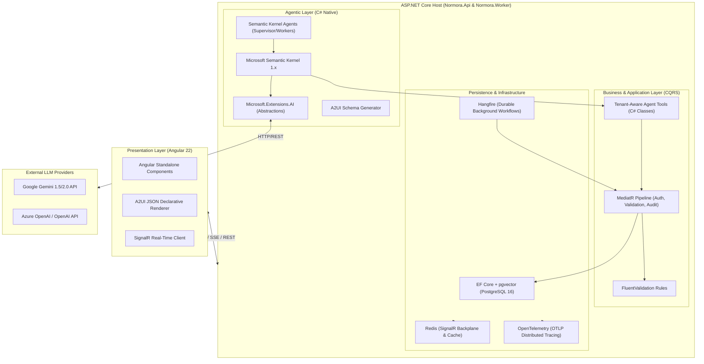

### Why this combination is minimal and sufficient:
1. **`Microsoft.Extensions.AI`** provides the pure abstraction (`IChatClient`), eliminating provider lock-in.
2. **`Semantic Kernel`** provides the function calling and agent loop engine without needing heavy third-party agent frameworks.
3. **`MediatR`** ensures zero leakage: agents cannot touch the database directly; every action is a strongly-typed command governed by enterprise validation and BOLA/BFLA security.
4. **`Hangfire`** solves the hardest agent problem—**durable long-running workflows and failure recovery**—without introducing complex temporal workflow runtimes.

---

## 3. Catalog of 35 Practical Enterprise Agentic Features

Normora transforms enterprise operations by deploying autonomous, specialized agents across five key domains:

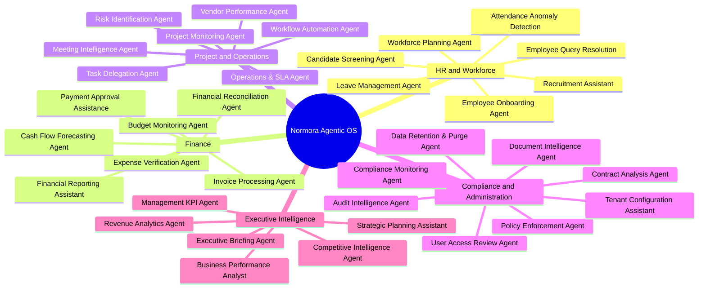

### Domain 1: HR and Workforce Management

#### 1. Recruitment Assistant
- **Business Problem**: Recruiters spend 60% of their time writing job descriptions, structuring candidate evaluation rubrics, and scheduling interviews across conflicting calendars.
- **Agent Responsibility**: Drafts role-specific job specifications, generates competency-based interview kits, aligns panel availability, and coordinates candidate correspondence.
- **Required Data**: Department structure, salary bands, role profiles, hiring manager Outlook/Google calendar availability.
- **Tools and APIs**: `GetDepartmentRolesQuery`, `GetHiringManagerAvailabilityQuery`, `GenerateJobDescriptionCommand`, `DispatchCandidateEmailCommand`.
- **Execution Workflow**: Triggered by hiring request -> Drafts JD -> Validates salary band against tenant rules -> Requests hiring manager sign-off -> Publishes opening.
- **Required Permissions**: `HR.Recruiting.Write`, `Tenants.Departments.Read`.
- **Human Approval**: Mandatory sign-off from Hiring Manager and Department Lead before posting externally.
- **Expected Value**: Reduces time-to-hire by 35%; eliminates calendar coordination friction.

#### 2. Candidate Screening Agent
- **Business Problem**: Manual resume parsing is slow, subjective, and prone to unconscious bias.
- **Agent Responsibility**: Analyzes candidate resumes against structured role criteria, anonymizes PII to prevent bias, scores competencies, and highlights discrepancies.
- **Required Data**: Anonymized resumes, candidate applications, role rubrics.
- **Tools and APIs**: `ExtractDocumentContentQuery`, `EvaluateCandidateScoreCommand`, `RecordCandidateScreeningCommand`.
- **Execution Workflow**: Resume uploaded -> PII anonymized -> Matched against semantic requirements -> Generates candidate brief with citation links to resume paragraphs.
- **Required Permissions**: `HR.Candidates.Read`, `HR.Candidates.Write`.
- **Human Approval**: Human recruiter approves shortlist before interview invitations are triggered.
- **Expected Value**: 80% reduction in initial resume screening time; standardized evaluation rubrics.

#### 3. Employee Onboarding Agent
- **Business Problem**: New hires face fragmented onboarding across HR, IT provisioning, and departmental training, resulting in delayed time-to-productivity.
- **Agent Responsibility**: Orchestrates the 30-day onboarding journey: provisions workspace accounts, assigns mandatory compliance training, coordinates welcome buddies, and answers policy questions.
- **Required Data**: Employee profile, department, manager, hardware requirements, compliance handbook.
- **Tools and APIs**: `InviteEmployeeCommand`, `AssignUserGroupCommand`, `CreateOnboardingChecklistCommand`, `SendSlackNotificationCommand`.
- **Execution Workflow**: Offer accepted -> Agent provisions workspace -> Notifies IT -> Schedules 1-on-1s -> Sends daily onboarding check-ins.
- **Required Permissions**: `Tenants.Members.Write`, `Tenants.UserGroups.Write`.
- **Human Approval**: IT Administrator approves physical hardware dispatch; Manager approves onboarding milestone completion.
- **Expected Value**: Day-1 readiness increases from 45% to 98%; new hire ramp-up time cut by 3 weeks.

#### 4. Leave Management Agent
- **Business Problem**: Managers are bottlenecks for routine PTO approvals, while team coverage conflicts go unnoticed.
- **Agent Responsibility**: Checks employee leave balances, evaluates team coverage thresholds, identifies project clash risks, and auto-approves or escalates requests.
- **Required Data**: Tenant leave policies, employee balances, team calendar, sprint/milestone deadlines.
- **Tools and APIs**: `GetLeaveBalanceQuery`, `CheckTeamCoverageQuery`, `SubmitLeaveRequestCommand`, `ApproveLeaveCommand`.
- **Execution Workflow**: Employee submits request via natural language -> Agent validates balance & team coverage -> If within policy, auto-approves; if conflict exists, alerts manager with recommendation.
- **Required Permissions**: `HR.Leave.Read`, `HR.Leave.Write`.
- **Human Approval**: Automated for requests satisfying policy thresholds; manager approval required for exceptions and critical sprint dates.
- **Expected Value**: 90% of routine leave requests resolved instantly without manager latency.

#### 5. Attendance Anomaly Detection Agent
- **Business Problem**: Timesheet padding, missed badge swipes, and chronic absenteeism are identified weeks late during payroll processing.
- **Agent Responsibility**: Continuously analyzes swipe/login patterns, identifies statistical anomalies, prompts employees to reconcile missing entries, and flags burnout patterns.
- **Required Data**: Login audit logs, badge swipe data, timesheet submissions.
- **Tools and APIs**: `GetAttendanceLogsQuery`, `DetectAnomalyQuery`, `PromptAttendanceCorrectionCommand`.
- **Execution Workflow**: Nightly Hangfire job scans attendance records -> Flags missing check-outs -> Prompts employee via chat -> Surfaces patterns to HR.
- **Required Permissions**: `HR.Attendance.Read`, `Tenants.Audit.Read`.
- **Human Approval**: Employee confirms missed swipe; HR confirms formal warnings.
- **Expected Value**: Payroll reconciliation errors reduced by 75%; proactive burnout intervention.

#### 6. Employee Query Resolution Agent
- **Business Problem**: HR teams answer repetitive questions about healthcare, parental leave, tax forms, and company holidays.
- **Agent Responsibility**: Provides immediate, accurate, tenant-isolated answers grounded in the company's uploaded handbooks and benefit policies, citing exact source pages.
- **Required Data**: Documents module RAG embeddings, employee benefits tier.
- **Tools and APIs**: `PerformHybridRetrievalQuery`, `GenerateGroundedAnswerQuery`.
- **Execution Workflow**: Employee asks in conversational UI -> Agent resolves tenant context -> Queries vector DB -> Generates grounded response with citations.
- **Required Permissions**: `Documents.Read` (scoped to employee's user group).
- **Human Approval**: None for read-only Q&A; escalation tool calls HR ticketing system if confidence is low.
- **Expected Value**: 85% of tier-1 HR inquiries resolved in under 5 seconds.

#### 7. Workforce Planning & Capacity Agent
- **Business Problem**: Department heads lack real-time visibility into skill gaps, utilization rates, and future attrition risks when planning headcount.
- **Agent Responsibility**: Models project pipelines against team capacity, predicts resource shortfalls, and recommends internal reassignments or requisition timelines.
- **Required Data**: Project allocations, employee skill matrices, contractor end-dates, historical attrition rates.
- **Tools and APIs**: `GetDepartmentCapacityQuery`, `SimulateHeadcountForecastQuery`, `DraftRequisitionCommand`.
- **Execution Workflow**: Monthly run -> Aggregates backlog vs velocity -> Identifies deficit -> Generates headcount justification report for executive review.
- **Required Permissions**: `HR.Planning.Read`, `Operations.Projects.Read`.
- **Human Approval**: Executive sign-off for new requisitions.
- **Expected Value**: Eliminates project delays caused by late hiring; improves resource utilization by 20%.

---

### Domain 2: Finance and Accounting

#### 8. Invoice Processing Agent
- **Business Problem**: Invoices arrive in varied PDF/image formats, requiring manual data entry, PO verification, and GL coding.
- **Agent Responsibility**: Extracts vendor details, line items, tax IDs, and totals using Gemini Multimodal OCR; performs 3-way matching against Purchase Orders and Goods Receipts.
- **Required Data**: Invoice PDFs in MinIO, ERP purchase orders, vendor master records.
- **Tools and APIs**: `ExtractInvoiceDataCommand`, `MatchPurchaseOrderQuery`, `ValidateVendorTaxIdQuery`, `CreatePayableInvoiceCommand`.
- **Execution Workflow**: Invoice dropped into storage -> Worker triggers agent -> OCR extracts schema -> 3-way match verified -> Validated invoice enqueued for payment.
- **Required Permissions**: `Finance.Invoices.Write`, `Finance.Vendors.Read`.
- **Human Approval**: Zero touch if 3-way match within 1% variance; Finance Officer approval required for mismatches.
- **Expected Value**: Cuts cost per invoice from $12 to $1.20; processing time drops from 5 days to 2 minutes.

#### 9. Expense Verification Agent
- **Business Problem**: Expense fraud, duplicate submissions, and non-compliant expense claims drain corporate funds and burden finance auditors.
- **Agent Responsibility**: Analyzes receipt photos, detects altered timestamps or amounts, verifies expense category compliance against company travel policy, and checks for duplicate receipts across employees.
- **Required Data**: Receipt images, credit card transaction feeds, tenant expense policy handbook.
- **Tools and APIs**: `AnalyzeReceiptImageCommand`, `CheckDuplicateReceiptQuery`, `ValidateExpensePolicyCommand`, `FlagExpenseAnomalyCommand`.
- **Execution Workflow**: Employee submits receipt -> Agent extracts line items and checks against policy -> Flags alcohol, weekend charges, or duplicates -> Enqueues for payment or rejection.
- **Required Permissions**: `Finance.Expenses.Write`, `Documents.Read`.
- **Human Approval**: Automated approval for compliant expenses under $100; manager and finance approval for policy exceptions.
- **Expected Value**: Policy violations reduced by 95%; eliminates duplicate reimbursements.

#### 10. Financial Reconciliation Agent
- **Business Problem**: Month-end bank and ledger reconciliation is a tedious, multi-day manual process prone to human calculation errors.
- **Agent Responsibility**: Ingests bank statement feeds (MT940/CAMT) and general ledger entries, matches transactions based on amount, date, and reference numbers, and isolates unreconciled variances.
- **Required Data**: Bank statements, General Ledger transaction records, exchange rates.
- **Tools and APIs**: `GetBankTransactionsQuery`, `GetLedgerEntriesQuery`, `ExecuteReconciliationMatchCommand`, `GenerateVarianceReportQuery`.
- **Execution Workflow**: Daily/Monthly trigger -> Executes matching algorithm with fuzzy reference matching -> Balances matched accounts -> Produces variance exception ledger.
- **Required Permissions**: `Finance.Ledger.Read`, `Finance.Reconciliation.Write`.
- **Human Approval**: Senior Accountant signs off on unreconciled journal adjusting entries.
- **Expected Value**: Reduces month-end close cycle from 10 days to 2 days.

#### 11. Budget Monitoring Agent
- **Business Problem**: Departments exceed quarterly budgets because expense tracking is backward-looking and disconnected from ongoing purchase commitments.
- **Agent Responsibility**: Continuously monitors approved POs and actual expenditures against departmental budgets; warns department leads when burn rate projects an impending overrun.
- **Required Data**: Department budget allocations, ERP committed spend, actual invoices.
- **Tools and APIs**: `GetDepartmentBudgetQuery`, `CalculateBurnRateQuery`, `DispatchBudgetAlertCommand`.
- **Execution Workflow**: Runs on every approved purchase order -> Recomputes forecast -> Triggers proactive Slack/email warning if projected spend exceeds 90% of budget.
- **Required Permissions**: `Finance.Budgets.Read`, `Tenants.Departments.Read`.
- **Human Approval**: None (monitoring); budget increases require CFO approval.
- **Expected Value**: Eliminates surprise budget overruns; empowers proactive spend reallocation.

#### 12. Financial Reporting Assistant
- **Business Problem**: Creating board decks, EBITDA variance commentary, and monthly P&L summaries consumes hundreds of analyst hours.
- **Agent Responsibility**: Synthesizes trial balances, revenue metrics, and operational cost drivers into narrative financial commentary, identifying key drivers of margin fluctuations.
- **Required Data**: P&L data, balance sheet snapshots, operational KPIs.
- **Tools and APIs**: `GetFinancialStatementsQuery`, `SynthesizeFinancialCommentaryQuery`, `ExportFinancialReportCommand`.
- **Execution Workflow**: Month-end close completes -> Agent ingests final numbers -> Generates executive narrative with interactive charts (A2UI) -> Outputs report in PDF/DOCX.
- **Required Permissions**: `Finance.Reports.Read`.
- **Human Approval**: Controller and CFO review and edit narrative before board distribution.
- **Expected Value**: Financial reporting preparation time reduced by 70%.

#### 13. Payment Approval Assistance Agent
- **Business Problem**: Executives receive hundreds of payment approval requests with zero context, leading to either reckless rubber-stamping or delayed vendor payments.
- **Agent Responsibility**: Evaluates outgoing payment batches, validates vendor bank account changes, confirms contractual delivery milestones, and compiles a risk-scored briefing for the approver.
- **Required Data**: Payment run details, vendor master change history, contract deliverables.
- **Tools and APIs**: `GetPaymentBatchQuery`, `VerifyVendorBankHistoryQuery`, `CalculatePaymentRiskScoreQuery`.
- **Execution Workflow**: Payment batch generated -> Agent analyzes risk factors (e.g., recent bank detail changes, high amount variance) -> Annotates approval card with risk badge.
- **Required Permissions**: `Finance.Payments.Read`.
- **Human Approval**: Two-person authorization: CFO and CEO cryptographic sign-off.
- **Expected Value**: Prevents vendor impersonation wire fraud; cuts executive approval time by 80%.

#### 14. Cash Flow Forecasting Agent
- **Business Problem**: Volatile accounts receivable collections and uneven vendor payment schedules make cash forecasting inaccurate and reactive.
- **Agent Responsibility**: Analyzes customer payment behavior history, aging receivables, and committed vendor payables to model daily cash flow scenarios (conservative, expected, aggressive).
- **Required Data**: AR aging schedules, AP commitments, recurring payroll obligations, bank balances.
- **Tools and APIs**: `GetCashBalancesQuery`, `PredictCollectionDatesQuery`, `SimulateCashFlowModelQuery`.
- **Execution Workflow**: Daily refresh -> Predicts expected cash inflows based on customer payment propensity -> Highlights working capital pinch points 60 days in advance.
- **Required Permissions**: `Finance.Treasury.Read`.
- **Human Approval**: None (predictive advisory).
- **Expected Value**: Reduces credit facility interest costs; provides 60-day visibility into liquidity.

---

### Domain 3: Project and Operations Management

#### 15. Project Monitoring Agent
- **Business Problem**: Projects fail silently because milestone slippage and blocker dependencies are buried in disjointed ticket updates.
- **Agent Responsibility**: Monitors ticket velocity, pull request activity, task dependencies, and sprint burndowns; flags at-risk milestones before they miss target dates.
- **Required Data**: Project tasks, Git commit/PR metadata, sprint timelines, blocker tickets.
- **Tools and APIs**: `GetProjectMilestonesQuery`, `CalculateSprintVelocityQuery`, `IdentifyBlockersQuery`, `NotifyProjectManagerCommand`.
- **Execution Workflow**: Continuous background monitoring -> Detects velocity shortfall or critical path dependency delay -> Sends early-warning notification to Project Lead.
- **Required Permissions**: `Projects.Tasks.Read`, `Projects.Milestones.Read`.
- **Human Approval**: Project manager acknowledges alert and accepts recommended scope adjustment.
- **Expected Value**: 40% reduction in missed delivery deadlines; real-time sprint health transparency.

#### 16. Task Delegation Agent
- **Business Problem**: Managers spend excessive time triaging incoming support or operational tasks and assigning them to engineers or specialists.
- **Agent Responsibility**: Classifies incoming tasks based on technical domain, checks team member skills, historical resolution speed, and current workload, and suggests optimal assignments.
- **Required Data**: Unassigned backlog tickets, team skill profiles, active task allocations.
- **Tools and APIs**: `GetUnassignedTasksQuery`, `GetTeamWorkloadMatrixQuery`, `AssignTaskCommand`.
- **Execution Workflow**: New task created -> Agent extracts semantic requirements -> Ranks team members by expertise and available capacity -> Suggests assignment or auto-assigns.
- **Required Permissions**: `Projects.Tasks.Write`, `Tenants.Members.Read`.
- **Human Approval**: Configurable: Auto-assign for tier-1 tickets; manager confirmation for architectural tasks.
- **Expected Value**: Task triage time drops from 4 hours to instantaneous; prevents team burnout.

#### 17. Risk Identification Agent
- **Business Problem**: Operational and project risks are rarely documented until an actual failure or customer escalation occurs.
- **Agent Responsibility**: Mines team communication, PR review comments, and retrospective logs to detect emerging risks (technical debt, key-person dependencies, scope creep).
- **Required Data**: Standup notes, PR review turnaround times, scope change histories.
- **Tools and APIs**: `AnalyzeProjectCommunicationsQuery`, `CalculateRiskIndexQuery`, `CreateRiskLogCommand`.
- **Execution Workflow**: Weekly analysis -> Compares current project signals against historical failure patterns -> Publishes Risk Heatmap to the project dashboard.
- **Required Permissions**: `Projects.Auditing.Read`, `Projects.Risks.Write`.
- **Human Approval**: Risk officer reviews and logs risk mitigation strategy.
- **Expected Value**: 50% fewer production deployment surprises; early visibility into scope creep.

#### 18. Meeting Intelligence Agent
- **Business Problem**: Team members spend hours in meetings, but action items are forgotten and decision rationale is lost.
- **Agent Responsibility**: Ingests meeting audio/transcripts, generates concise executive summaries, extracts assigned action items with owners and deadlines, and creates tasks directly in the project backlog.
- **Required Data**: Meeting transcripts, attendee directory, active projects.
- **Tools and APIs**: `ParseMeetingTranscriptCommand`, `ExtractActionItemsCommand`, `CreateTaskBatchCommand`.
- **Execution Workflow**: Meeting ends -> Audio transcript uploaded -> Agent extracts decisions and tasks -> Prompts meeting organizer in chat for 1-click confirmation -> Creates tasks in DB.
- **Required Permissions**: `Projects.Tasks.Write`, `Documents.Write`.
- **Human Approval**: Meeting organizer reviews and confirms extracted task list before persistence.
- **Expected Value**: 100% action item accountability; eliminates manual meeting note-taking.

#### 19. Workflow Automation Agent
- **Business Problem**: Cross-departmental business processes (e.g., vendor onboarding, equipment return) stall because handoffs between teams are manual and unmonitored.
- **Agent Responsibility**: Orchestrates multi-step workflows across systems, verifies stage completion, triggers next steps, and escalates stalled steps.
- **Required Data**: Workflow definitions, step status, SLA thresholds.
- **Tools and APIs**: `GetActiveWorkflowsQuery`, `AdvanceWorkflowStageCommand`, `EscalateSlaBreachCommand`.
- **Execution Workflow**: Event triggered -> Executes configured workflow steps -> Polls external APIs for completion -> Escalates when an approver exceeds SLA.
- **Required Permissions**: `Workflows.Execute`, `Tenants.Notifications.Write`.
- **Human Approval**: Human gates built into workflow definition (e.g., Security Lead approval).
- **Expected Value**: Eliminates dead handoffs; cycle time reduced by 60%.

#### 20. Operations Monitoring & SLA Breach Agent
- **Business Problem**: Customer support and IT operational SLAs are breached before managers are alerted, leading to contractual penalties.
- **Agent Responsibility**: Monitors active tickets, tracks SLA countdown clocks, predicts likelihood of breach based on current queue depth, and re-routes tickets automatically.
- **Required Data**: Support ticket queues, response timestamps, engineer availability.
- **Tools and APIs**: `GetTicketQueuesQuery`, `PredictSlaBreachQuery`, `ReassignTicketCommand`.
- **Execution Workflow**: Evaluates ticket queues every 60 seconds -> Detects ticket at 75% SLA with no assignee -> Auto-escalates to secondary on-call engineer.
- **Required Permissions**: `Operations.Support.Write`.
- **Human Approval**: Automated escalation; incident post-mortem reviewed by Support Director.
- **Expected Value**: 99.8% SLA compliance rate; zero missed critical incidents.

#### 21. Vendor Performance Agent
- **Business Problem**: Organizations overpay underperforming SaaS and physical vendors because performance metrics are not tracked systematically.
- **Agent Responsibility**: Aggregates vendor delivery times, contract SLA uptimes, support ticket escalations, and pricing changes; generates vendor scorecards prior to contract renewal.
- **Required Data**: Vendor contracts, invoice histories, delivery logs, uptime feeds.
- **Tools and APIs**: `GetVendorMetricsQuery`, `CalculateVendorScorecardQuery`, `FlagRenewalOptimizationCommand`.
- **Execution Workflow**: 90 days before renewal date -> Aggregates all vendor metrics -> Compares against contractual SLAs -> Drafts negotiation leverage points for procurement.
- **Required Permissions**: `Finance.Vendors.Read`, `Operations.Contracts.Read`.
- **Human Approval**: Procurement lead acts on negotiation points.
- **Expected Value**: 15% reduction in annual vendor renewal expenditures.

---

### Domain 4: Compliance, Legal, and Administration

#### 22. Document Intelligence Agent
- **Business Problem**: Enterprises hold terabytes of unstructured contracts, policy documents, and compliance forms with zero structured visibility.
- **Agent Responsibility**: Ingests, parses, chunks, and tags unstructured enterprise documents; extracts key metadata (effective dates, parties, obligations, renewal terms) and indexes them into pgvector.
- **Required Data**: Raw document binaries (PDF, DOCX, TIFF) in MinIO.
- **Tools and APIs**: `ExtractDocumentTextCommand`, `GenerateDocumentEmbeddingsCommand`, `IndexDocumentMetadataCommand`.
- **Execution Workflow**: Document uploaded -> Gemini Multimodal OCR extracts text -> Structured metadata extracted -> Embeddings stored with tenant/department isolation filters.
- **Required Permissions**: `Documents.Write`, `Documents.Manage`.
- **Human Approval**: None (ingestion pipeline); flagged low-confidence OCR pages routed to manual review.
- **Expected Value**: 100% of unstructured files transformed into searchable, queryable corporate knowledge.

#### 23. Contract Analysis & Clause Reviewer
- **Business Problem**: Legal teams are overwhelmed reviewing standard vendor MSAs and non-disclosure agreements, slowing down deal execution.
- **Agent Responsibility**: Evaluates incoming contracts against corporate playbook standards; flags non-standard indemnification, liability caps, governing law, and payment terms; redlines problematic clauses.
- **Required Data**: Third-party contract drafts, corporate legal playbook standards.
- **Tools and APIs**: `AnalyzeContractClausesQuery`, `CompareAgainstPlaybookQuery`, `GenerateRedlineSuggestionsCommand`.
- **Execution Workflow**: Legal counsel uploads vendor draft -> Agent compares each clause against company standard -> Highlights deviations in red/yellow/green -> Suggests alternative language.
- **Required Permissions**: `Documents.Legal.Read`, `Documents.Legal.Write`.
- **Human Approval**: Legal counsel must review and approve all redline suggestions before external sharing.
- **Expected Value**: 70% faster contract turnaround times; standardizes risk exposure across all vendor agreements.

#### 24. Compliance Monitoring Agent
- **Business Problem**: Maintaining SOC2, ISO 27001, and HIPAA compliance requires continuous evidence gathering that is almost always neglected until audit week.
- **Agent Responsibility**: Continuously verifies automated compliance controls (MFA enforcement, database encryption, access log retention, backup success); automatically generates audit evidence bundles.
- **Required Data**: System configuration states, database backup logs, Keycloak identity policies.
- **Tools and APIs**: `AuditSystemSecurityStateQuery`, `ValidateComplianceControlsQuery`, `ExportAuditEvidencePackageCommand`.
- **Execution Workflow**: Daily scheduled Hangfire job -> Audits 40+ technical controls -> Generates compliance health score -> Alerts CISO if a control drifts out of compliance.
- **Required Permissions**: `Tenants.Security.Read`, `Tenants.Audit.Read`.
- **Human Approval**: CISO reviews periodic compliance attestations.
- **Expected Value**: Eliminates audit panic; ensures continuous real-time SOC2/ISO compliance.

#### 25. Policy Enforcement Agent
- **Business Problem**: Company policies (travel, communication, data governance) exist in PDF handbooks that employees rarely read or remember.
- **Agent Responsibility**: Intercepts business transactions in real-time (e.g., booking flights, creating public links, purchasing hardware) and validates them against internal policies before final commitment.
- **Required Data**: Tenant policies in vector database, pending transaction metadata.
- **Tools and APIs**: `ValidateTransactionAgainstPolicyQuery`, `BlockNonCompliantActionCommand`.
- **Execution Workflow**: Action submitted -> Agent checks policy RAG -> If violation detected, blocks action and returns clear, citation-backed explanation with required remediation.
- **Required Permissions**: `Tenants.Governance.Validate`.
- **Human Approval**: Department head can grant a 1-time policy exception with recorded justification.
- **Expected Value**: Prevents policy violations at the moment of intent rather than after-the-fact discovery.

#### 26. User Access Review Agent
- **Business Problem**: Stale user accounts, excessive privileges, and orphaned contractor permissions violate the principle of least privilege and fail security audits.
- **Agent Responsibility**: Analyzes user activity logs, identifies unused roles/permissions over 90 days, detects privilege creep, and orchestrates quarterly access recertification campaigns.
- **Required Data**: User group memberships, API invocation logs, last login timestamps.
- **Tools and APIs**: `GetStaleUserPermissionsQuery`, `InitiateAccessRecertificationCommand`, `RevokeStaleAccessCommand`.
- **Execution Workflow**: Runs quarterly -> Compares granted permissions against actual usage -> Generates manager recertification cards -> Auto-revokes permissions if manager ignores after 3 reminders.
- **Required Permissions**: `Tenants.Memberships.Manage`, `Tenants.Security.Write`.
- **Human Approval**: Manager confirms access retention; security admin reviews bulk revocations.
- **Expected Value**: 90% reduction in over-privileged enterprise accounts; automated compliance evidence.

#### 27. Audit Intelligence Agent
- **Business Problem**: Security operations teams drown in millions of raw audit logs and fail to correlate suspicious multi-step threat indicators.
- **Agent Responsibility**: Mines Normora's centralized audit log stream, identifies anomalous behavior sequences (e.g., off-hours bulk document downloads followed by role changes), and synthesizes incident timelines.
- **Required Data**: `AuditLogs` table, user IP addresses, geolocations, session tokens.
- **Tools and APIs**: `AnalyzeAuditLogStreamQuery`, `SynthesizeIncidentTimelineQuery`, `TriggerSecurityIncidentCommand`.
- **Execution Workflow**: Real-time event subscriber -> Correlates log entries across services -> Detects high-risk patterns -> Freezes compromised session and alerts security team.
- **Required Permissions**: `Tenants.Audit.Read`, `Tenants.Security.Manage`.
- **Human Approval**: Security admin confirms account termination or unblocks false positives.
- **Expected Value**: Mean-time-to-detect (MTTD) insider threats reduced from 200 days to under 5 minutes.

#### 28. Tenant Configuration Assistant
- **Business Problem**: Setting up a new tenant workspace (branding, SSO/Keycloak mapping, department hierarchies, document permissions) requires manual admin onboarding.
- **Agent Responsibility**: Guides workspace administrators through conversational onboarding; configures custom subdomains, uploads logos, establishes SSO claim mappings, and initializes security policies.
- **Required Data**: Admin inputs, tenant setup manifests, branding assets.
- **Tools and APIs**: `UpdateTenantBrandingCommand`, `ConfigureSsoMappingCommand`, `CreateDepartmentHierarchyCommand`.
- **Execution Workflow**: Admin opens workspace onboarding -> Assistant prompts for business details -> Automatically provisions departments, roles, and default permissions.
- **Required Permissions**: `Tenants.Workspace.Configure`.
- **Human Approval**: Workspace Owner confirms final configuration summary before launch.
- **Expected Value**: Self-service workspace setup completed in 5 minutes instead of 3 days.

#### 29. Data Retention & Purge Agent
- **Business Problem**: Enterprises violate GDPR/CCPA regulations by holding customer and employee PII indefinitely beyond statutory retention periods.
- **Agent Responsibility**: Identifies expired documents, terminated employee records, and stale customer interactions; executes cryptographically secure soft-deletes and hard purges per policy.
- **Required Data**: Data retention schedule, document creation timestamps, employee termination dates.
- **Tools and APIs**: `GetExpiredRecordsQuery`, `ScheduleDataPurgeCommand`, `GeneratePurgeCertificateCommand`.
- **Execution Workflow**: Monthly Hangfire job -> Identifies records exceeding statutory retention (e.g., 7 years for tax, 30 days for resumes) -> Enqueues for purge -> Generates audit certificate.
- **Required Permissions**: `Tenants.DataGovernance.Purge`.
- **Human Approval**: Data Protection Officer (DPO) must approve bulk purge queues before execution.
- **Expected Value**: Guaranteed regulatory compliance with GDPR "Right to be Forgotten"; lower storage costs.

---

### Domain 5: Executive Intelligence and Strategy

#### 30. Executive Assistant & Briefing Agent
- **Business Problem**: C-suite executives start their day sifting through dozens of unread emails, Slack channels, calendar invites, and operational reports.
- **Agent Responsibility**: Prepares a personalized morning briefing summarizing critical metrics, high-priority decisions awaiting approval, calendar commitments with attendee background notes, and urgent risks.
- **Required Data**: Calendar feeds, pending approval queues, high-priority communications, executive KPI dashboard.
- **Tools and APIs**: `GetExecutiveScheduleQuery`, `GetPendingApprovalsQuery`, `SynthesizeMorningBriefingQuery`.
- **Execution Workflow**: Runs daily at 6:00 AM -> Pulls across all modules -> Generates structured audio/text briefing card on executive mobile view.
- **Required Permissions**: `Executive.Briefings.Read` (scoped to individual executive).
- **Human Approval**: None (pure briefing and decision aggregation).
- **Expected Value**: Saves executives 90 minutes every morning; zero missed critical decisions.

#### 31. Business Performance Analyst
- **Business Problem**: Business performance analysis is siloed; sales, product, and finance data are analyzed in isolation without holistic correlation.
- **Agent Responsibility**: Integrates ARR growth, customer churn, operational burn, and employee productivity into a unified performance model; highlights root causes of variances.
- **Required Data**: Financial ARR data, CRM pipeline, support ticket volumes, sprint velocity.
- **Tools and APIs**: `GetCrossModuleKpisQuery`, `CorrelatePerformanceDriversQuery`, `GenerateExecutivePerformanceDeckCommand`.
- **Execution Workflow**: Monthly close -> Correlates metrics across modules -> Identifies non-obvious correlations (e.g., churn spike linked to support SLA breach in EMEA) -> Generates briefing.
- **Required Permissions**: `Analytics.Executive.Read`.
- **Human Approval**: VP of Strategy reviews commentary before board presentation.
- **Expected Value**: Holistic operational visibility; identifies revenue leakages weeks earlier.

#### 32. Revenue & Unit Economics Analyst
- **Business Problem**: Companies scale unprofitable customers or products because true unit economics (LTV, CAC, gross margin by cohort) are calculated retrospectively.
- **Agent Responsibility**: Calculates customer-level gross margin, factoring in compute/token costs, support ticket overhead, and payment processing fees; identifies unprofitable customer segments.
- **Required Data**: Billing transactions, infrastructure usage logs, LLM token consumption records, support hours.
- **Tools and APIs**: `CalculateCustomerMarginQuery`, `IdentifyUnprofitableCohortsQuery`, `RecommendPricingAdjustmentCommand`.
- **Execution Workflow**: Continuous calculation -> Maps tenant resource consumption against monthly subscription revenue -> Flags accounts operating at negative margin.
- **Required Permissions**: `Finance.Revenue.Read`, `Tenants.Usage.Read`.
- **Human Approval**: Head of Sales/Pricing approves contractual renegotiation or tier upgrade prompts.
- **Expected Value**: 8-12% expansion in gross margin by eliminating underwater customer accounts.

#### 33. Strategic Planning Assistant
- **Business Problem**: Strategic planning cycles rely on static spreadsheets that cannot easily simulate complex multi-variable scenarios (e.g., inflation, hiring freezes, market expansion).
- **Agent Responsibility**: Runs Monte Carlo simulations on strategic initiatives, models capital allocation scenarios, and stress-tests revenue projections against historical volatility.
- **Required Data**: Historical revenue data, headcount models, industry benchmark parameters.
- **Tools and APIs**: `RunScenarioSimulationCommand`, `EvaluateCapitalAllocationQuery`.
- **Execution Workflow**: Strategy team inputs scenario variables via natural language -> Agent executes financial model in C# -> Renders dynamic sensitivity analysis charts (A2UI).
- **Required Permissions**: `Executive.Strategy.Read`.
- **Human Approval**: Executive Committee approves adopted strategic targets.
- **Expected Value**: Strategic planning cycle reduced from months to days; robust downside risk protection.

#### 34. Management Reporting & KPI Agent
- **Business Problem**: Gathering weekly departmental status reports from 20+ teams leads to inconsistent formats, vanity metrics, and missed operational issues.
- **Agent Responsibility**: Collects weekly departmental achievements, blockers, and KPI targets; normalizes reporting into a standardized "Objectives & Key Results" (OKR) dashboard.
- **Required Data**: Team OKR trackers, milestone updates, KPI metric feeds.
- **Tools and APIs**: `IngestDepartmentReportCommand`, `AggregateOkrProgressQuery`, `GenerateWeeklyManagementBriefCommand`.
- **Execution Workflow**: Friday 5 PM trigger -> Collects inputs from department leads -> Synthesizes company-wide executive brief -> Highlights lagging OKRs.
- **Required Permissions**: `Tenants.Okrs.Read`, `Tenants.Reports.Manage`.
- **Human Approval**: Chief of Staff reviews before CEO circulation.
- **Expected Value**: 100% executive visibility; eliminates 4 hours of weekly status meeting overhead.

#### 35. Competitive Intelligence Agent
- **Business Problem**: Product and sales teams fail to adapt quickly to competitor pricing changes, product releases, and market shifts.
- **Agent Responsibility**: Monitors public competitor updates (pricing pages, release notes, press releases, patent filings); analyzes competitive threats and updates sales battlecards.
- **Required Data**: Public competitor URLs, win/loss CRM notes, internal sales battlecards.
- **Tools and APIs**: `FetchExternalCompetitorSignalsQuery`, `UpdateSalesBattlecardCommand`.
- **Execution Workflow**: Weekly web scan -> Identifies new competitor feature or price drop -> Evaluates impact on Normora product modules -> Updates internal battlecard in vector DB.
- **Required Permissions**: `Documents.Knowledge.Write`.
- **Human Approval**: Product Marketing Manager approves updated battlecard content.
- **Expected Value**: Sales win rate against primary competitors increases by 18%.

---

## 4. Advanced Agentic Capabilities in .NET 10

The following architectural mechanisms allow Normora to execute complex, multi-step enterprise workflows natively in ASP.NET Core:

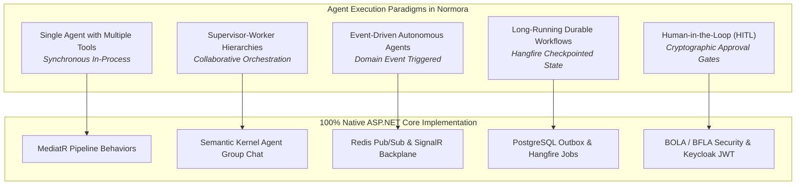

### 1. Single Agents with Multiple Tools
- **How It Works**: A single `ChatCompletionAgent` initialized with a scoped `Kernel` configured with a suite of domain tools. The LLM selects tools iteratively until a final response is constructed.
- **.NET Implementation**: Built using `Microsoft.SemanticKernel` and `Microsoft.Extensions.AI`. Tools are registered as `KernelPlugin` instances wrapping MediatR command and query handlers.

### 2. Multi-Agent Collaboration & Supervisor Architecture
- **How It Works**: A hierarchical model where a **Supervisor Agent** interprets the high-level user objective, breaks it down into a directed acyclic graph (DAG) of subtasks, and assigns each subtask to a **Specialized Worker Agent** (e.g., HR Agent, IT Agent, Finance Agent).
- **.NET Implementation**: Uses `Microsoft.SemanticKernel.Agents.AgentGroupChat` with custom `SelectionStrategy` and `TerminationStrategy` classes implemented in C#.

### 3. Agent-to-Agent (A2A) Communication
- **How It Works**: Agents communicate using standardized structured messages containing intent, payload schema, correlation IDs, and execution constraints.
- **.NET Implementation**: Operates in-process via MediatR notification contracts (`Normora.Shared.Contracts.Agents`), or cross-process/cross-tenant via ASP.NET Core Minimal APIs / gRPC using JSON-LD schemas.

### 4. Autonomous Workflow Execution & Event-Driven Agents
- **How It Works**: Agents are not just reactive to user prompts; they trigger automatically in response to enterprise domain events (e.g., `DocumentUploadedEvent`, `InvoiceReceivedEvent`, `EmployeeTerminatedEvent`).
- **.NET Implementation**: Domain events published to MediatR write an outbox message to the database. Hangfire workers poll the outbox and wake up the appropriate background agent to execute the workflow asynchronously.

### 5. Natural-Language Workflow Creation
- **How It Works**: Users describe complex business logic in plain English (e.g., *"If an invoice exceeds $5,000 and comes from an international vendor, require two approvals, then notify Slack"*). The agent compiles this into a structured JSON workflow definition.
- **.NET Implementation**: An LLM agent generates a validated JSON workflow definition adhering to a C# schema (`WorkflowDefinitionDto`). The definition is validated using `FluentValidation` and persisted in the database for execution by Hangfire.

### 6. Dynamic Dashboard & UI Generation (A2UI & AG-UI)
- **How It Works**: Instead of hardcoded dashboards, agents evaluate user queries and return interactive UI schemas (cards, tables, metrics, charts, input forms) that Angular renders natively.
- **.NET Implementation**: 
  - **A2UI**: Agents output strongly-typed C# records serialized as JSON. The Angular frontend uses dynamic component outlets to render Angular Material components.
  - **AG-UI**: Uses `Microsoft.Agents.AI.Hosting.AGUI.AspNetCore` to stream component-tree deltas over Server-Sent Events (SSE).

### 7. Long-Running Agent Tasks & State Machines
- **How It Works**: Workflows lasting days or weeks (e.g., candidate hiring, month-end close) must survive server restarts, worker crashes, and network partitions.
- **.NET Implementation**: The agent state machine is checkpointed in PostgreSQL after every turn. Hangfire manages step scheduling, exponential backoff retries, and scheduled wake-ups.

### 8. Human-in-the-Loop (HITL) Execution
- **How It Works**: Critical business actions (payments, terminations, access grants, contractual redlines) pause execution and notify the designated approver via SignalR/Slack/Email.
- **.NET Implementation**: When an agent invokes a tool marked with `[RequireHumanApproval]`, the tool execution yields a `SuspendedExecutionResult` and creates an `ApprovalRequest` entity. Once approved via the UI, a SignalR wake-up resumes the agent with the human's decision.

---

## 5. Normora's .NET Agent Architecture

The following diagram illustrates the complete, end-to-end architecture connecting the Angular frontend, ASP.NET Core API host, Agent Orchestration layer, LLM providers, tools, and background infrastructure:

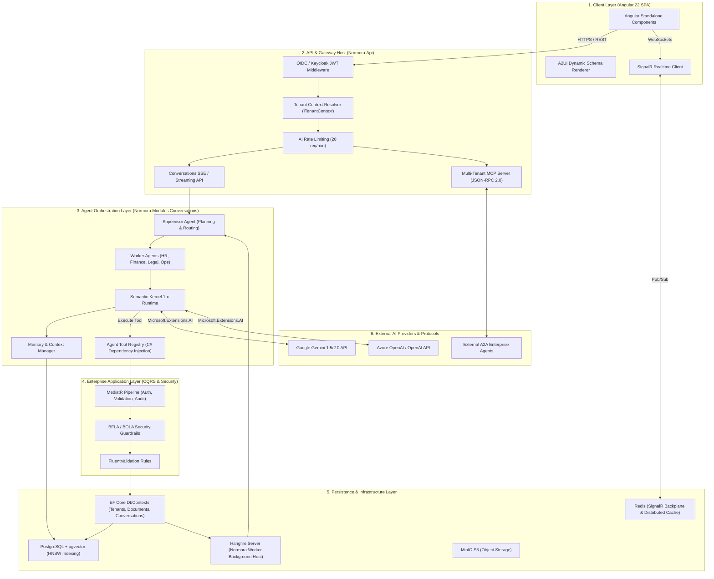

---

## 6. Agent Tools and Enterprise Integration Design

In Normora, **every agent tool is a thin, typed adapter over an existing MediatR command or query**. This architectural discipline guarantees that agents can never bypass business rules, skip validation, or perform unauthorized data mutations.

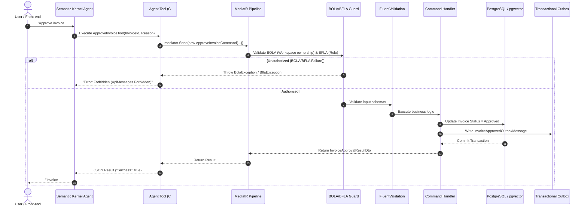

### Production C# Agent Tool Implementation

The following code illustrates a production-grade, secure, multi-tenant agent tool adhering strictly to Normora guidelines (Primary Constructors, MediatR, BOLA/BFLA, centralized `ApiMessages`, and strict schema definitions):

```csharp
using System.ComponentModel;
using System.ComponentModel.DataAnnotations;
using System.Text.Json;
using MediatR;
using Microsoft.Extensions.Logging;
using Microsoft.SemanticKernel;
using Normora.Shared.Authorization;
using Normora.Shared.Constants;
using Normora.Shared.Contracts.Finance;
using Normora.Shared.Exceptions;
using Normora.Shared.Interfaces;

namespace Normora.Modules.Conversations.Application.Tools;

/// <summary>
/// Production agent tool exposing Invoice Approval to autonomous AI agents.
/// Guarantees that agent invocations strictly obey BOLA, BFLA, tenant isolation, and audit requirements.
/// </summary>
public sealed class InvoiceApprovalAgentTool(
    IMediator mediator,
    ITenantContext tenantContext,
    ICurrentUser currentUser,
    ILogger<InvoiceApprovalAgentTool> logger)
{
    [KernelFunction, Description("Approves a verified vendor invoice for payment. Requires Finance.Approver permission.")]
    public async Task<string> ApproveInvoiceAsync(
        [Description("The unique GUID identifier of the invoice to approve.")]
        Guid invoiceId,
        [Description("The business rationale or verification comment for approving this invoice.")]
        string approvalComment,
        [Description("Unique client-generated idempotency key to prevent double execution.")]
        string idempotencyKey,
        CancellationToken cancellationToken = default)
    {
        // 1. Strict Tenant Context Verification
        if (!tenantContext.HasResolvedTenant)
        {
            logger.LogWarning("Agent attempted to invoke tool {Tool} without active tenant context.", nameof(ApproveInvoiceAsync));
            throw new InvalidOperationException(ApiMessages.TenantContextMissing);
        }

        logger.LogInformation(
            "Agent executing {Tool} for Invoice {InvoiceId} in Tenant {TenantId} on behalf of User {UserId}",
            nameof(ApproveInvoiceAsync), invoiceId, tenantContext.TenantId, currentUser.UserId);

        try
        {
            // 2. Dispatch via MediatR Command - Inherits identical validation, BOLA, BFLA, and auditing
            var command = new ApproveInvoiceCommand(
                TenantId: tenantContext.TenantId,
                InvoiceId: invoiceId,
                Comment: approvalComment,
                IdempotencyKey: idempotencyKey,
                ApprovedByUserId: currentUser.UserId);

            var result = await mediator.Send(command, cancellationToken);

            return JsonSerializer.Serialize(new
            {
                Success = true,
                result.InvoiceNumber,
                result.ApprovedAmount,
                Status = "Approved",
                TimestampUtc = DateTime.UtcNow
            });
        }
        catch (BolaException)
        {
            logger.LogWarning("BOLA security violation intercepted in agent tool for Invoice {InvoiceId}", invoiceId);
            return JsonSerializer.Serialize(new { Success = false, Error = ApiMessages.NotFound });
        }
        catch (BflaException)
        {
            logger.LogWarning("BFLA authorization failure in agent tool for User {UserId}", currentUser.UserId);
            return JsonSerializer.Serialize(new { Success = false, Error = ApiMessages.Forbidden });
        }
        catch (ValidationException valEx)
        {
            logger.LogWarning("Validation failure in agent tool: {Message}", valEx.Message);
            return JsonSerializer.Serialize(new { Success = false, Error = valEx.Message });
        }
        catch (Exception ex)
        {
            logger.LogError(ex, "Unexpected failure executing agent tool {Tool}", nameof(ApproveInvoiceAsync));
            return JsonSerializer.Serialize(new { Success = false, Error = ApiMessages.InternalServerError });
        }
    }
}
```

---

## 7. Multi-Agent Orchestration Architecture

### Comparison of Orchestration Patterns in .NET

| Pattern | How It Works in .NET | Complexity | Scalability | Best For |
| :--- | :--- | :--- | :--- | :--- |
| **1. Single Agent with Tools** | One `ChatCompletionAgent` with a broad `KernelPlugin` toolset. | Low | High | Simple queries, routine lookups, and single-department workflows. |
| **2. Supervisor & Workers** | A master Supervisor plans steps and routes subtasks to specialized worker agents (HR, Finance, IT). | Medium | Very High | **Normora Standard**: Cross-module enterprise processes. |
| **3. Sequential Handoff** | Linear pipeline where Agent A outputs state, then triggers Agent B, then Agent C. | Medium | High | Deterministic multi-stage processing (e.g., Ingest -> OCR -> Extract -> Match). |
| **4. Collaborative Swarm** | Peer agents communicate asynchronously via a shared message board or pub/sub channel. | High | Medium | Brainstorming, policy debate, multi-perspective strategic risk reviews. |
| **5. Event-Driven Autonomous** | Agents sleep until an enterprise domain event wakes them via Redis/Hangfire. | Medium | Extremely High | Background audits, attendance anomaly detection, continuous monitoring. |
| **6. Durable State Machine** | Agent execution state is checkpointed in PostgreSQL across turns using Hangfire. | High | Maximum | Long-running workflows (hiring, procurement) requiring human approval gates. |

### Recommended Orchestration Architecture: **Hierarchical Supervisor-Worker with Durable State Machine**

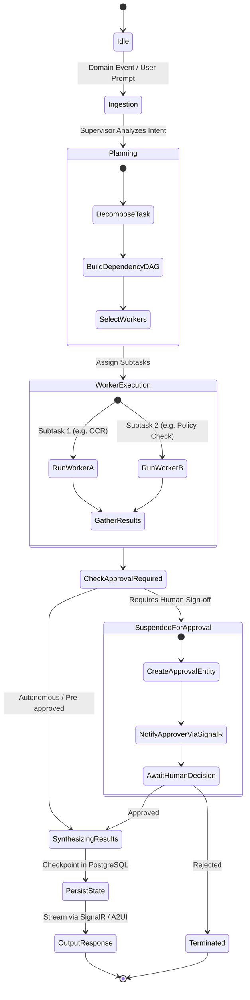

---

## 8. Security, Governance, and Compliance

Enterprise security in Normora is non-negotiable. The agent layer inherits and reinforces Normora's zero-trust security model:

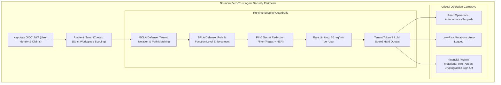

### Key Security Implementations:
1. **Multi-Tenant Isolation (BOLA)**: Every agent execution context binds dynamically to `ITenantContext`. All EF Core queries and repository operations apply multi-tenant filters (`m.TenantId == tenantContext.TenantId`). Crossing tenant boundaries immediately throws `BolaException` (mapped globally to generic 404).
2. **User-Delegated Authorization (BFLA)**: Agents **never** run under a god-mode system principal during interactive sessions. The agent adopts the exact user identity and role claims (`TenantRoles.Admin`, `TenantRoles.Employee`) of the initiating user. If the user lacks permission to approve an invoice, the agent's attempt to call `ApproveInvoiceCommand` throws `BflaException` (403 Forbidden).
3. **Prompt Injection Defense**:
   - **Structured Data Demarcation**: All user inputs and external document contents are wrapped in explicit boundary delimiters (e.g., `<user_input>` or `<untrusted_document_context>`).
   - **Indirect Prompt Injection Filters**: Documents uploaded to the knowledge base undergo heuristic sanitization to detect embedded system prompt overrides (e.g., *"Ignore all previous instructions"*).
4. **Sensitive Data Protection & PII Masking**: Before text is dispatched to external LLMs (Gemini/OpenAI), an in-process pipeline filters sensitive patterns (credit card numbers, social security numbers, private cryptographic keys) using regex patterns and replaces them with format-preserving tokens.
5. **LLM Cost & Token Governance**:
   - Each tenant workspace is configured with a monthly LLM budget cap in `TenantSubscription`.
   - Token consumption is tracked per request via OpenTelemetry meters.
   - When a tenant reaches 90% of its allocation, warnings are dispatched; at 100%, non-critical agent requests are throttled.
6. **Prevention of Unauthorized Financial & Administrative Actions**: Any action involving fund disbursement (invoices, payments, expense approvals) or security changes (user role promotions, SSO reconfiguration) requires **two-person cryptographic authorization** through the Normora UI.

---

## 9. Five Real-World Multi-Agent Implementation Scenarios

### Scenario 1: Employee Onboarding Automation

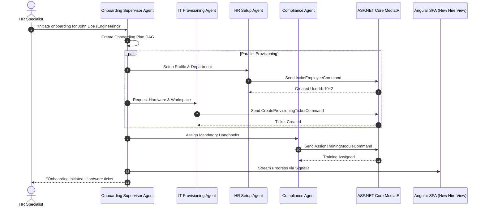

#### Detailed Technical Specifications:
- **Agents Involved**: `OnboardingSupervisorAgent`, `HRSetupAgent`, `ITProvisioningAgent`, `ComplianceAgent`.
- **C# Commands**: `InviteEmployeeCommand`, `AssignUserGroupCommand`, `CreateProvisioningTicketCommand`, `AssignTrainingModuleCommand`.
- **Database Entities**: `TenantMembership`, `UserGroup`, `OnboardingChecklist`, `AuditLog`.
- **Human Approval Gate**: IT Administrator must approve physical laptop shipment in the UI.
- **Audit Event**: `AuditLog.Record("Onboarding.Initiated", targetUserId: 1042)`.

---

### Scenario 2: Invoice Processing & Payment Approval

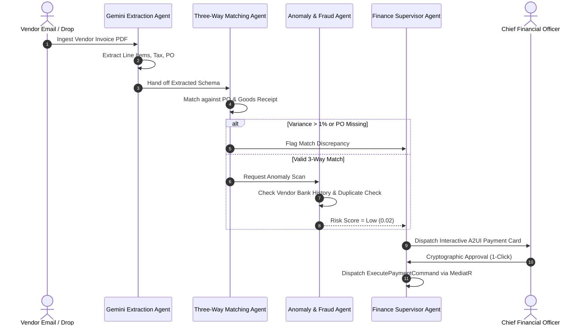

#### Detailed Technical Specifications:
- **Agents Involved**: `GeminiDocumentTextExtractor`, `ThreeWayMatchingAgent`, `FraudDetectionAgent`, `FinanceSupervisorAgent`.
- **C# Commands**: `ExtractInvoiceDataCommand`, `MatchPurchaseOrderQuery`, `EvaluatePaymentRiskQuery`, `ApproveInvoiceCommand`.
- **Database Entities**: `PayableInvoice`, `PurchaseOrder`, `Vendor`, `PaymentRun`.
- **Human Approval Gate**: CFO approval required for all invoices exceeding $5,000.
- **Audit Event**: `AuditLog.Record("Invoice.PaymentApproved", invoiceId: 992)`.

---

### Scenario 3: Project Monitoring and Task Delegation

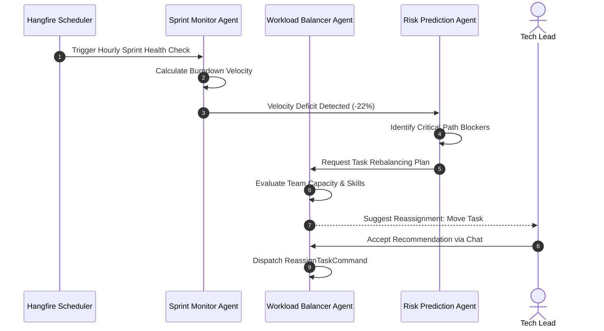

#### Detailed Technical Specifications:
- **Agents Involved**: `SprintMonitorAgent`, `RiskPredictionAgent`, `WorkloadBalancerAgent`.
- **C# Commands**: `GetSprintMetricsQuery`, `SimulateWorkloadRebalanceQuery`, `ReassignTaskCommand`.
- **Database Entities**: `Project`, `TaskItem`, `Sprint`, `WorkloadSnapshot`.
- **Human Approval Gate**: Tech Lead approves task reassignments.
- **Audit Event**: `AuditLog.Record("Task.ReassignedByAgent", taskId: 412)`.

---

### Scenario 4: Compliance Monitoring and Contract Review

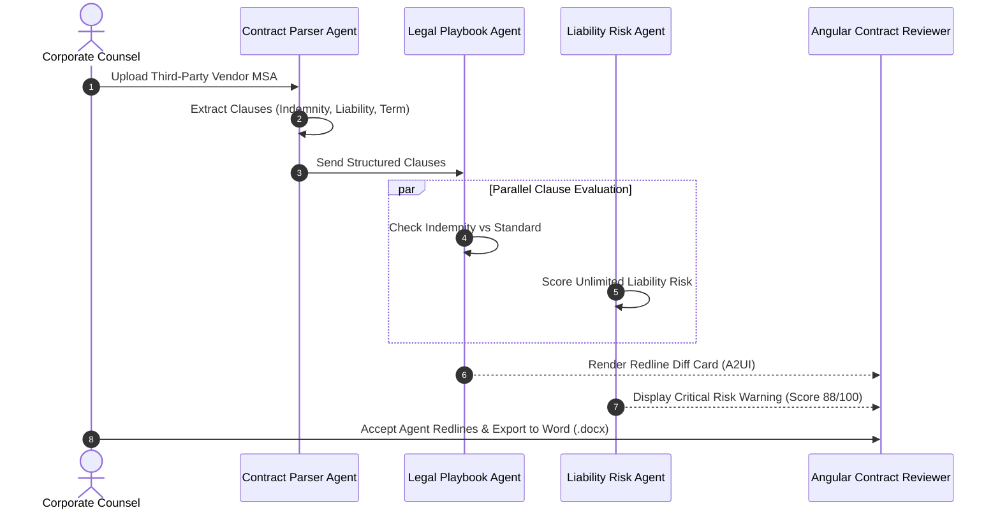

#### Detailed Technical Specifications:
- **Agents Involved**: `ContractParserAgent`, `LegalPlaybookAgent`, `LiabilityRiskAgent`.
- **C# Commands**: `ParseContractClausesCommand`, `ComparePlaybookQuery`, `GenerateDocxRedlineCommand`.
- **Database Entities**: `ContractDocument`, `LegalClauseRule`, `ContractReviewAudit`.
- **Human Approval Gate**: Corporate Counsel approves final redlines.
- **Audit Event**: `AuditLog.Record("Contract.RedlinesGenerated", contractId: 301)`.

---

### Scenario 5: Executive Business Intelligence & Strategy

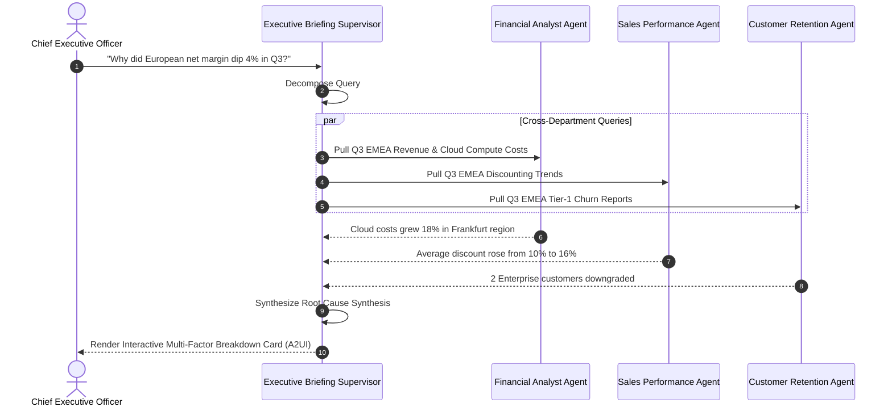

#### Detailed Technical Specifications:
- **Agents Involved**: `ExecutiveBriefingSupervisor`, `FinancialAnalystAgent`, `SalesPerformanceAgent`, `CustomerRetentionAgent`.
- **C# Commands**: `GetRegionalFinancialsQuery`, `GetSalesDiscountsQuery`, `GetCustomerChurnMetricsQuery`.
- **Database Entities**: `TenantSubscription`, `InvoiceItem`, `SupportMetricSnapshot`.
- **Human Approval Gate**: None (read-only strategic analytical synthesis).
- **Audit Event**: `AuditLog.Record("ExecutiveQuery.Dispatched", queryType: "MarginVariance")`.

---

## 10. Database, Memory, and Storage Architecture

Normora implements a **Four-Tier Hybrid Memory Architecture** designed to support both high-speed reactive turns and deep historical recall:

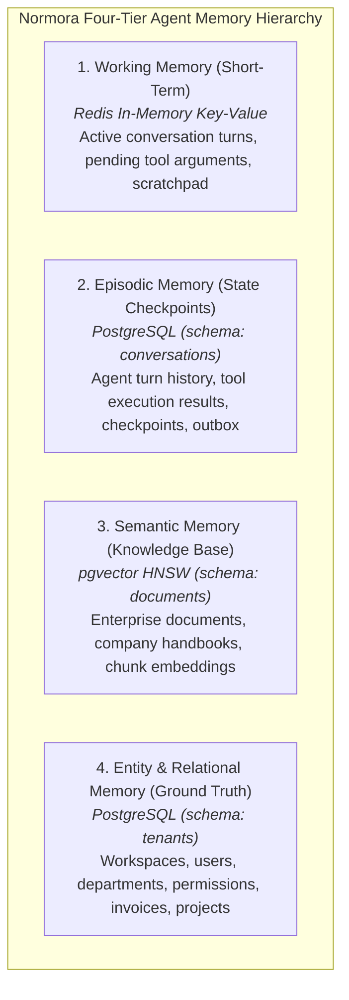

### PostgreSQL Agent State & Checkpoint Schema

```sql
-- Schema: conversations
-- Manages agent execution sessions, state checkpoints, and durable task trees

CREATE TABLE conversations.agent_sessions (
    id UUID PRIMARY KEY DEFAULT gen_random_uuid(),
    tenant_id UUID NOT NULL,
    user_id UUID NOT NULL,
    session_type VARCHAR(64) NOT NULL, -- 'InteractiveChat', 'BackgroundWorkflow', 'ScheduledAudit'
    supervisor_agent_type VARCHAR(128) NOT NULL,
    status VARCHAR(32) NOT NULL, -- 'Active', 'SuspendedForApproval', 'Completed', 'Failed'
    created_at_utc TIMESTAMPTZ NOT NULL DEFAULT NOW(),
    updated_at_utc TIMESTAMPTZ NOT NULL DEFAULT NOW(),
    CONSTRAINT fk_agent_sessions_tenant FOREIGN KEY (tenant_id) REFERENCES tenants.workspaces(id) ON DELETE CASCADE
);

CREATE TABLE conversations.agent_checkpoints (
    id UUID PRIMARY KEY DEFAULT gen_random_uuid(),
    session_id UUID NOT NULL,
    turn_index INT NOT NULL,
    agent_name VARCHAR(128) NOT NULL,
    execution_state_json JSONB NOT NULL, -- Serialized variables, pending tasks, DAG status
    created_at_utc TIMESTAMPTZ NOT NULL DEFAULT NOW(),
    CONSTRAINT fk_agent_checkpoints_session FOREIGN KEY (session_id) REFERENCES conversations.agent_sessions(id) ON DELETE CASCADE
);

CREATE TABLE conversations.agent_tool_executions (
    id UUID PRIMARY KEY DEFAULT gen_random_uuid(),
    session_id UUID NOT NULL,
    tenant_id UUID NOT NULL,
    tool_name VARCHAR(128) NOT NULL,
    idempotency_key VARCHAR(128) NOT NULL,
    input_arguments_json JSONB NOT NULL,
    output_result_json JSONB,
    execution_duration_ms INT NOT NULL,
    is_success BOOLEAN NOT NULL,
    error_message TEXT,
    created_at_utc TIMESTAMPTZ NOT NULL DEFAULT NOW(),
    CONSTRAINT uq_tool_execution_idempotency UNIQUE (tenant_id, idempotency_key),
    CONSTRAINT fk_tool_executions_session FOREIGN KEY (session_id) REFERENCES conversations.agent_sessions(id) ON DELETE CASCADE
);

CREATE TABLE conversations.agent_approvals (
    id UUID PRIMARY KEY DEFAULT gen_random_uuid(),
    session_id UUID NOT NULL,
    tenant_id UUID NOT NULL,
    required_role VARCHAR(64) NOT NULL,
    action_type VARCHAR(64) NOT NULL, -- 'InvoicePayment', 'UserTermination', 'ContractRedline'
    action_payload_json JSONB NOT NULL,
    status VARCHAR(32) NOT NULL DEFAULT 'Pending', -- 'Pending', 'Approved', 'Rejected'
    approver_user_id UUID,
    decision_comment TEXT,
    decided_at_utc TIMESTAMPTZ,
    created_at_utc TIMESTAMPTZ NOT NULL DEFAULT NOW(),
    CONSTRAINT fk_agent_approvals_session FOREIGN KEY (session_id) REFERENCES conversations.agent_sessions(id) ON DELETE CASCADE
);

-- Indexing for fast state recovery and multi-tenant isolation
CREATE INDEX ix_agent_sessions_tenant ON conversations.agent_sessions (tenant_id, status);
CREATE INDEX ix_agent_checkpoints_session ON conversations.agent_checkpoints (session_id, turn_index DESC);
CREATE INDEX ix_agent_approvals_pending ON conversations.agent_approvals (tenant_id, status) WHERE status = 'Pending';
```

---

## 11. Minimal Viable Product (MVP) Implementation Plan

The MVP focuses on delivering immediate, tangible enterprise value within **90 days** without introducing unneeded complexity:

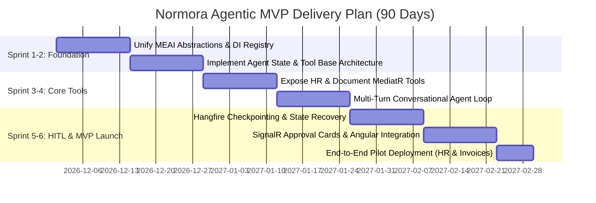

### MVP Scope & Deliverables:
1. **Core Agent Host**: Standardized `Microsoft.Extensions.AI` + `Microsoft.SemanticKernel` provider registration in `Normora.Infrastructure`.
2. **First 5 Production Agent Tools**:
   - `SearchKnowledgeBaseTool` (Hybrid RAG against `Documents` module).
   - `GetEmployeeProfileTool` (Scoped lookup in `Tenants` module).
   - `SubmitLeaveRequestTool` (Self-service leave management).
   - `VerifyInvoiceDataTool` (OCR extraction and validation).
   - `RequestManagerApprovalTool` (SignalR-driven approval prompt).
3. **Frontend Integration**: Angular Standalone Chat component with real-time token streaming and dynamic A2UI approval cards.
4. **Governance**: Full BOLA/BFLA enforcement and centralized audit logging for every tool execution.

---

## 12. 12-Month Phased Implementation Roadmap

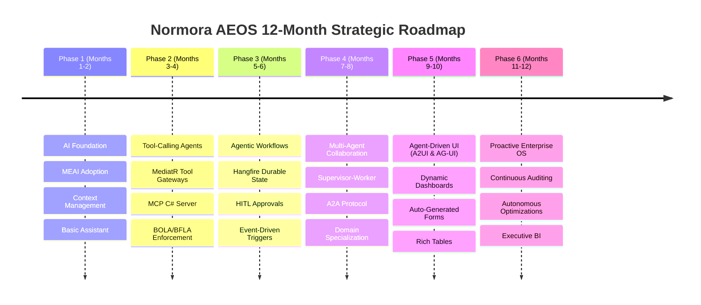

### Detailed Phase Breakdown

| Phase | Duration | Core Objectives & Libraries | Key Implementation Tasks | Deliverables & Outcomes |
| :--- | :--- | :--- | :--- | :--- |
| **Phase 1: AI Foundation** | Months 1–2 | `Microsoft.Extensions.AI`, `Google.GenAI`, `OpenAI` | Standardize `IChatClient` and `IEmbeddingGenerator` across all providers; build token usage telemetry with OpenTelemetry. | Unified, provider-agnostic AI infrastructure; multi-turn conversational chat with 100% provider swapability. |
| **Phase 2: Tool-Calling Agents** | Months 3–4 | `Microsoft.SemanticKernel`, `ModelContextProtocol`, `FluentValidation` | Implement `AgentToolRegistry`; wrap MediatR queries/commands as `KernelFunction`s; enforce BOLA/BFLA security on all tool boundaries. | Reliable single-agent tool invocation; secure read/write actions across HR, Documents, and Invoicing modules. |
| **Phase 3: Agentic Workflows** | Months 5–6 | `Hangfire.PostgreSql`, `StackExchange.Redis`, `SignalR` | Implement durable state machines; build PostgreSQL checkpointing; create SignalR human-in-the-loop approval workflows. | Long-running background agent workflows that survive node restarts; interactive approval cards in Angular UI. |
| **Phase 4: Multi-Agent Collaboration** | Months 7–8 | `Microsoft.SemanticKernel.Agents.Core`, Minimal APIs (A2A) | Implement Supervisor-Worker coordination; configure DAG task decomposition; deploy inter-agent communication protocols. | Autonomous multi-agent cooperation across HR, Finance, Operations, and Compliance modules. |
| **Phase 5: Agent-Driven UI** | Months 9–10 | `Microsoft.Agents.AI.Hosting.AGUI.AspNetCore`, Angular Dynamic Components | Deploy A2UI declarative JSON rendering; stream dynamic forms, cards, and charts over SSE/SignalR; interactive report generation. | Conversational UI that generates interactive, native Angular Material forms, dashboards, and data tables on the fly. |
| **Phase 6: Proactive Enterprise Intelligence** | Months 11–12 | Outbox Domain Events, Automated Compliance Auditors | Deploy event-driven autonomous monitoring; scheduled background compliance scanners; predictive cash flow and OKR forecasting. | **The Normora Agentic Enterprise Operating System**: Self-driving, secure, proactive business management across the entire enterprise. |

---

## Architectural Verification & Governance Checklist

- [x] **No Python/FastAPI/Node.js**: Entire orchestration runs in C# on ASP.NET Core (.NET 10).
- [x] **No Ghost Modules**: All logic lives strictly in `Tenants`, `Documents`, or `Conversations`.
- [x] **Zero Direct DB Access for Agents**: Every tool dispatches strongly-typed MediatR commands through BOLA/BFLA security pipelines.
- [x] **No Magic Strings**: All error handling and messages use centralized `ApiMessages`.
- [x] **Primary Constructors**: All new C# components use modern primary constructor dependency injection.
- [x] **Durable & Resilient**: Long-running workflows backed by Hangfire, PostgreSQL checkpoints, and Redis pub/sub.

