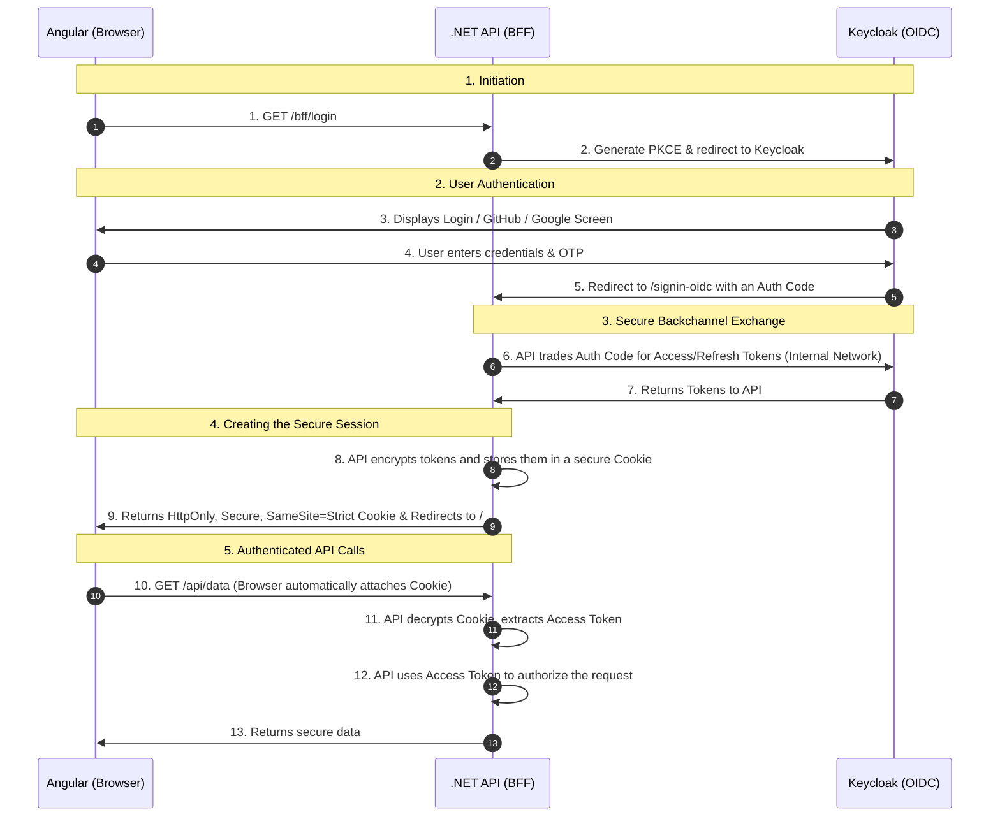

# Architecture

Normora follows a **Modular Monolith** architecture on the backend and a standard **Single Page Application (SPA)** architecture on the frontend. The API, background worker, and one-off migration runner are independently deployable processes built from the same server solution.

## High-Level Tech Stack
- **Frontend**: Angular, TypeScript, Nginx
- **Backend**: .NET 10 (ASP.NET Core Web API)
- **Database**: PostgreSQL 15 (managed via pgAdmin 4)
- **Identity Provider**: Keycloak 24 (with Google and GitHub Sign-In Integrations)
- **Object Storage**: MinIO
- **Infrastructure**: Docker & Docker Compose

The project's engineering history from its initial commit is documented in [Engineering Timeline](#engineering-timeline).

## Backend Architecture (Modular Monolith)
The backend is structured into distinct modules to enforce separation of concerns while keeping deployment simple.

Crucially, there is no shared "Infrastructure" layer, and **no cross-module DbContext leakage is permitted**. Each module encapsulates its own persistence logic, DbContext, domain entities, jobs, and external service integrations:

- **Normora.Api**: The HTTP/BFF host. It contains controllers, middleware (`TenantResolutionMiddleware`), SignalR hubs (`DocumentHub`), and dependency injection composition. Its one-off `--migrate` mode invokes module-owned migration contracts instead of resolving module contexts.
- **Normora.Worker**: A separate generic host running Hangfire workers and scheduling recurring jobs. API replicas do not run background workers.
- **Normora.Shared**: Shared contracts (`Normora.Shared.Contracts.*`), cross-cutting abstractions, MediatR pipeline behaviors (`AuditBehavior`), constants (`ApiMessages`, `TenantRoles`), and provider-neutral interfaces (`ITenantResolutionService`, `IDocumentNotificationService`, `IDatabaseMigrator`, `IAgentTool`, `IAgentToolRegistry`, `IEmailSender`, `IPaymentService`).
- **Modules** (`server/Modules/`):
  Each module resides in a clean directory named after its bounded context with a matching `.csproj` file. Inside each `.csproj`, `<AssemblyName>` and `<RootNamespace>` are explicitly specified as `Normora.Modules.<ModuleName>` to maintain binary stability for migration snapshots and job serializers while keeping directory structures concise:
  - `server/Modules/Tenants/Tenants.csproj` (`Normora.Modules.Tenants`): Multi-tenancy lifecycle, membership validation, departments, user groups, white-label branding, invitations, subscription plans, and isolated tenant persistence (`TenantsDbContext`).
  - `server/Modules/Documents/Documents.csproj` (`Normora.Modules.Documents`): Document upload/management vertical slices (`UploadDocumentCommand`, `DeleteDocumentCommand`, `GetEmployerDocumentsQuery`, `SearchDocumentsQuery`, `GetDocumentChunkQuery`), background ingestion (`DocumentProcessingJob`, `PurgeDeletedDocumentsJob`), text extraction (Apache Tika), chunk embedding generation (`GeminiEmbeddingService`), hybrid retrieval (`RetrievalService`), and isolated data storage (`DocumentsDbContext`).
  - `server/Modules/Conversations/Conversations.csproj` (`Normora.Modules.Conversations`): Multi-turn conversational RAG pipeline (`AskConversationCommand`, `AskConversationStreamCommand`), generative text models (`GeminiTextGenerationService`), autonomous agent tool calling (`AgentToolRegistry`, `CalculatePolicyLimitTool`, `EscalateInquiryTool`, `SearchCompanyDocumentsTool`), auto-titling, conversation metrics, saved answer exports (Markdown, QuestPDF, Docx), and chat history persistence (`ConversationsDbContext`).

### Boundary Enforcement Rules
1. **100% DbContext Encapsulation**: Module DbContexts (`TenantsDbContext`, `DocumentsDbContext`, `ConversationsDbContext`) are used only inside their owning modules. The host can request migrations via `IDatabaseMigrator`, but does not resolve a module context directly.
2. **Contract-Driven Cross-Module Queries**: When one module or the host requires data owned by another module, it dispatches a lightweight MediatR query contract residing in `Normora.Shared.Contracts.*` (e.g. `GetTenantDashboardMetricsQuery`, `GetDocumentDashboardMetricsQuery`, `GetConversationDashboardMetricsQuery`, `GetAccessibleDocumentFileNamesQuery`, `GetTenantAdminRecipientsQuery`).
3. **Boundary Interfaces**: Cross-cutting infrastructure hooks are decoupled using shared interfaces. 
   - `ITenantResolutionService`: Allows `TenantResolutionMiddleware`, `DocumentHub`, and `McpController` to validate memberships and resolve tenant slugs without direct access to `TenantsDbContext`.
   - `IDocumentNotificationService`: Enables background workers (`DocumentProcessingJob`) in the Documents module to push real-time WebSocket progress updates without coupling the module to SignalR hub dependencies.
   - `IDatabaseMigrator`: Lets each module migrate its own persistence boundary from the one-off migration runner.
4. **Immediate Membership Revocation**: Tenant membership and department permissions are resolved from the Tenants database on every request so changes take effect across all API replicas immediately.
5. **Explicit Migration Lifecycle**: Schema migrations run as a serialized `dotnet Normora.Api.dll --migrate` deployment step, not during API startup. Pending-model-change warnings are not suppressed.
6. **Production Infrastructure Requirements**: Production requires a distributed Redis cache, MinIO TLS, and explicit trusted reverse-proxy IPs. Forwarded headers are limited to one trusted proxy hop.

## Identity & Access Management (IAM)
Normora uses the **Backend-For-Frontend (BFF)** pattern powered by `Duende.BFF` to eliminate token exposure to the browser entirely.

### Authentication Flow



### Detailed Breakdown

#### 1. Initiation
When you click "Login" in Angular, it doesn't talk to Keycloak directly. Instead, it navigates to the .NET API at `/bff/login`. The API generates a secure challenge (PKCE) and redirects your browser to Keycloak.

#### 2. User Authentication
You land on the Keycloak login screen (`http://localhost:8080`). You enter your password, do the OTP challenge, or click GitHub. Keycloak verifies who you are.

#### 3. The Callback & Backchannel (Where the magic happens)
Once Keycloak approves you, it redirects your browser *back* to the API at `http://localhost:4200/signin-oidc` with a temporary, one-time-use **Authorization Code**.
- The API takes this code and secretly talks to Keycloak over the internal Docker network (`http://keycloak:8080`).
- The API trades the Authorization Code for your real Access Token and Refresh Token. 
- *Crucially, these tokens never touch your browser.*

#### 4. The Secure Cookie
Because your Angular app needs a way to prove it's logged in, the API takes those tokens, encrypts them, and wraps them in a highly secure **Cookie** (named `normora-auth` or `__Host-spa`).
- **HttpOnly**: JavaScript cannot read it (immune to XSS attacks).
- **Secure**: It can only be sent over HTTPS.
- **SameSite=Strict**: It can only be sent to your exact API, preventing Cross-Site Request Forgery (CSRF).

#### 5. Authenticated API Calls
From now on, whenever Angular makes an HTTP request to the API (e.g., fetching a user profile), the browser *automatically* attaches that secure cookie. 
The API decrypts the cookie, finds the Keycloak Access Token inside, validates it, and processes your request!

> [!NOTE]
> All of the "weird" configuration we did earlier (like setting `KC_HOSTNAME_URL` and creating the `DockerOidcBackchannelHandler`) was necessary to ensure Step 3 and Step 6 could happen seamlessly across both the public browser network and the internal Docker network simultaneously.

### Docker Reverse-Proxy Gotcha (UseForwardedHeaders)
When the API runs inside Docker behind an nginx reverse proxy, `HttpContext.Request.Host` resolves to the internal Docker hostname (`api:8080`) rather than the public-facing address (`localhost:4200`). This causes the OIDC middleware to build an incorrect `redirect_uri`, which Keycloak rejects.

**Fix**: `UseForwardedHeaders` middleware is registered in `Program.cs` to read the `X-Forwarded-Host`, `X-Forwarded-For`, and `X-Forwarded-Proto` headers that nginx injects, allowing the API to correctly reconstruct the public URL. Only explicitly configured proxy IPs are trusted; do not clear ASP.NET Core's default proxy restrictions.

```csharp
app.UseForwardedHeaders(new ForwardedHeadersOptions
{
    ForwardedHeaders = ForwardedHeaders.XForwardedFor 
                     | ForwardedHeaders.XForwardedHost 
                     | ForwardedHeaders.XForwardedProto
});
```

Nginx must also set `proxy_set_header X-Forwarded-Host $host;` on all proxy blocks pointing to the API.

### SignalR & BFF Authentication Gotcha
When unauthenticated users attempt to connect to SignalR Hubs (`/hub/negotiate`), ASP.NET Core's default behavior is to return a `302 Redirect` to the Identity Provider (Keycloak). Because this is an AJAX/Fetch request from the SignalR client, the browser will automatically follow the redirect in the background, resulting in failed or cancelled cross-origin API calls to Keycloak's `/auth` endpoint.

**Fix**: All SignalR Hub route mappings in `Program.cs` must be explicitly appended with `.AsBffApiEndpoint()`. This tells the Duende BFF middleware to intercept unauthenticated requests to the hub and correctly return a `401 Unauthorized` response instead of a redirect.

```csharp
app.MapHub<DocumentHub>("/hubs/documents").AsBffApiEndpoint();
```

### Token Lifecycle
- **Access tokens** and **refresh tokens** are encrypted inside the `__Host-spa` cookie by the BFF — the browser never sees them.
- **Token renewal** is fully automatic. When the access token expires, `Duende.BFF` performs a back-channel refresh with Keycloak and updates the cookie transparently.
- **CSRF protection**: All mutating requests (`POST`, `PUT`, `DELETE`) must include the `X-CSRF: 1` header, enforced globally via `.AsBffApiEndpoint()`.

### Angular Route Guard Synchronization
The SPA's routing decisions (`AuthGuard`) rely on the authentication state provided by the BFF (`/bff/user`). Because the BFF network check is asynchronous, `AuthGuard` must wait for the initial check to complete before executing.
- If `AuthGuard` evaluates the state before the check completes (e.g., during a hard page reload), it will incorrectly assume the user is unauthenticated and trigger a premature redirect to the `/auth/login` route.
- **Fix**: The `AuthService` uses a nullable `BehaviorSubject<boolean | null>` to track initialization. The `AuthGuard` uses an RxJS `filter(state => state !== null)` pipe to pause route evaluation until the BFF check conclusively returns `true` or `false`.
- **CSRF protection**: All mutating requests (`POST`, `PUT`, `DELETE`) must include the `X-CSRF: 1` header, enforced globally via `.AsBffApiEndpoint()`.

### JIT User Provisioning
When a user successfully authenticates via Keycloak (or Google/GitHub via Keycloak), their local shadow profile (`User.cs`) is updated or created. The `GetCurrentUserQueryHandler` automatically syncs their latest `DisplayName` and `Email` from the OIDC claims (populated from the BFF cookie) into PostgreSQL on every login.

## Observability
The backend relies on **OpenTelemetry (OTLP)** for a unified observability layer:
- **Tracing**: Traces HTTP requests (ASP.NET), outgoing HTTP calls (e.g. Gemini), and Entity Framework database queries.
- **Metrics**: Captures standard process metrics alongside custom application metrics (e.g. LLM tokens consumed, RAG latency, background job completion).
- **Exporters**: Designed to export to the console during development and a vendor-neutral OTLP collector in production.

## Frontend Architecture
The Angular application resides in the `client/` directory and communicates with the .NET backend via REST APIs. During local development and production, requests to `/api/*` are proxied to the backend. The frontend seamlessly handles complex auth flows, including intercepting OAuth callbacks to redirect users accepting invitations.

## Deployment
The local stack is containerized. `docker-compose.yml` orchestrates PostgreSQL, pgAdmin, Keycloak, MinIO, Redis, Tika, a one-off schema migrator, the .NET API, a separate Hangfire worker, and the Angular client served via Nginx. The API starts only after migrations complete successfully. Production deployments should run migrations as a serialized release step and configure trusted proxy IPs, Redis, and MinIO TLS.

## Multi-Tenancy and Scalable Architecture
Normora implements a highly scalable **Multi-Tenant Architecture** using a many-to-many relationship between Users and Tenants. This is a foundational design choice that supports both business growth and long-term development velocity.

### Junction-Based Identity Model
Rather than a 1-to-1 mapping where one user belongs to one organization, Normora uses a `TenantMembership` junction entity. This decouples the core user identity from their contextual authorization.

**Key Benefits for B2B SaaS:**
1. **Single Sign-On (Unified Identity)**: Users maintain a single account (one email/password) across the platform, regardless of how many organizations they are invited to.
2. **Context-Specific Roles (Granular Access Control)**: Because the `TenantRole` (e.g., Employer, Employee) is stored on the `TenantMembership` rather than the `User` record, a user can have entirely different permission levels depending on which tenant workspace they are currently viewing.
3. **Frictionless Collaboration**: This architecture inherently supports complex B2B scenarios, allowing accountants, contractors, and parent companies to seamlessly switch between multiple clients' or subsidiaries' workspaces without logging out.
4. **Simplified User Experience**: The frontend provides a "workspace switcher." The backend dynamically enforces the correct permissions based on the requested tenant context.
5. **Efficient Lifecycle Management**: If a user updates their profile or leaves the platform entirely, only one `User` record needs to be updated or deactivated. If they leave a specific organization, only their specific `TenantMembership` is removed.

### Scalable Development
This design physically prevents the accumulation of technical debt regarding identity management:
- **Architectural Scalability**: Eliminates the need for users to create duplicate accounts with different emails just to join a second company, preventing database bloat and terrible UX.
- **Development Scalability**: Future features can be added cleanly. For example, adding new specialized roles (e.g., "Billing Admin") only requires updating the `TenantMembership` authorization logic, leaving the core authentication and identity systems untouched.

### Department & User Group Scoping (Isolated Answers)
To support large organizations where sensitive documents (like HR policies or Executive reports) must be restricted, Normora extends its multi-tenancy with **Internal Data Scoping**:
- **Effective Departments Resolution**: At login, the `Tenants` module resolves all departments a user is part of (both direct assignments and those inherited via `UserGroups`). These `DepartmentIds` are embedded in the user's OIDC claims.
- **Scoped Hybrid Search**: When querying the RAG pipeline (`AskNormora`), the backend reads these claims and dynamically filters the `pgvector` hybrid search. It restricts results strictly to chunks from documents marked as **Company Wide** (no departments) or matching the user's **Effective Departments**. This guarantees that an employee cannot retrieve AI-generated answers from restricted departmental documents.

### Personal Workspaces
Every user is automatically provisioned a private `Tenant` marked as `IsPersonal = true`. This ensures that individual users have a secure, isolated sandbox to upload and query their own private documents without polluting corporate workspace databases or search results.
- **Simplified Capabilities**: Personal workspaces bypass complex B2B features. For example, document uploads in a personal workspace automatically hide the Department Assignment UI, as there is no organizational hierarchy within a personal tenant.
- **Unified Data Model**: By treating the personal sandbox as simply another `Tenant`, the backend requires zero specialized schema alterations. The standard data isolation, hybrid search, and generative boundaries work flawlessly and uniformly.

## Code Quality Standards
To ensure a maintainable and robust codebase, Normora adheres to strict clean code principles:
- **No Magic Strings**: Authorization roles and API response messages are centralized into statically typed constant classes (e.g., `TenantRoles.cs` and `ApiMessages.cs` in the backend, and equivalent TypeScript constants in the frontend). This prevents typo-driven security vulnerabilities and simplifies localization or future refactoring.
- **Unified API Responses**: Every API endpoint uses a generic `ApiResponse<T>` wrapper, guaranteeing that successful data payloads, validation errors, and server exceptions all return identical JSON envelopes.
- **OpenAPI Documentation**: The backend leverages Scalar UI to auto-generate interactive, developer-friendly OpenAPI specifications that strictly map to the `ApiResponse<T>` schemas and XML comments.
- **Configuration & Options Pattern**: All configuration values are strongly typed using the `IOptions<T>` pattern. Magic strings (URLs, claim types, scopes) are strictly avoided. See [Configuration Architecture](configuration.md) for details.

## Application Security (BOLA & BFLA)
Security and data isolation are critical in a multi-tenant environment. Normora is specifically designed to mitigate common API vulnerabilities, notably **Broken Object Level Authorization (BOLA/IDOR)** and **Broken Function Level Authorization (BFLA)**.

### Preventing BFLA
BFLA occurs when users can execute functions (endpoints) they shouldn't have access to based on their roles.
- **Tenant Context Extraction**: The `TenantResolutionMiddleware` securely extracts the `X-Tenant-Id` header from incoming requests. Crucially, it queries the database (`TenantsDbContext`) to verify that the authenticated user genuinely belongs to that tenant.
- **Strict Role Validation**: The `[RequireTenant(params string[] roles)]` attribute acts as an authorization filter. It checks the successfully resolved `ITenantContext` to ensure the user holds the specific role (e.g., "admin", "employee") *within that specific tenant* before the controller logic is executed.

### Preventing BOLA (IDOR)
BOLA occurs when an application does not properly validate that the user is authorized to access the specific object ID they requested (e.g., manipulating a document ID or tenant ID in the URL).
- **Context-Bound Operations**: Controllers enforce BOLA protection by strictly associating operations with the authorized `ITenantContext`. Even if a route provides an `{id}` (like `DELETE /api/Documents/{id}` or `POST /api/Tenants/{id}/suspend`), the backend explicitly verifies that the requested object belongs to the user's validated `tenantContext.TenantId`. 
- **Example**: In the `SuspendTenant` endpoint, the `{id}` from the route is validated against `_tenantContext.TenantId`. This prevents a malicious tenant admin from suspending *another* tenant by injecting their own valid `X-Tenant-Id` header while manipulating the target `{id}` in the URL.

## White-Label Branding & Workspace Routing
Normora supports per-tenant white-labeling without separate application builds. Each tenant can have its own brand identity applied dynamically at runtime.

### Data Model
Branding is stored in a dedicated `TenantBranding` table (1-to-1 with `Tenant`) rather than embedded directly in the `Tenant` row, keeping branding concerns fully separated:

```
TenantBranding
├── Id
├── TenantId       (FK → Tenant)
├── PrimaryColor   (e.g. "#3b82f6")
├── SecondaryColor
├── LogoUrl
└── FaviconUrl
```

### Anonymous Branding API
`GET /api/tenants/branding/{slug}` is an `[AllowAnonymous]` endpoint so the Angular app can fetch and apply a tenant's brand *before* the user logs in.

### Frontend: Dynamic CSS Variables
The `TenantBrandingService` (Angular) extracts the tenant slug from the workspace path URL on app startup and applies branding as CSS custom properties on the document root:

```typescript
document.documentElement.style.setProperty('--brand-primary', branding.primaryColor);
```

This causes the entire app to reskin automatically without any rebuild.

## Document Processing Lifecycle

Document metadata is stored in PostgreSQL while the original file is stored in MinIO. The document status is represented by the shared `DocumentStatus` enum:

```text
Uploaded -> Processing -> Ready
                         \-> Failed
```

The upload request currently stores the file and creates an `Uploaded` metadata record. The employer document list displays the lifecycle state using readable API values. The background worker, text extraction, normalization, and chunking steps are intentionally separate follow-up increments so a document is never shown as `Ready` before ingestion has completed.

Hangfire uses PostgreSQL storage and runs `DocumentProcessingJob` in the separate `Normora.Worker` process. Uploads enqueue a job only after the MinIO object and document metadata have been persisted. The job validates both the document ID and tenant ID outside the HTTP tenant context, downloads the tenant-owned object from MinIO, sends it to Apache Tika, stores the extracted text, normalizes it into bounded `DocumentChunk` rows, and moves the document to `Ready`. Extraction failures move the document to `Failed` and are rethrown for Hangfire retry. The Hangfire dashboard is available at `/hangfire` in Development only.

Chunks are tenant-owned and uniquely ordered per document. A retry removes the document's existing chunks and recreates them, preventing duplicate chunk records. Each chunk is capped at approximately 4,000 characters and preserves paragraph boundaries where possible. Embeddings and vector search are separate later stages.

When `Gemini:ApiKey` is configured, the ingestion job generates a 768-dimensional Gemini embedding for each chunk and stores it in PostgreSQL `pgvector` before publishing `Ready`. Without a key, local ingestion still completes through chunking and leaves embeddings null; retrieval is disabled until embeddings are available.

The tenant-protected `GET /api/documents/search?query=...&limit=5` endpoint embeds the query, applies the current tenant's chunk filter, ranks results by pgvector cosine distance, and returns the matching source document, chunk index, content, and similarity score. It is retrieval only; answer generation and citations belong to the next RAG slice.

The employee `POST /api/ask` endpoint uses the same tenant-filtered retrieval, rejects weak matches below the similarity threshold, and sends only the selected chunks to Gemini generation. Its response contains the grounded answer and document/chunk citations; when evidence is insufficient it returns a no-answer message instead of guessing.

### Realtime Document Events

Authenticated clients connect to `/hubs/documents` and explicitly join a tenant group. SignalR automatically forwards the secure `__Host-spa` cookie for authentication. The hub validates the current user's membership before adding the connection. Upload and processing transitions publish `DocumentStatusChanged` events to that tenant group, allowing the employer document list to update without polling.

### Path-Based Workspace Routing
After a successful login:
- **User with no tenants**: stays on base `localhost:4200` and is routed to `/onboarding`.
- **User with tenants**: redirected to `/app/workspaces/{slug}/{dashboard}` using their default (non-personal) membership's tenant slug.

> **Future Enhancement**: Persist the user's last selected tenant and use it for login routing instead of always defaulting to the first membership.

## Export Answers

Employees can export any saved answer to a portable file format directly from the **Saved Answers** page. Exports are generated synchronously in the API process — no Hangfire job or polling is required for the current document sizes.

### Abstraction Design

The export system follows the **Strategy Pattern** via the `IAnswerExporter` interface, keeping the MediatR query handler completely decoupled from any specific library:

```
IAnswerExporter
    ├── MarkdownAnswerExporter   → .md  (pure string-building, no dependencies)
    ├── PdfAnswerExporter        → .pdf (QuestPDF 2025.5.0)
    └── DocxAnswerExporter       → .docx (DocumentFormat.OpenXml 3.3.0)
```

All three exporters receive an `AnswerExportData` record containing:

| Field | Source |
|---|---|
| `Question` | The most recent preceding `User` message in the same conversation |
| `Answer` | The saved assistant message content |
| `Citations` | All `MessageCitation` records attached to the message, ordered by rank |
| `SavedAt` | `SavedAnswer.CreatedAt` |
| `EmployeeName` | `ICurrentUser.DisplayName` or `Email` |
| `TenantName` | The conversation `Title` (used as contextual label) |

The exporters are registered as **singletons** in `ApplicationServiceExtensions` — they are stateless and safe to share across requests.

### QuestPDF License

The community licence is set once in `PdfAnswerExporter`'s static constructor, which runs the first time the singleton is resolved. This keeps the licence setting inside the module (`Normora.Modules.Conversations`) that owns the QuestPDF package reference, avoiding a transitive package dependency on `Normora.Api`.

```csharp
static PdfAnswerExporter() => QuestPDF.Settings.License = LicenseType.Community;
```

### PDF Layout

The QuestPDF document is structured as:

```
┌──────────────────────────────────────────┐
│  Normora                  Saved Answer   │  ← Page header
│  ──────────────────────────────────────  │
│  Employee: …   Saved: …                  │  ← Metadata
│                                          │
│  Question                                │  ← H2 heading
│  ┌──────────────────────────────────┐    │
│  │  > Question text (shaded block)  │    │
│  └──────────────────────────────────┘    │
│                                          │
│  Answer                                  │  ← H2 heading
│  Plain-text body (Markdown stripped)     │
│                                          │
│  Sources                                 │  ← H3 heading
│  ┌──────────────────┬─────────────┐      │
│  │ Document         │ Relevance   │      │  ← Citation table
│  ├──────────────────┼─────────────┤      │
│  │ Policy.pdf       │ 92%         │      │
│  └──────────────────┴─────────────┘      │
│                                          │
│  Page 1 of 1                             │  ← Page footer
└──────────────────────────────────────────┘
```

### DOCX Layout

The Open XML SDK document uses proper paragraph styles with no external Word installation required:

- **Title**: Bold, large, indigo `#6366f1`
- **Metadata**: Semi-bold label + plain value pairs
- **Question**: Left-bordered paragraph (indigo accent) with italic text
- **Answer**: Paragraphs split by double-newline, Markdown symbols stripped
- **Citations**: Native `Table` with header row shading
- **Footer**: Small italic attribution line

### API Endpoint

```
GET /api/saved-answers/{id}/export?format=Markdown|Pdf|Docx
```

- The `ExportSavedAnswerQuery` MediatR handler enforces tenant isolation via EF Core global query filters and validates `UserId` ownership before fetching the document.
- The controller streams the `byte[]` result using `File(bytes, contentType, fileName)`, which sets `Content-Disposition: attachment` automatically.
- The filename is derived deterministically: `normora-answer-{yyyy-MM-dd}{ext}`.

### Frontend Download Pattern

The Angular `SavedAnswerService.exportAnswer()` method uses `responseType: 'blob'` to receive the binary response, then creates a temporary `<a>` element with `URL.createObjectURL()` to trigger the browser's native save-as dialog — no third-party download library required:

```typescript
const anchor = document.createElement('a');
anchor.href = URL.createObjectURL(blob);
anchor.download = `normora-answer-${today}.pdf`;
anchor.click();
URL.revokeObjectURL(anchor.href);
```

The export dropdown on each saved-answer card shows a spinner during the in-flight request and uses a `HostListener` on `document:click` to close the menu when the user clicks outside.

## Soft Deletion and Data Retention Strategy
Normora relies heavily on soft deletion (`DeletedAt`, `RemovedAt`) combined with EF Core **Global Query Filters** to immediately hide deleted resources (Documents, Employees) from all RAG lookups, dashboard lists, and searches without altering individual queries.

- **Document Purge**: Soft-deleted documents broadcast a SignalR event for optimistic UI updates. They are physically deleted from MinIO (and database rows purged) in bounded, retry-safe batches via a nightly Hangfire job (`PurgeDeletedDocumentsJob`) after a 30-day grace period.
- **Local-First Identity Sync**: Removing an employee soft-deletes their `TenantMembership` locally first. Access is instantly revoked via Global Query Filters. Afterward, a best-effort `IHttpClientFactory` call attempts to un-sync the user from the Keycloak Admin API, safely logging any errors without rolling back the local transaction. This protects against identity provider outages preventing critical access revocations.

## Audit Logging Architecture

Normora implements automatic, cross-cutting audit logging via MediatR's open pipeline behavior pattern (`IPipelineBehavior<TRequest, TResponse>`).

### 1. The `IAuditableRequest` Abstraction
Any MediatR command that modifies tenant state implements the `IAuditableRequest` marker interface:

```csharp
public interface IAuditableRequest
{
    string Action { get; }
    string? TargetType => null;
    string? TargetId => null;
    object? GetAuditMetadata() => null;
}
```

Audited operations include:
- `UploadDocumentCommand` (`Document.Upload`)
- `DeleteDocumentCommand` (`Document.Delete`)
- `InviteEmployeeCommand` (`Employee.Invite`)
- `AcceptInvitationCommand` (`Employee.AcceptInvitation`)
- `RemoveEmployeeCommand` (`Employee.Remove`)
- Department CRUD (`Department.Create`, `Department.Update`, `Department.Delete`)
- User Group CRUD (`UserGroup.Create`, `UserGroup.Update`, `UserGroup.Delete`)
- `UpdateTenantBrandingCommand` (`Tenant.UpdateBranding`)
- `SuspendTenantCommand` (`Tenant.Suspend`)

### 2. MediatR `AuditBehavior`
The pipeline behavior intercepts requests before and after execution:
1. Checks if the incoming request implements `IAuditableRequest`.
2. Resolves active tenant context (`ITenantContext`) and authenticated actor (`ICurrentUser`).
3. Executes the inner request handler (`await next()`).
4. If successful, creates an `AuditLog` domain record via `IAuditService` containing:
   - `TenantId` (guaranteed tenant boundary)
   - `UserId` (authenticated actor GUID)
   - `Action` (e.g. `Document.Upload`)
   - `TargetType` & `TargetId` (affected resource)
   - `Metadata` (serialized JSON context)
   - `CreatedAtUtc` (UTC timestamp)

```csharp
public class AuditBehavior<TRequest, TResponse>(
    IAuditService auditService,
    ITenantContext tenantContext,
    ICurrentUser currentUser) : IPipelineBehavior<TRequest, TResponse>
    where TRequest : notnull
{
    public async Task<TResponse> Handle(TRequest request, RequestHandlerDelegate<TResponse> next, CancellationToken ct)
    {
        var response = await next();
        if (request is IAuditableRequest auditable && tenantContext.HasTenant)
        {
            await auditService.LogAsync(
                tenantContext.TenantId,
                currentUser.UserId,
                auditable.Action,
                auditable.TargetType,
                auditable.TargetId,
                auditable.GetAuditMetadata(),
                ct);
        }
        return response;
    }
}
```

### 3. Querying and UI
Employers access audit logs via `GET /api/audit-logs` (`GetAuditLogsQuery`). The endpoint supports cursor-style or page-based pagination, date-range filtering (`fromDate`, `toDate`), action category filtering, and keyword search against metadata and actor display names.

---

## Transactional Email Architecture (Provider-Agnostic)

Normora provides transactional email notifications (employee invitations, document processing failure alerts, document-ready notifications, and HR escalation tickets) built on a provider-agnostic abstraction.

### 1. Transport Abstraction (`IEmailSender`)
Email delivery logic does not couple to third-party SDKs:
- **`IEmailSender`** (`Normora.Shared.Interfaces`): Core interface declaring `SendEmailAsync(string to, string subject, string htmlBody, CancellationToken ct)`.
- **`ResendEmailSender`**: Production implementation using Resend REST API via `IHttpClientFactory` (`https://api.resend.com/emails`).
- **`NullEmailSender`**: Safe fallback implementation for automated tests or local setups where `RESEND_API_KEY` is omitted, avoiding unhandled crashes.

### 2. Configuration & Options
Configured in `Normora.Shared.Options.EmailOptions`:
- `Provider`: `"Resend"` or `"Null"`
- `ApiKey`: Provider API key (`RESEND_API_KEY`)
- `FromEmail`: Verified sender address (`RESEND_FROM_EMAIL`)
- `FromName`: Sender display name (defaults to `"Normora"`)
- `DevOverrideRecipient`: Development interceptor (`DEV_OVERRIDE_EMAIL`) that redirects all outbound emails to the developer's verified sandbox inbox.

### 3. Asynchronous Worker Execution
Email dispatch is fully non-blocking:
- Handlers invoke `IEmailService.SendAsync(...)`.
- The request is serialized and enqueued into **Hangfire** (`SendEmailJob`) with automatic retry policies (10s, 30s, 60s), ensuring transient provider rate limits or network blips never fail the originating HTTP request.

---

## Subscription & Plan Limits Architecture

Multi-tenant SaaS scalability requires strict governance over shared compute, storage, and AI resource consumption. Normora implements tier-based quota management directly in the core application pipeline.

### 1. Tier Definitions
Each workspace is associated with a `TenantPlan` record (`tenants.tenant_plans`):

| Plan Tier | Max Documents | Max Employees | Max Storage Bytes | Description |
|---|---|---|---|---|
| **Free** | 10 | 5 | 50 MB | Starter tier for small teams and evaluations. |
| **Pro** | 100 | 50 | 5 GB | Growth tier with department and user group scoping. |
| **Enterprise** | 10,000 | 5,000 | 500 GB | Full-scale enterprise tier with white-label branding, pgvector search, and audit trails. |

### 2. Cross-Module Quota Verification
Because `Documents` and `Tenants` are separate modules with isolated DbContexts:
- The `Documents` module exposes CQRS query contracts (`GetTenantDocumentUsageQuery` and `CheckTenantUploadLimitQuery`).
- When a document upload is initiated (`UploadDocumentCommandHandler`):
  1. The handler retrieves the tenant's active `TenantPlan`.
  2. Queries current document usage (count of non-deleted documents and sum of stored file sizes).
  3. Verifies that `currentDocs + 1 <= MaxDocuments` and `currentBytes + incomingFile.Length <= MaxStorageBytes`.
  4. If either quota would be exceeded, throws a `PlanLimitExceededException`.
- Similarly, `InviteEmployeeCommandHandler` validates current active memberships (`Count < MaxEmployees`) before dispatching new invitations.

### 3. HTTP 402 Payment Required & Client Handling
- `PlanLimitExceededException` is caught by `GlobalExceptionHandler` and mapped to HTTP `402 Payment Required` with a structured `ApiResponse.Failure(ApiMessages.PlanLimitExceeded)`.
- The Angular frontend interceptor handles 402 responses and surfaces clear, actionable upgrade guidance rather than generic failure toasts.
- The `SubscriptionComponent` provides real-time resource meters (visual progress bars indicating document, seat, and storage utilization percentages) alongside tier cards for one-click plan upgrades.

### 4. Decoupled Payment Gateway Architecture (`IPaymentService`)
To eliminate vendor lock-in, payment processing is decoupled behind the `IPaymentService` abstraction:
- **Provider-Agnostic Interface**: `IPaymentService` defines contracts for generating hosted checkout parameters (`CreateCheckoutSessionAsync`), processing cryptographic return callbacks (`ProcessCallbackAsync`), and generating billing portal links (`CreatePortalSessionAsync`).
- **Agnostic Database Schema**: Workspace payment state in `TenantPlan` stores vendor-neutral columns `PaymentTransactionId` and `PaymentReferenceId` rather than provider-branded columns.
- **Configurable Provider**: Configured in `appsettings.json` via `Payment:Provider` (e.g. `PayU`).

### 5. PayU Hosted Checkout & Cryptographic SHA-512 Verification
The initial implementation `PayUPaymentService` integrates PayU India:
- **Hosted Checkout Sessions (`POST /api/subscription/checkout`)**:
  - Eliminates PCI-DSS compliance scope by utilizing PayU India hosted checkout (`https://test.payu.in/_payment` in development, `https://secure.payu.in/_payment` in production).
  - The server securely determines plan pricing based on the selected tier and workspace currency, assigns a unique transaction ID (`txnid`), and attaches User Defined Fields (`udf1` = tenantId, `udf2` = tier, `udf3` = currency, `udf4` = tenantSlug, `udf5` = userEmail).
  - Computes a tamper-proof SHA-512 request hash:
    `sha512(key|txnid|amount|productinfo|firstname|email|udf1|udf2|udf3|udf4|udf5||||||SALT)`
  - The frontend dynamically constructs and automatically submits a signed hidden HTML form (`submitPayUForm`) to hand off to PayU.
- **Local vs International Payment Support**:
  - **UPI (Local)**: Full UPI support (Google Pay, PhonePe, Paytm, BHIM, and QR code) for Indian Rupee (`inr`) transactions.
  - **Credit & Debit Cards (Global & Domestic)**: Cards (Visa, Mastercard, RuPay, American Express, Diners Club) supporting international payments in major currencies (`inr`, `usd`, `eur`, `gbp`, `cad`, `aud`, `jpy`, `sgd`) as well as domestic card payments.
- **Workspace Currency Persistence**:
  - The workspace billing currency is persisted in `TenantPlan.Currency` (defaulting to `"inr"`).
  - When users travel abroad, the application retains the workspace's configured INR currency, preventing accidental foreign transaction markups and preserving local UPI options.
- **Cryptographic Callback Verification (`POST /api/subscription/payu-callback`)**:
  - Public return endpoint (`[AllowAnonymous]` + `[IgnoreAntiforgeryToken]`) securely receives the browser postback from PayU (`surl` / `furl`).
  - Recomputes the reverse SHA-512 hash against the server's private `MerchantSalt`:
    - With additional charges: `sha512(additionalCharges|SALT|status||||||udf5|udf4|udf3|udf2|udf1|email|firstname|productinfo|amount|txnid|key)`
    - Standard: `sha512(SALT|status||||||udf5|udf4|udf3|udf2|udf1|email|firstname|productinfo|amount|txnid|key)`
  - Rejects hash mismatches immediately with `ApiMessages.PayUHashMismatch`.
  - On verified `success`, updates workspace quota limits to the purchased tier, records `PaymentTransactionId` and `PaymentReferenceId`, updates `SubscriptionStatus = 'active'`, and records an immutable audit log entry.
  - Redirects the user back to the tenant-scoped subscription settings with `?status=success` or `?status=failed&error=...`.
- **Tier Hierarchy & Action Locking**:
  - The UI models a strict tier hierarchy: `Free` (0) < `Pro` (1) < `Enterprise` (2).
  - When a workspace is subscribed to a tier (e.g., Enterprise), all lower/previous tier buttons are permanently disabled (`cursor-not-allowed`) and indicate `"Included in {Plan}"`.
  - Only upgrade pathways to strictly higher tiers are selectable.

---

## Code Quality, Security & Engineering Standards (Remediation & Best Practices)

Following a comprehensive senior architectural audit, the codebase implements strict patterns across security, tenancy, performance, and frontend resilience:

### 1. Security & Authorization (BOLA, BFLA & Zero Magic Strings)
- **Centralized Error & Response Constants (`ApiMessages`)**:
  - Hardcoded strings in exceptions, controllers, and alerts are strictly prohibited.
  - All messages reside in `Normora.Shared.Constants.ApiMessages` on the backend and `@core/constants/api-messages.ts` on the frontend.
- **BOLA Protection (Broken Object Level Authorization)**:
  - When a user requests a resource they do not own or have access to within the tenant boundary, handlers throw `BolaException()`.
  - Mapped globally to `404 Not Found` with generic `ApiMessages.NotFound` to completely eliminate resource ID enumeration vulnerabilities.
- **BFLA Protection (Broken Function Level Authorization)**:
  - When an authenticated user lacks permissions for an operation, handlers throw `BflaException()`.
  - Mapped globally to `403 Forbidden` returning a structured `ApiResponse.Failure(ApiMessages.Forbidden)`.
- **RAG Soft-Delete Data Isolation**:
  - In cross-department joins where `.IgnoreQueryFilters()` is applied to evaluate user permissions, queries explicitly filter `x.doc.DeletedAt == null` to prevent soft-deleted documents from ever entering semantic or keyword retrieval pipelines.

### 2. Multi-Tenancy & Database Schema Robustness
- **Soft-Delete Unique Constraints**:
  - Re-inviting previously removed members cannot trigger duplicate key violations because `TenantMemberships` enforces a partial unique index:
    `HasIndex(m => new { m.TenantId, m.UserId }).IsUnique().HasFilter("\"RemovedAt\" IS NULL")`
  - Handlers like `AcceptInvitationCommandHandler` check `.IgnoreQueryFilters()` to detect prior memberships and reactivate them cleanly (`RemovedAt = null`).
- **Vector Search Indexing**:
  - `DocumentChunks.Embedding` is indexed using PostgreSQL pgvector HNSW (`vector_cosine_ops`, `m = 16`, `ef_construction = 64`) ensuring $O(\log N)$ approximate nearest neighbor search under enterprise-scale chunk volumes.
- **Concurrency & JIT Auto-Provisioning**:
  - Just-in-Time user auto-provisioning catches `DbUpdateException` to safely handle concurrent parallel requests on initial authentication without race conditions.

### 3. Clean Architecture & Decoupling
- **Zero Cross-Module DbContext Leakage**:
  - Direct cross-module DbContext injection is forbidden across the entire codebase. API controllers, middleware, and hubs never inject `TenantsDbContext`, `DocumentsDbContext`, or `ConversationsDbContext`.
  - The legacy God Aggregator `GetDashboardSummary` (which previously injected 3 DbContexts simultaneously) was refactored into a pure MediatR orchestrator dispatching lightweight, decoupled contracts: `GetTenantDashboardMetricsQuery`, `GetDocumentDashboardMetricsQuery`, and `GetConversationDashboardMetricsQuery`.
  - `McpController` queries the Documents module through `GetMcpResourceDocumentsQuery` and `GetMcpDocumentContentQuery`, and validates tenants using `ITenantResolutionService`.
- **Feature Slices Re-Homed into Modules**:
  - All command and query handlers, background ingestion workers, and embedding services were migrated from the API project directly into their respective modules (`server/Modules/Documents/Application/` and `server/Modules/Conversations/Application/`).
  - `Normora.Api` contains no business logic or feature handlers; it serves exclusively as a protocol host for controllers, hubs, middleware, and startup configuration.
- **Decoupled External Identity (`ExternalUserId`)**:
  - The domain entity `User` maps external OIDC identity provider subject IDs to the database column `ExternalUserId` rather than vendor-specific names like `KeycloakUserId`. LINQ queries and junction tables operate against `ExternalUserId`, guaranteeing that swapping or federating identity providers requires zero schema or query alterations.
- **Provider-Neutral Storage & AI Naming**:
  - Storage references use `StorageObjectName` instead of vendor-specific names (`MinioObjectName`).
  - LLM errors and tool registry contracts use vendor-neutral terminology (`ITextGenerationService`, `IAgentToolRegistry`, `ApiMessages.AiQuotaExceeded`, `ApiMessages.AiServiceUnavailable`).
- **Modern Primary Constructors**:
  - All dependency injection across `DbContext`s, controllers, handlers, and background services utilizes C# primary constructors rather than verbose private fields and constructor boilerplate.
- **Query Optimization**:
  - Read-only middleware and verification queries apply `.AsNoTracking()` to avoid unnecessary EF Core change-tracker overhead.
  - List queries project directly into DTOs via `.Select()` rather than loading heavy entity graphs with redundant `.Include()` statements.

### 4. Frontend Resilience & Strict Typing (Angular)
- **Centralized HTTP Interceptor Handling**:
  - `api.interceptor.ts` centrally catches HTTP 401 (redirect), 402 (plan quota upgrade notification), 403 (BFLA toast), 404 (BOLA toast on non-GETs), 429 (rate-limit backoff), and 5xx (server error).
  - `tenant.interceptor.ts` uses strict URL prefix matching (`.startsWith('/api/') || .startsWith(environment.apiUrl)`) to ensure `X-Tenant-Id` headers are reliably attached without contaminating third-party URLs.
- **Contract Realignment & Strict Types**:
  - All Angular services and components use strict TypeScript typing, avoiding `: any`.
  - Route guards (`workspace.guard.ts`, `role.guard.ts`) strictly type user profiles using `CurrentUser` and `UserTenantMembership`.
  - Paginated list components use typed `PagedResult<T>` and PrimeNG `PaginatorState`.
  - UI reactive state uses Angular Signals (`signal`, `computed`) and eliminates nested RxJS subscriptions.

## Engineering Timeline

This timeline summarizes the major product and architecture milestones recorded in Git history. It is intentionally milestone-based rather than a list of all 243 commits. Commit IDs are included as representative evidence.

### August 26-31, 2026 — Repository and product foundations

- **August 26:** The repository begins with `bd4b55a` (`Initial commit`); `09e7d8c` establishes the .NET modular-monolith server and Docker Compose infrastructure.
- **August 28-29:** Infrastructure and project documentation are expanded, the Angular application and routes are scaffolded, Keycloak/OIDC authentication is integrated, document management is built with CQRS and MinIO, and tenant isolation is introduced (`205368f`, `961db36`, `58b3e57`, `46bf3ea`, `3aaf9a5`).
- **August 30-31:** Employer onboarding and invitations arrive; backend boundaries are tightened into a modular monolith, authentication and tenant flows are hardened, and Google sign-in, invitation expiry, and profile synchronization are added (`9d97dcd`, `0f5d73e`, `57c16bc`, `ee2bda6`).

### September 1-8, 2026 — Tenant security and document scope

- Tenant authorization receives a BOLA remediation, followed by white-label branding and BFLA improvements (`eb5ba1d`, `01b2cfe`, `79dce0a`).
- Document ingestion grows to include lifecycle status, background processing, Apache Tika extraction, chunking, tenant-scoped real-time events, and pgvector embeddings with tenant-safe retrieval (`efd8e5d`, `916cb8d`, `3818b2f`, `042f1d2`, `1df8216`, `4f49e6e`, `2175fe2`).
- Departments and user groups become first-class authorization and document-scoping concepts; client components are subsequently split and bundle/routing performance is improved (`c5aecc0`, `73afa7d`, `73e94f4`, `e7636eb`, `b0d29e2`).

### September 9-19, 2026 — Conversational RAG and secure sessions

- Conversational RAG develops from a foundation into query understanding, hybrid vector/keyword retrieval, grounded answer generation, telemetry, and a complete chat experience (`9525d2a`, `ce97b52`, `cd17afc`, `8a30c6d`, `f71129c`).
- Server-sent event streaming, saved answers, and tenant-scoped workspace switching extend the conversation workflow (`0d8b883`, `b286745`, `0d8ba2e`).
- Security controls expand with rate limiting, file magic-byte validation, and exception-leak fixes. The authentication architecture then moves to Duende BFF with PostgreSQL-backed sessions, while documentation and error responses become more consistent (`9455849`, `c51d377`, `1273c92`, `849d971`).

### September 20-30, 2026 — Platform maturity and defense in depth

- Configuration and API messages are centralized; white-label branding persistence, path-based workspace routing, and dynamic branding are implemented (`716d610`, `d06fab5`, `28f65c7`, `e2fea5e`).
- Core RAG retrieval is refactored, and the repository adds CodeQL SAST and OWASP ZAP DAST workflows plus security-header hardening (`99c6863`, `44d49c8`, `8ee9ad8`, `3fb2c86`, `84c8409`).
- Saved-answer exports, audit fixes, conversation feedback, and document versioning/outdated-answer detection are delivered (`a596829`, `357dace`, `e462a10`, `24227b5`).

### October 2-14, 2026 — Lifecycle, governance, and operational features

- Document and membership soft deletion, scheduled physical cleanup, paginated employee management, and last-admin protection strengthen lifecycle management (`0a9d5a0`, `29a92d3`, `a664447`, `9efe982`).
- Employee profiles, citation previews, suggested questions, and shareable read-only conversations improve the product workflow (`9c82195`, `4cd320a`, `3afba35`, `024c2e5`).
- Cross-module query contracts, employer audit logging, subscription quotas, and SignalR/WebSocket authorization and proxy handling are added (`5f6a6bf`, `731830e`, `1dee741`, `52883ef`, `f20c271`).

### October 16-26, 2026 — Billing, integrations, and maintainability

- Secure Stripe checkout and webhooks are introduced, followed by asynchronous email dispatch, Redis caching, and an AI tool-calling/MCP endpoint (`de7b0bd`, `b8cd323`, `c591477`, `f526a32`).
- Architecture and code-quality audits consolidate module conventions, security standards, primary constructors, and centralized API messages (`964d016`, `661203f`, `f700d71`).
- Billing moves from Stripe to PayU with UPI/card support, callback hardening, and trusted tenant-slug redirects (`2674502`, `6826496`, `fbb3daf`, `91639c7`, `1137a68`).

### October 28-29, 2026 — Provider-neutral modular monolith

- Provider-specific concepts are removed from shared contracts; payment, email, identity, AI, and storage concerns are expressed through provider-neutral abstractions. Document persistence dependencies move out of Shared (`7bfba4a`, `1cfec0c`, `8e1e9cf`, `7fc8c03`, `46c43ab`).
- Module-owned DbContexts and composition roots are enforced, feature slices are re-homed, and PostgreSQL schemas are isolated by module (`821db03`, `4f9f275`, `7afddbc`, `55a1d90`).
- Conversation orchestration is decomposed, provider options and templates move to their owning modules, and streaming cancellation, full-text-search resilience, embedding throughput, and payment signature comparison are hardened (`22919a1`, `8c86753`).
- The latest architecture hardening separates `Normora.Worker` from the API, introduces an explicit one-off migration process, restricts trusted proxy configuration, requires secure production dependencies, removes stale authorization caching, and makes document purge batches retryable (`6d4bacb`).
- Migrations run through module-owned `IDatabaseMigrator` implementations before API/worker rollout; production proxy IPs are explicitly configured, Redis and MinIO TLS are required, and membership/department authorization changes take effect without stale cache entries.
- Purge processing uses bounded batches and idempotent storage deletion before database removal; per-document failures are logged and surfaced so Hangfire can retry incomplete work. Regression coverage was added for membership-revocation freshness and PostgreSQL translation of the purge cursor query.

### Deployment and verification record

- Production deployment runs `dotnet Normora.Api.dll --migrate` as a serialized step before the API and worker start. Production also requires explicitly configured trusted proxies, Redis, and MinIO TLS.
- `dotnet build .\\server\\Normora.slnx` completed with zero warnings and errors; `dotnet test .\\server\\Normora.slnx --no-build` and `docker compose config --quiet` passed.
- Docker image builds were not verified because the Docker Desktop engine was unavailable in the recorded environment.
