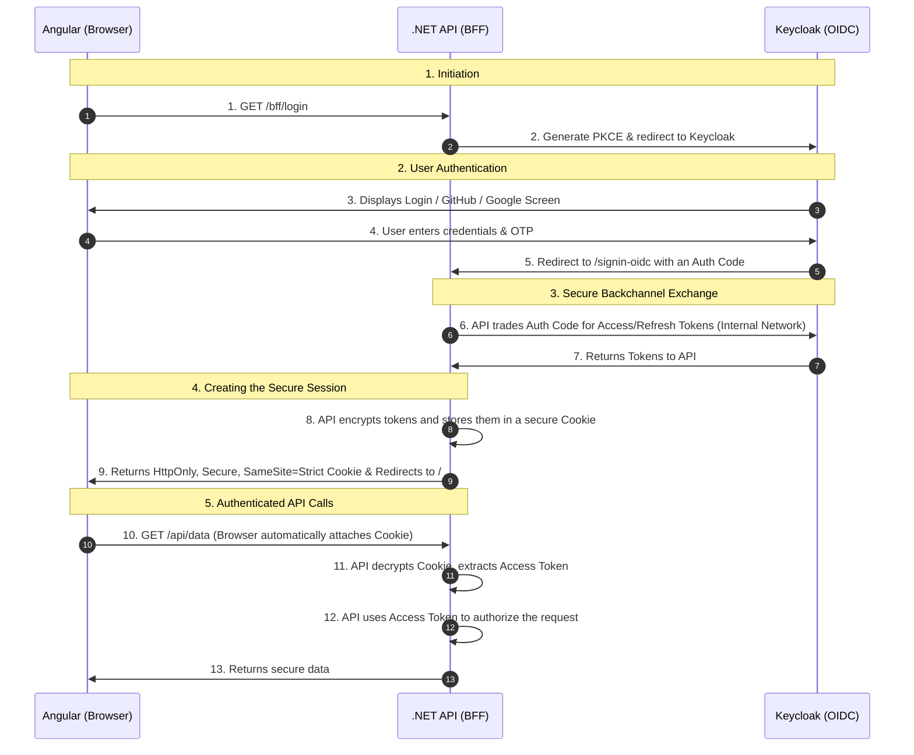

# Backend Onboarding & .NET Course

Welcome to the Normora backend! This guide is tailored for developers who might be coming from Node.js, Go, or Python, and need to quickly understand the architectural patterns used in this **.NET 10 Modular Monolith**.

---

## 1. The Modular Monolith Architecture

Normora is deployed as an API host, a separate Hangfire worker, and a one-off migration process. Business capabilities are divided into bounded contexts (Modules) in the `server/Modules/` directory.

**Rules of the Modular Monolith:**
1. **Module-Owned Persistence**: The `Tenants`, `Documents`, and `Conversations` modules each own a `DbContext` and a PostgreSQL schema. User profiles and tenant memberships currently belong to the Tenants module.
2. **No Direct Joins**: You cannot write a LINQ query that joins a `Document` with a `Tenant`. You must query by IDs across boundaries.
3. **Cross-Module Communication**: When a module requires operations or data owned by another module, it dispatches MediatR contracts in `Normora.Shared.Contracts.*`:
   - `Documents` checks permissions via queries in `Normora.Shared.Contracts.Tenants`.
   - `Conversations` retrieves knowledge chunks from `Documents` via `PerformHybridRetrievalQuery` (`Normora.Shared.Contracts.Documents`) — never directly inject `IRetrievalService`.
   - `Documents` (`McpController`) discovers and executes tools in `Conversations` via `GetMcpToolsQuery` and `ExecuteMcpToolCommand` (`Normora.Shared.Contracts.Conversations`) — never directly inject `IAgentToolRegistry`.
4. **100% DbContext Encapsulation**: DbContexts are strictly private to their owning module. API controllers, middleware, and SignalR hubs must **never** inject a module `DbContext`.
5. **Feature Slices and Controllers Live in Modules**: All commands, queries, domain entities, background ingestion jobs, entity configurations, and HTTP controllers live inside their owning module (`server/Modules/<ModuleName>/`). `Normora.Api` contains strictly application hosting (middleware, OIDC/BFF configuration, Program.cs) with no business controllers.
6. **Decoupled Boundary Interfaces**: When infrastructure or middleware requires module operations, expose an abstraction in `Normora.Shared.Interfaces` (e.g. `ITenantResolutionService` backed by distributed caching with a 30s sliding TTL, `IDocumentNotificationService`, `IEmailSender`, `IPaymentService`).
7. **No Module-Internal Concerns in Shared**: Keep `Normora.Shared` provider-neutral and lean. Internal services (like `ITextEmbeddingService`), prompts, and domain constants (like `RagConstants`, `ConversationConstants`) must reside in their respective modules.
8. **Host & Infrastructure Separation**: Cross-cutting infrastructure adapters (Hangfire, Redis distributed caching, OpenTelemetry, SignalR hubs, migration runner) and external provider adapters live in `Normora.Infrastructure`. The background worker process (`Normora.Worker`) references `Normora.Infrastructure` and required modules, never `Normora.Api`.
9. **External Provider Boundary (Provider Pattern)**: Business modules must remain 100% free of third-party vendor SDKs (e.g. MinIO, Google AI). Modules define provider-neutral domain contracts (`IDocumentStorageService`, `ITextGenerationService`, `ITextEmbeddingService`, `IDocumentTextExtractor`), while vendor-specific implementations live in `server/Normora.Infrastructure/Providers/` and are wired via `ProviderServiceExtensions.cs`.
10. **Multi-Host SignalR Redis Backplane**: Because background workers (`Normora.Worker`) and the HTTP BFF host (`Normora.Api`) run in separate processes/containers, all SignalR broadcasting is coordinated through a shared Redis pub/sub backplane (`Microsoft.AspNetCore.SignalR.StackExchangeRedis`) via `AddNormoraSignalR`. Background workers publish to Redis, and `Normora.Api` relays events down to connected browser WebSockets.

### Source Documentation Convention
Each hand-written source file documents its primary type with a concise XML summary. Add inline comments only for non-obvious business rules, security boundaries, retry behavior, or lifecycle decisions; generated EF migrations and snapshots remain generated and unedited.

### Module Directory & Assembly Conventions
Modules live in `server/Modules/<ModuleName>/<ModuleName>.csproj` (e.g., `server/Modules/Tenants/Tenants.csproj`).
Inside each `.csproj`, we explicitly specify:
```xml
<PropertyGroup>
  <AssemblyName>Normora.Modules.<ModuleName></AssemblyName>
  <RootNamespace>Normora.Modules.<ModuleName></RootNamespace>
</PropertyGroup>
```
**Why this is required:**
- **Clean Folder Naming**: Eliminates repetitive folder prefixes (`Modules/Tenants/` instead of `Modules/Normora.Modules.Tenants/`).
- **Binary & Snapshot Stability**: In .NET, MSBuild defaults the output assembly to the project name (`Tenants.dll`). Setting `<AssemblyName>` preserves the compiled binary name (`Normora.Modules.Tenants.dll`), ensuring that existing EF Core migration snapshots and Hangfire background job type serializers continue to resolve without type mismatches.
- **Namespace Consistency**: `<RootNamespace>` ensures new C# types created in the module default to `Normora.Modules.<ModuleName>.*`.

---

## 2. MediatR and CQRS

We use the **Command Query Responsibility Segregation (CQRS)** pattern heavily, facilitated by the `MediatR` library. 

Instead of bloated "Service" classes, every action is a standalone class.
- **Commands**: Modify state (e.g., `CreateDocumentCommand`). They return `void` or the ID of the created entity.
- **Queries**: Read state (e.g., `GetConversationQuery`). They do not modify the database.

### Example: A Request Lifecycle

1. **The Controller**: Receives the HTTP request and immediately dispatches it.
```csharp
[HttpPost]
[RequireTenant("employer")]
public async Task<IActionResult> Create([FromBody] CreateDepartmentCommand command)
{
    var id = await _mediator.Send(command);
    return Ok(new ApiResponse<Guid>(id));
}
```

2. **The Handler**: The actual business logic lives here (using modern C# Primary Constructors for clean DI):
```csharp
public class CreateDepartmentCommandHandler(TenantsDbContext db, ITenantContext tenantContext) 
    : IRequestHandler<CreateDepartmentCommand, Guid>
{
    public async Task<Guid> Handle(CreateDepartmentCommand request, CancellationToken ct)
    {
        var dept = new Department { Name = request.Name, TenantId = tenantContext.TenantId };
        db.Departments.Add(dept);
        await db.SaveChangesAsync(ct);
        return dept.Id;
    }
}
```

3. **Pipeline Behaviors**: Cross-cutting concerns are handled via open pipeline behaviors (e.g., `AuditBehavior<TRequest, TResponse>`). By implementing marker interfaces such as `IAuditableRequest`, commands automatically trigger structured audit event logging on completion without polluting handler business logic.

### CQRS Operation Folder Structure
To maintain organization across hundreds of operations, commands and queries are partitioned into dedicated folders per operation:

```
Application/{Feature}/
├── Commands/
│   └── {OperationName}/
│       ├── {OperationName}Command.cs
│       ├── {OperationName}CommandHandler.cs
│       └── {OperationName}CommandValidator.cs  (optional)
├── Queries/
│   └── {OperationName}/
│       ├── {OperationName}Query.cs
│       └── {OperationName}QueryHandler.cs
└── DTOs/
    └── {Feature}Dtos.cs
```

Each operation has its request, handler, and validator in separate files within that folder, preventing monolith handler files.

### Persistence & Lean DbContexts
- Module `DbContext` classes remain lean.
- All entity configurations are defined in standalone classes implementing `IEntityTypeConfiguration<T>` in `server/Modules/{ModuleName}/Persistence/Configurations/{Entity}Configuration.cs`.
- **Parameterless Entity Configurations**: Configuration classes must have parameterless public constructors. Never pass scoped dependencies (such as `ITenantContext`) into configuration constructors, as this breaks EF Core's assembly scanning (`ApplyConfigurationsFromAssembly`).
- **Dynamic Query Filter Binding**: Multi-tenant global query filters must bind dynamically to the DbContext's instance property (`_tenantContext.TenantId`) on each query rather than capturing scoped constructor parameters.
- The DbContext loads configurations automatically via `modelBuilder.ApplyConfigurationsFromAssembly(typeof({ModuleName}DbContext).Assembly);`.
- Architectural fitness is verified automatically by unit tests in `Normora.Architecture.Tests` (`ModularMonolithArchitectureTests`).

---

## 3. Authentication & BFF

Normora uses the **Backend-For-Frontend (BFF)** pattern powered by `Duende.BFF`.



### Detailed Breakdown

#### 1. Initiation
When you click "Login" in Angular, it doesn't talk to Keycloak directly. Instead, it navigates to the .NET API at `/bff/login`. The API generates a secure challenge (PKCE) and redirects your browser to Keycloak.

#### 2. User Authentication
You land on the Keycloak login screen (`http://localhost:8080`). You enter your password, do the OTP challenge, or click GitHub. Keycloak verifies who you are.

#### 3. The Callback & Backchannel (Where the magic happens)
Once Keycloak approves you, it redirects your browser *back* to the API at `http://localhost:4200/signin-oidc` with a temporary, one-time-use **Authorization Code**.
- The API takes this code and secretly talks to Keycloak over the internal Docker network (`http://keycloak:8080`).
- The API trades the Authorization Code for your real Access Token and Refresh Token. 
- *Crucially, these tokens never touch your browser.*

#### 4. The Secure Cookie
Because your Angular app needs a way to prove it's logged in, the API takes those tokens, encrypts them, and wraps them in a highly secure **Cookie** (named `normora-auth` or `__Host-spa`).
- **HttpOnly**: JavaScript cannot read it (immune to XSS attacks).
- **Secure**: It can only be sent over HTTPS.
- **SameSite=Strict**: It can only be sent to your exact API, preventing Cross-Site Request Forgery (CSRF).

#### 5. Authenticated API Calls
From now on, whenever Angular makes an HTTP request to the API (e.g., fetching a user profile), the browser *automatically* attaches that secure cookie. 
The API decrypts the cookie, finds the Keycloak Access Token inside, validates it, and processes your request!

> [!NOTE]
> All of the "weird" configuration we did earlier (like setting `KC_HOSTNAME_URL` and creating the `DockerOidcBackchannelHandler`) was necessary to ensure Step 3 and Step 6 could happen seamlessly across both the public browser network and the internal Docker network simultaneously.

#### 6. Server-Side Session Persistence
By default, Duende BFF stores user sessions in memory. This means every time the backend container restarts, all users are logged out. To fix this, we use the official `Duende.BFF.EntityFramework` library to persist sessions in our **PostgreSQL** database. 
- You do **not** need to manually create C# models for this table. The library provides the `SessionDbContext` and the required models out of the box. 
- The EF Core migrations tool reads these built-in models and automatically generates the `UserSessions` table for us.

3. **Anti-Forgery (CSRF)**: All mutating requests (`POST`, `PUT`, `DELETE`) require an `X-CSRF: 1` header, which is enforced globally by the `AsBffApiEndpoint()` convention in `Program.cs`.

### Docker Reverse-Proxy Gotcha
When running in Docker, the API sits behind an nginx reverse proxy. The API container's internal hostname is `api:8080`, but the browser-facing public URL is `localhost:4200`. 

If not corrected, the OIDC middleware will build an `redirect_uri` pointing to `api:8080/signin-oidc`, which Keycloak will reject as an unregistered URI.

**Fix**: `UseForwardedHeaders` is registered early in `Program.cs`. Configure the exact reverse-proxy IPs in `ReverseProxy:KnownProxies`:
```csharp
var forwardedHeadersOptions = new ForwardedHeadersOptions
{
    ForwardedHeaders = ForwardedHeaders.XForwardedFor 
                     | ForwardedHeaders.XForwardedHost 
                     | ForwardedHeaders.XForwardedProto
};
forwardedHeadersOptions.ForwardLimit = 1;
forwardedHeadersOptions.KnownProxies.Add(IPAddress.Parse(trustedProxyIp));
app.UseForwardedHeaders(forwardedHeadersOptions);
```

The local Compose network pins the Nginx container IP and configures it as trusted. Production must configure the actual proxy IPs; the API rejects startup if the list is empty or malformed. Never clear the trusted proxy lists or trust an entire broad network.

> **Rule of thumb**: Always register `UseForwardedHeaders` **before** `UseAuthentication` and `UseBff`, and trust only known ingress proxy addresses.

---

## 4. Security: BOLA & BFLA Prevention

Security is the highest priority in Normora. We strictly prevent Broken Object Level Authorization (BOLA) and Broken Function Level Authorization (BFLA).

### `ITenantContext`
Never trust a `TenantId` sent in a request body or URL route. The `TenantResolutionMiddleware` intercepts the `X-Tenant-Id` header (or path slug), verifies the user is an active member of that tenant in the cached repository, and injects `ITenantContext` into the DI scope for that request.

### `[RequireTenant]` Attribute
Controllers use `[RequireTenant]` to enforce Broken Function Level Authorization (BFLA):
```csharp
[HttpPost]
[RequireTenant(TenantRoles.Admin)] // Only Administrators in the active workspace can execute this
public async Task<IActionResult> CreateDepartment([FromBody] CreateDepartmentRequest request) ...
```

### Exception Envelopes
- **BOLA**: If a requested entity does not exist or belongs to another tenant/user, throw `BolaException()`. The global exception handler maps this to a generic HTTP 404 response (`ApiResponse.Failure(ApiMessages.NotFound)`). Never return custom object-missing messages that allow ID enumeration.
- **BFLA**: If a user lacks the required role, throw `BflaException()`. Mapped globally to HTTP 403 Forbidden (`ApiResponse.Failure(ApiMessages.Forbidden)`).

---

## 5. Entity Framework Core (EF Core) & Persistence

We use EF Core as our ORM across isolated PostgreSQL schemas.

### Parameterless Entity Configurations
Every entity mapping must be defined in its own `IEntityTypeConfiguration<T>` class with a public parameterless constructor under `server/Modules/{ModuleName}/Persistence/Configurations/`:

```csharp
public class DocumentConfiguration : IEntityTypeConfiguration<Document>
{
    public void Configure(EntityTypeBuilder<Document> builder)
    {
        builder.ToTable("Documents", "documents");
        builder.HasKey(d => d.Id);
        builder.Property(d => d.Title).HasMaxLength(300).IsRequired();
        builder.HasIndex(d => new { d.TenantId, d.DeletedAt });
    }
}
```

The module `DbContext` auto-discovers and registers all configurations via:
```csharp
modelBuilder.ApplyConfigurationsFromAssembly(typeof(DocumentsDbContext).Assembly);
```

### Dynamic Multi-Tenant Query Filters
Never pass `ITenantContext` to configuration constructors! Global query filters must bind dynamically to the DbContext's instance property so that `_tenantContext.TenantId` is evaluated dynamically on each query execution:

```csharp
// Inside DocumentsDbContext.cs
modelBuilder.Entity<Document>()
    .HasQueryFilter(d => d.TenantId == _tenantContext.TenantId && d.DeletedAt == null);
```

### Migrations
Because each module owns an isolated schema and DbContext, specify the context when generating migrations:
```bash
dotnet ef migrations add AddDocumentTags --context DocumentsDbContext --project server/Modules/Documents --startup-project server/Normora.Api
```

### Controlled Migrations & The `migrator` Service
The API does not modify the database schema during normal HTTP startup. Migrations must always run as a one-off, serialized deployment step, and dependent services (`api` and `worker`) only start after migrations complete successfully.

#### Local and Production Execution
```powershell
# Run directly from host CLI:
dotnet run --project server/Normora.Api/Normora.Api.csproj -- --migrate

# Or execute published binary:
dotnet .\server\Normora.Api\bin\Release\net10.0\Normora.Api.dll --migrate
```

In the local Docker Compose stack (`docker-compose.yml`), this migration execution is encapsulated in a dedicated ephemeral service named **`migrator`**:
```yaml
  migrator:
    build:
      context: ./server
      dockerfile: Dockerfile
    container_name: normora_migrator
    command: ["--migrate"]
    depends_on:
      postgres:
        condition: service_healthy
```
Both `api` and `worker` depend on `migrator` with `condition: service_completed_successfully`.

#### Ephemeral Host Architecture (`MigrationHostExtensions`)
When `--migrate` is supplied, `Program.cs` branches immediately into [`MigrationHostExtensions.RunMigrationsAsync(args)`](file:///c:/Users/Sanjeev%20Kumar/Codes/Normora/server/Normora.Api/Extensions/MigrationHostExtensions.cs), executing within a minimal `Host.CreateApplicationBuilder`. This isolates schema migration from:
- Kestrel web server listeners
- OpenTelemetry EF Core instrumentation and console exporters
- Duende BFF session background cleanup hosted services
- MVC Controllers, SignalR hubs, OpenAPI/Scalar routes, and rate limiters

This architectural separation prevents SIGSEGV crashes (exit code 139) during container teardown when running as PID 1 in Linux containers.

#### Why Migrations Are Isolated in a Separate Container
1. **Prevents Startup Race Conditions**: Scaling out multiple API or Worker replicas in parallel would otherwise result in concurrent schema migrations, database deadlocks, and corrupted `__EFMigrationsHistory` tables.
2. **Strict Modular Monolith Encapsulation**: Per architectural guidelines, the host API never directly resolves module `DbContext` instances. Instead, each module registers its own `IDatabaseMigrator` implementation:
   - `TenantsDatabaseMigrator` (`TenantsDbContext` - tenants, memberships, roles, subscriptions)
   - `DocumentsDatabaseMigrator` (`DocumentsDbContext` - documents, chunks, vector embeddings via `pgvector`)
   - `ConversationsDatabaseMigrator` (`ConversationsDbContext` - chats, messages, citations, feedback)
   - `SessionDatabaseMigrator` (`SessionDbContext` - Duende BFF user session tables)
3. **Sequential Execution**: `DatabaseMigrationRunner` iterates through all registered migrators sequentially, logging progress before exiting cleanly with exit code `0`.

---

## 6. How to Add a New CQRS Vertical Slice

Follow this exact pattern when adding a new capability to any module:

### Step 1: Create the Operation Folder
For example, to add an operation named `ArchiveDocument`:
```
server/Modules/Documents/Application/Documents/Commands/ArchiveDocument/
├── ArchiveDocumentCommand.cs
├── ArchiveDocumentCommandHandler.cs
└── ArchiveDocumentCommandValidator.cs
```

### Step 2: Define the Command
```csharp
namespace Normora.Modules.Documents.Application.Documents.Commands.ArchiveDocument;

public record ArchiveDocumentCommand(Guid DocumentId) : IRequest<ApiResponse<bool>>, IAuditableRequest
{
    public string ActionName => "Document.Archived";
}
```

### Step 3: Implement FluentValidation (Optional but Recommended)
```csharp
namespace Normora.Modules.Documents.Application.Documents.Commands.ArchiveDocument;

public class ArchiveDocumentCommandValidator : AbstractValidator<ArchiveDocumentCommand>
{
    public ArchiveDocumentCommandValidator()
    {
        RuleFor(x => x.DocumentId).NotEmpty().WithMessage(ApiMessages.RequiredField);
    }
}
```

### Step 4: Implement the Handler (Using C# Primary Constructors)
```csharp
namespace Normora.Modules.Documents.Application.Documents.Commands.ArchiveDocument;

public class ArchiveDocumentCommandHandler(
    DocumentsDbContext db,
    ITenantContext tenantContext) : IRequestHandler<ArchiveDocumentCommand, ApiResponse<bool>>
{
    public async Task<ApiResponse<bool>> Handle(ArchiveDocumentCommand request, CancellationToken ct)
    {
        // Obscure unauthorized records behind BOLA 404
        var doc = await db.Documents.FirstOrDefaultAsync(d => d.Id == request.DocumentId, ct);
        if (doc == null)
            throw new BolaException();

        doc.Archive();
        await db.SaveChangesAsync(ct);

        return ApiResponse.Success(true);
    }
}
```

### Step 5: Expose via the Module Controller
```csharp
namespace Normora.Modules.Documents.API;

[ApiController]
[Route("api/documents")]
public class DocumentsController(IMediator mediator) : ControllerBase
{
    [HttpPost("{id:guid}/archive")]
    [RequireTenant(TenantRoles.Admin)]
    public async Task<IActionResult> Archive([FromRoute] Guid id, CancellationToken ct)
    {
        var response = await mediator.Send(new ArchiveDocumentCommand(id), ct);
        return Ok(response);
    }
}
```

---

## 7. Cross-Module Communication

When a handler in one module requires data or actions owned by another module:
1. **Define a MediatR Contract** in `server/Normora.Shared/Contracts/{ModuleName}/`:
   ```csharp
   namespace Normora.Shared.Contracts.Documents;
   
   public record PerformHybridRetrievalQuery(
       string QueryText,
       int Limit,
       IReadOnlyList<Guid> AuthorizedDepartmentIds) : IRequest<IReadOnlyList<RetrievedChunkDto>>;
   ```
2. **Implement the Handler inside the Owning Module** (`Documents`):
   ```csharp
   namespace Normora.Modules.Documents.Application.Retrieval.Queries.PerformHybridRetrieval;
   
   public class PerformHybridRetrievalQueryHandler(IRetrievalService retrieval) 
       : IRequestHandler<PerformHybridRetrievalQuery, IReadOnlyList<RetrievedChunkDto>> ...
   ```
3. **Dispatch via `IMediator` from the Requesting Module** (`Conversations`):
   ```csharp
   var chunks = await mediator.Send(new PerformHybridRetrievalQuery(query, 5, deptIds), ct);
   ```
*Never directly add project references or inject internal services across module boundaries!*

---

## 8. Dependency Injection & Modern C# Conventions

- **Primary Constructors**: Always declare injected services directly in the class definition header (`class Service(IDep A, IDep B)`) rather than declaring private fields and constructor bodies.
- **Service Lifetimes**:
  - `AddScoped`: Created once per HTTP request (Use for all `DbContext`s, CQRS handlers, and tenant-aware services).
  - `AddTransient`: Lightweight stateless helpers.
  - `AddSingleton`: Application-wide immutable singletons (e.g. `ICacheService` adapters, tokenizers).
- **No Magic Strings**: Always reference `ApiMessages.*` and `TenantRoles.*` rather than hardcoding string constants.
