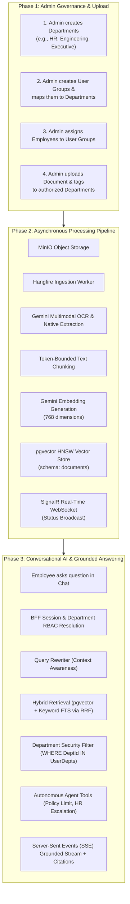
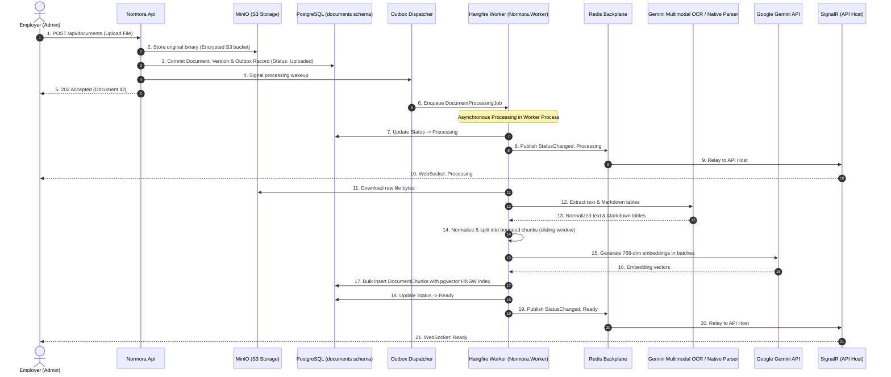

# How Normora Works: Document Ingestion, Departmental RBAC & Grounded Conversational AI

Welcome to **Normora**! This guide provides an end-to-end visual walkthrough of how document ingestion, organizational scoping, and secure conversational AI operate together.

The foundational design principle of Normora is **Zero-Trust Conversational RAG**: when an employee converses with the AI, the system guarantees that the AI *only* retrieves and reasons over documents that the employee's assigned departments explicitly authorize them to see.

---

## 1. High-Level Lifecycle Overview



---

## 2. Phase 1: Configuration & Departmental Scoping

The administrator structures the organizational knowledge graph:

1. **Departments**: Logical subdivisions of company data (e.g., *"Human Resources"*, *"Engineering"*, *"Executive Leadership"*).
2. **Document Ingestion**: The admin uploads company documents (PDF, DOCX, TXT). Each document is assigned to one or more departments (or marked *Company-Wide*).
   > *Example*: `Q3_Financial_Projections.pdf` is assigned exclusively to the **Executive Leadership** department.
3. **User Groups**: Logical employee cohorts mapped to one or more departments.
   > *Example*: A *"Senior Managers"* user group is granted access to both **Human Resources** and **Executive Leadership**.
4. **User Assignment**: Employees are added to User Groups, automatically inheriting access to corresponding departmental knowledge partitions.

---

## 3. Phase 2: Ingestion & Vector Indexing Pipeline

When an employer uploads a document, Normora offloads compute-heavy processing to an asynchronous background worker pipeline:



1. **Transactional Outbox Decoupling**: Original files are saved to MinIO S3 object storage; file metadata, version, and a `DocumentProcessingOutboxMessage` are committed atomically within the same database transaction, ensuring no work is lost even if downstream background dispatch experiences transient faults. The API immediately returns `202 Accepted`.
2. **Multimodal OCR & Text Normalization**: Gemini Multimodal OCR extracts verbatim text and structured Markdown tables from PDFs and image scans (PNG, JPG, WEBP), while native in-memory OpenXML and stream parsers instantly extract DOCX and TXT files.
3. **Bounded Chunking**: Cleaned text is segmented into optimal token chunks with sliding-window overlaps to preserve context.
4. **HNSW Vector Storage**: 768-dimensional embeddings are indexed in PostgreSQL using pgvector HNSW (`vector_cosine_ops`, `m = 16`, `ef_construction = 64`), enabling sub-millisecond approximate nearest neighbor lookups under enterprise volume.
5. **Real-Time Visibility via Redis Backplane**: `Normora.Worker` pushes lifecycle updates over the Redis SignalR backplane (`Uploaded` ➔ `Processing` ➔ `Ready` / `Failed`). The API host relays these directly to connected browser WebSockets, updating the employer's dashboard live without browser polling. When an unexpected ingestion failure occurs, the document is moved to `Failed`, full stack traces are logged to internal telemetry, and a sanitized alert email is dispatched to tenant administrators using safe user guidance (`DocumentEmailTemplates.DocumentProcessingFailedEmail`) to prevent technical error details or upstream HTTP status codes from leaking (CWE-209).

---

## 4. Phase 3: Conversational RAG & Departmental Isolation

When an employee asks a question in the chat interface:

> *"What are the Q3 financial projections and travel meal caps?"*

The system executes the following secure pipeline:

```mermaid
flowchart TD
    User([Employee]) --> Chat["Chat Interface (Angular SPA)"]
    Chat -->|POST /api/conversations/{id}/messages/stream| API["Conversations API"]

    subgraph AuthLayer ["1. Authorization & Context Resolution"]
        API --> Auth["BFF Session Check & Cached Tenant Resolution"]
        Auth --> ResolveDepts["Calculate User's Effective Department IDs<br/>(e.g., Engineering only)"]
        API --> Rewriter{"Context Required?"}
        Rewriter -->|Follow-up Question| RewriteLLM["Query Rewriter LLM<br/>Produces Standalone Query"]
        Rewriter -->|Standalone Question| RawQuery["Original User Query"]
    end

    subgraph RetrievalLayer ["2. Department-Filtered Hybrid Retrieval & Noise Rejection"]
        RawQuery & RewriteLLM --> Hybrid["Hybrid Retrieval Service"]
        Hybrid --> Vec["pgvector Cosine Similarity<br/>(Filter: distance <= 0.70)"]
        Hybrid --> FTS["PostgreSQL Full-Text Search<br/>(plainto_tsquery 'english')"]
        Vec & FTS --> RRF["Reciprocal Rank Fusion (RRF)<br/>Fuses rank lists & calibrates score (0.0 - 1.0)"]
        RRF --> Rerank["Quality & Margin Filter<br/>(Score >= 40% AND >= 70% of top match)"]
    end

    subgraph GenerationLayer ["3. Autonomous Agent Tools & Streaming"]
        Rerank --> Context["Assemble Grounded Prompt<br/>(System Instructions + Chunks)"]
        Context --> Gemini["Gemini Flash LLM (Function Calling Loop)"]
        Gemini -->|Autonomous Decision| Tools{"Tool Call?"}
        Tools -->|calculate_policy_limit| ToolCalc["Compute Meal Allowance"]
        Tools -->|escalate_hr_inquiry| ToolEsc["Send HR Admin Escalation Email"]
        ToolCalc & ToolEsc --> Gemini
        Tools -->|Synthesize Final Answer| Stream["SSE Token Stream + Citations"]
    end

    Stream -->|Real-time Tokens & Clickable Citations| Chat
```

### Critical Security Boundaries
1. **Physical Retrieval Partitioning**: The vector similarity query applies a hard database filter:
   ```sql
   WHERE ("TenantId" = @tenantId) 
     AND ("DepartmentId" IS NULL OR "DepartmentId" = ANY(@authorizedDepartmentIds))
   ```
   If a junior engineer asks about Executive Financials, the database query physically ignores executive documents, guaranteeing that unauthorized chunks are never read into memory or passed to the LLM.
2. **Autonomous Tool Calling**: When the user's inquiry requires policy computations (e.g. travel limits) or human intervention (e.g. escalating an unanswered question), Gemini autonomously triggers registered agent tools (`calculate_policy_limit`, `escalate_hr_inquiry`) inside the user's tenant context.
3. **Transparent Citations**: Every generated answer streams alongside verified **Message Citations** (document title, chunk ID, relevance rank, and preview text), allowing employees to audit and verify source material.

---

## 5. Phase 4: Omnipresent Copilot & Agentic Workplace Intelligence (CopilotKit + Microsoft Agent Framework AG-UI)

Normora elevates beyond static question-answering with an omnipresent Copilot accessible across all application screens:

1. **Omnipresent Access**: Pressing `Ctrl+J` / `Cmd+J` or clicking the floating AI spark pill opens the slide-out Copilot sidebar without disrupting the user's current workflow.
2. **Real-Time Context Perception (AG-UI)**: The client's `CopilotService` observes the active router state and workspace context. If an administrator is on `/employer/documents`, the Copilot automatically suggests document governance prompts; if an employee is on `/employee/departments`, it suggests departmental clearance prompts.
3. **AG-UI Protocol Endpoint (`/api/copilotkit`)**: `@copilotkit/angular` communicates directly with Normora's ASP.NET Core backend over the AG-UI protocol, hosted by `Microsoft.Agents.AI.Hosting.AGUI.AspNetCore`.
4. **Microsoft Agent Framework (`NormoraWorkplaceAgent`)**: The backend hosts an `AIAgent` that bridges AG-UI runs to MediatR's `AskConversationStreamCommand`, streaming tokens back to the UI in real-time.
5. **Caller-Scoped Session Isolation**: `NormoraAgentIsolationKeyProvider` partitions session threads by `{TenantId}:{ExternalUserId}`, preventing thread hijacking and ensuring multi-tenant BOLA isolation.

