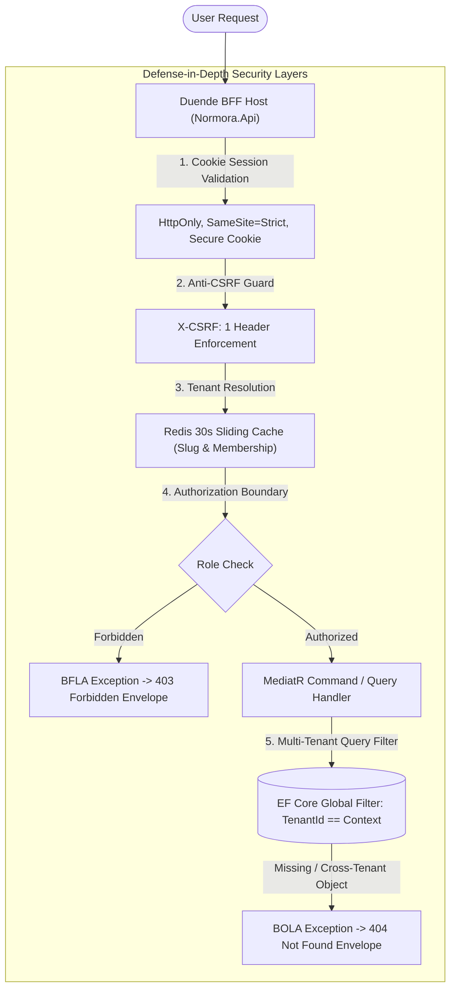

# Normora — System Overview & Architecture Summary

## 📌 Executive Summary

**Normora** is an enterprise-grade, multi-tenant knowledge management and conversational AI platform. It solves a fundamental problem facing modern enterprises: **how to empower employees with generative AI grounded in confidential internal company policies, without ever leaking restricted departmental data across organizational boundaries**.

By pairing a **.NET 10 Modular Monolith** with an **Angular 22 Single Page Application (SPA)**, Normora delivers the agility of a monolithic codebase with the strict architectural boundaries, horizontal scalability, and domain encapsulation of microservices.

---

## 🏢 Core Bounded Contexts

Normora is partitioned into three active business modules in `server/Modules/`, each owning its database schema, domain models, and persistence boundaries:

```mermaid
graph LR
    subgraph TenantsContext ["1. Tenants Module (schema: tenants)"]
        T1["Multi-Tenant Workspaces"]
        T2["Memberships & Roles"]
        T3["Departments & User Groups"]
        T4["White-Label Branding"]
        T5["Audit Logging"]
        T6["Subscription Billing (PayU)"]
    end

    subgraph DocumentsContext ["2. Documents Module (schema: documents)"]
        D1["Document Lifecycle"]
        D2["Gemini Multimodal OCR & Native Parsing"]
        D3["Bounded Text Chunking"]
        D4["pgvector HNSW Embeddings"]
        D5["Hybrid Retrieval (RRF)"]
        D6["Model Context Protocol (MCP)"]
    end

    subgraph ConversationsContext ["3. Conversations Module (schema: conversations)"]
        C1["Multi-Turn Chat RAG"]
        C2["Query Rewriter LLM"]
        C3["Autonomous Agent Tools"]
        C4["SSE Realtime Streaming"]
        C5["Citations & Feedback"]
        C6["Multi-Format Export"]
    end

    TenantsContext -->|Authorizes Scope| DocumentsContext
    DocumentsContext -->|Authoritative Chunks| ConversationsContext
```

### 1. Tenants Module (`server/Modules/Tenants/`)
- **Workspace Isolation**: Supports path-based multi-tenancy (`/app/workspaces/:slug/*`) with isolated data partitions and private workspace auto-provisioning for individuals.
- **Hierarchical Access Control**: Empowers administrators to model complex organizational hierarchies using **Departments** (data categories) and **User Groups** (employee cohorts).
- **Dynamic White-Labeling**: Runtime tenant branding dynamically binds custom primary/secondary hex colors, logos, and favicons to CSS custom properties on page load.
- **Enterprise Audit Logging**: MediatR pipeline behaviors intercept all state-mutating commands (e.g. member invitations, role promotions, document deletions) and write immutable JSON audit logs.
- **Subscription Quotas & Billing**: Implements tier limits (`Free`, `Pro`, `Enterprise`) on seats, documents, and storage using a provider-neutral `IPaymentService` abstraction supporting PayU India Hosted Checkout, SHA-512 cryptographic verification, UPI, and international credit cards.

### 2. Documents Module (`server/Modules/Documents/`)
- **Asynchronous Ingestion Pipeline**: Decouples file uploads from heavy text processing. Uploaded files are securely stored in MinIO object storage, while background ingestion jobs run in an independent **Hangfire** worker process (`Normora.Worker`).
- **Multimodal Text & OCR Extraction**: Utilizes **Google Gemini Multimodal Vision** to extract verbatim text and structured Markdown tables from PDFs and image scans (PNG, JPG, WEBP), alongside native in-memory OpenXML and stream parsing for DOCX and TXT files, protected by magic-byte security inspection.
- **Vector Embeddings & HNSW Indexing**: Normalizes extracted content into bounded chunks and generates 768-dimensional embeddings using Google's text-embedding models, indexed in PostgreSQL using `pgvector` HNSW (`vector_cosine_ops`) for sub-millisecond similarity lookups.
- **Departmental Authorization Filtering**: Vector similarity queries strictly enforce department permissions, physically excluding documents outside the authenticated user's department clearance.
- **Model Context Protocol (MCP)**: Implements standard JSON-RPC 2.0 endpoints (`/api/mcp`) allowing external agent frameworks to discover verified documents (`resources/list`) and execute approved workspace actions (`tools/call`).

### 3. Conversations Module (`server/Modules/Conversations/`)
- **Conversational RAG (Multi-Turn Chat)**: Manages persistent multi-turn conversations, maintaining sliding-window message memory and conversational summaries.
- **Context-Aware Query Rewriter**: Determines whether a follow-up inquiry requires historical context (e.g., *"Does this apply to managers?"* ➔ *"Does the 30-day expense policy apply to managers?"*) using a fast LLM before executing retrieval.
- **Reciprocal Rank Fusion (RRF) & Calibrated Relevance**: Merges semantic vector cosine ranking with full-text keyword search scores into a calibrated relevance score (0.0 to 1.0), filtering candidate noise with absolute and relative drop-off thresholds.
- **Autonomous Agent Tool Calling**: Intercepts Gemini function calling turns to execute registered workspace tools:
  - `calculate_policy_limit`: Deterministically calculates expense allowances (hotel caps, per-diem allowances, wellness stipends).
  - `escalate_hr_inquiry`: Dispatches transactional emails to workspace administrators when an inquiry cannot be answered from documentation.
  - `search_company_documents`: Performs deep cross-module retrieval via MediatR.
- **Grounded Streaming & Citations**: Streams real-time token buffers to the client via Server-Sent Events (SSE) alongside verified, clickable document chunk citations.
- **Omnipresent Copilot & AG-UI Perception**: Integrates the CopilotKit architectural pattern across the Angular SPA via `CopilotSidebarComponent` and `CopilotService`, enabling keyboard-driven (`Ctrl+J`) in-app copilot assistance with route-aware suggested prompts across all employer and employee management views.

---

## 🛡️ Enterprise Security Architecture

1. **BFF Architecture**: Token immunity—no access or refresh tokens are ever exposed to browser JavaScript or stored in local storage.
2. **BOLA (Broken Object Level Authorization) Prevention**: In accordance with OWASP API Security guidelines, requesting a resource outside the tenant or ownership scope results in a generic `BolaException` mapped to HTTP 404, preventing attacker ID enumeration.
3. **BFLA (Broken Function Level Authorization) Prevention**: Endpoints enforce role assertions via `[RequireTenant(TenantRoles.Admin)]` and map failures to structured 403 Forbidden envelopes (`BflaException`).
4. **Soft-Deletion & Deferred Physical Purge**: User removals and document deletions utilize soft-deletion with EF Core global query filters (`RemovedAt == null`, `DeletedAt == null`). Scheduled Hangfire background jobs perform permanent physical cleanup after retention windows.

---

## 🎯 Target Audience & Developer Experience

- **Enterprise Organizations**: Requiring private, tenant-isolated knowledge management that respects strict departmental boundaries.
- **Full-Stack & Systems Engineers**: Serving as a blueprint for production-ready .NET 10 Modular Monolith and Angular 22 architecture, exhibiting primary constructors, standalone components, Angular Signals, and MediatR CQRS patterns.
- **Agentic AI Architects**: Transforming Normora into an Agentic Enterprise Operating System (AEOS) powered natively by Microsoft Semantic Kernel, Microsoft.Extensions.AI, and C# Model Context Protocol (MCP). See [docs/agentic_ai_architecture.md](file:///c:/Users/Sanjeev%20Kumar/Codes/Normora/docs/agentic_ai_architecture.md).
