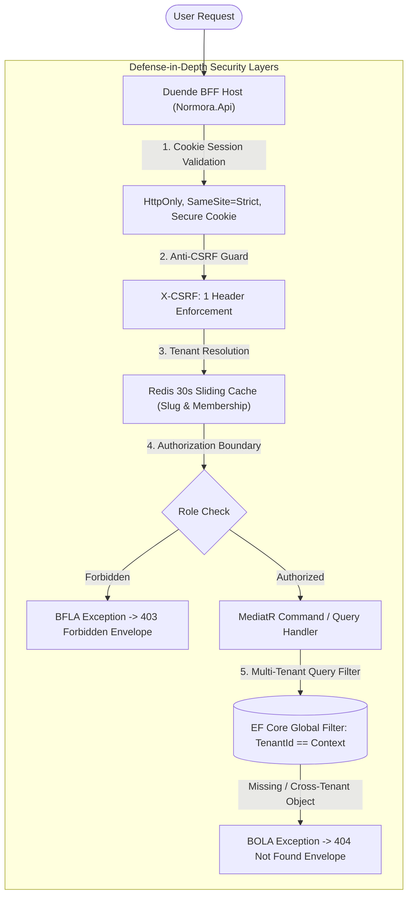

# Normora — System Overview & Architecture Summary

## 📌 Executive Summary

**Normora** is an enterprise-grade, multi-tenant knowledge management and conversational AI platform. It solves a fundamental problem facing modern enterprises: **how to empower employees with generative AI grounded in confidential internal company policies, without ever leaking restricted departmental data across organizational boundaries**.

By pairing a **.NET 10 Modular Monolith** with an **Angular 22 Single Page Application (SPA)**, Normora delivers the agility of a monolithic codebase with the strict architectural boundaries, horizontal scalability, and domain encapsulation of microservices.

---

## 🏢 Core Bounded Contexts

Normora is partitioned into three active business modules in `server/Modules/`, each owning its database schema, domain models, and persistence boundaries:

```mermaid
graph LR
    subgraph TenantsContext ["1. Tenants Module (schema: tenants)"]
        T1["Multi-Tenant Workspaces"]
        T2["Memberships & Roles"]
        T3["Departments & User Groups"]
        T4["White-Label Branding"]
        T5["Audit Logging"]
        T6["Subscription Billing (PayU)"]
    end

    subgraph DocumentsContext ["2. Documents Module (schema: documents)"]
        D1["Document Lifecycle"]
        D2["Gemini Multimodal OCR & Native Parsing"]
        D3["Bounded Text Chunking"]
        D4["pgvector HNSW Embeddings"]
        D5["Hybrid Retrieval (RRF)"]
        D6["Model Context Protocol (MCP)"]
    end

    subgraph ConversationsContext ["3. Conversations Module (schema: conversations)"]
        C1["Multi-Turn Chat RAG"]
        C2["Query Rewriter LLM"]
        C3["Autonomous Agent Tools"]
        C4["SSE Realtime Streaming"]
        C5["Citations & Feedback"]
        C6["Multi-Format Export"]
    end

    TenantsContext -->|Authorizes Scope| DocumentsContext
    DocumentsContext -->|Authoritative Chunks| ConversationsContext
```

### 1. Tenants Module (`server/Modules/Tenants/`)
- **Workspace Isolation**: Supports path-based multi-tenancy (`/app/workspaces/:slug/*`) with isolated data partitions and private workspace auto-provisioning for individuals.
- **Hierarchical Access Control**: Empowers administrators to model complex organizational hierarchies using **Departments** (data categories) and **User Groups** (employee cohorts).
- **Dynamic White-Labeling**: Runtime tenant branding dynamically binds custom primary/secondary hex colors, logos, and favicons to CSS custom properties on page load.
- **Enterprise Audit Logging**: MediatR pipeline behaviors intercept all state-mutating commands (e.g. member invitations, role promotions, document deletions) and write immutable JSON audit logs.
- **Subscription Quotas & Billing**: Implements tier limits (`Free`, `Pro`, `Enterprise`) on seats, documents, and storage using a provider-neutral `IPaymentService` abstraction supporting PayU India Hosted Checkout, SHA-512 cryptographic verification, UPI, and international credit cards.

### 2. Documents Module (`server/Modules/Documents/`)
- **Asynchronous Ingestion Pipeline**: Decouples file uploads from heavy text processing. Uploaded files are securely stored in MinIO object storage, while background ingestion jobs run in an independent **Hangfire** worker process (`Normora.Worker`).
- **Multimodal Text & OCR Extraction**: Utilizes **Google Gemini Multimodal Vision** to extract verbatim text and structured Markdown tables from PDFs and image scans (PNG, JPG, WEBP), alongside native in-memory OpenXML and stream parsing for DOCX and TXT files, protected by magic-byte security inspection.
- **Markdown & Table-Aware Chunking Engine**: Tracks heading hierarchies (`#`, `##`, `###`), prepends contextual breadcrumbs to chunks, preserves Markdown tables atomically without mid-table slicing, and splits oversized tables row-by-row while repeating column headers.
- **Batch Embeddings & HNSW Indexing**: Generates 768-dimensional embeddings via high-throughput batch embedding requests (`batchEmbedContents`, up to 100 texts/call) backed by `IEmbeddingGenerator<string, Embedding<float>>` from `Microsoft.Extensions.AI`, indexed in PostgreSQL using `pgvector` HNSW (`vector_cosine_ops`) for sub-millisecond similarity lookups.
- **Departmental Authorization Filtering**: Vector similarity queries strictly enforce department permissions, physically excluding documents outside the authenticated user's department clearance.
- **Model Context Protocol (MCP)**: Implements standard JSON-RPC 2.0 endpoints (`/api/mcp`) allowing external agent frameworks to discover verified documents (`resources/list`) and execute approved workspace actions (`tools/call`).

### 3. Conversations Module (`server/Modules/Conversations/`)
- **Conversational RAG (Multi-Turn Chat)**: Manages persistent multi-turn conversations, maintaining sliding-window message memory and conversational summaries.
- **Standardized Microsoft.Extensions.AI Pipeline**: LLM interactions (generation, streaming, query rewriting, suggestions) are unified through `IChatClient` (`GeminiChatClient`), eliminating custom HTTP clients, duplicate SSE parsers, and custom JSON schemas across infrastructure providers.
- **Context-Aware Query Rewriter**: Determines whether a follow-up inquiry requires historical context (e.g., *"Does this apply to managers?"* ➔ *"Does the 30-day expense policy apply to managers?"*) using a fast LLM before executing retrieval.
- **Reciprocal Rank Fusion (RRF) & Calibrated Relevance**: Merges semantic vector cosine ranking with full-text keyword search scores into a calibrated relevance score (0.0 to 1.0), filtering candidate noise with absolute and relative drop-off thresholds.
- **Autonomous Agent Tool Calling & 100% Action Coverage**: Employs a full 19-tool inventory registered with `IAgentToolRegistry` to execute workspace actions across all modules:
  - *Tenants Domain Tools*: `workspace_list_departments`, `workspace_create_department`, `workspace_list_employees`, `workspace_invite_employee`, `workspace_list_user_groups`, `workspace_create_user_group`, `workspace_get_dashboard_summary`, `workspace_get_audit_logs`.
  - *Documents Domain Tools*: `documents_search`, `documents_list`, `documents_get_metrics`, and `documents_delete` (with server-enforced HITL approval).
  - *Conversations Domain Tools*: `saved_answers_list`, `saved_answers_save`, `conversations_list`, `suggestions_get_popular`, `calculate_policy_limit`, `escalate_hr_inquiry`, and `workspace_request_form`.
- **Server-Enforced Human-In-The-Loop (HITL) Approvals**: Two-phase authorization model for destructive actions. Execution is automatically intercepted, persisted in PostgreSQL (`PendingApproval` with a 15-minute TTL), streamed to the user as an interactive A2UI confirmation card, and executed via `ApprovalsController` upon explicit user authorization.
- **Dynamic Missing-Parameter Intake Forms**: When agent tools require additional inputs, `workspace_request_form` emits an `intake_form_card`, rendered by Angular's reactive form component to capture missing parameters without conversational friction.
- **Reactive Workspace State Synchronization (`dataVersion`)**: Tracks monotonic workspace versions per tenant via `IWorkspaceStateSynchronizer`. When agent tools mutate workspace state, updates broadcast over SignalR and SSE streams, triggering Angular `effect()` observers to automatically reload employer management tables without page reloads.
- **Grounded Streaming & Citations**: Streams real-time token buffers to the client via Server-Sent Events (SSE) alongside verified, clickable document chunk citations.
- **Live Agent Tool Execution Lifecycle**: Streams real-time `tool_started` and `tool_finished` SSE events, rendering animated execution chips with live progress and completion summaries in the chat feed.
- **Interactive A2UI Action Cards & Simulators**: `IActionCardFactory` routes `AgentToolResult.StructuredData` to specialized card builders, rendering rich interactive client cards:
  - `ExpenseSimulatorCardComponent` (`policy_limit_card`): Interactive trip calculator with location tiers, hotel night steppers, and real-time total allowance estimation.
  - `HrEscalationCardComponent` (`hr_escalation_card`): Interactive 3-stage visual progress timeline (`Dispatched ➔ Under Review ➔ Resolution`), inquiry reference hashing, and one-click clipboard copying.
  - `IntakeFormCardComponent` (`intake_form_card`): Interactive reactive form dynamically built from tool-provided schemas.
  - Domain Action Cards: Dedicated card components for departments, employees, invitations, user groups, audit logs, and document deletions.
- **Unified Copilot Workstation (Dock / Expand Architecture)**: Unifies conversation and copilot experiences into a single omnipresent workstation with instant Dock / Expand full-screen toggling, threaded conversation drawer, search history filter, and seamless navigation integration across employer and employee views.
- **Agent UI Actuation & Co-Browsing**: Enables the Copilot agent and action cards to actuate client routes (`navigateActuation`) and trigger modals (`modalActuation`), alongside interactive citation clicking that opens `ChunkPreviewDrawerComponent` with markdown formatting and a one-click `Locate in Documents` co-browsing transition.
- **Multi-Agent Mesh Persona Switching**: Dynamically adapts agent personas directly in the Copilot interface (`All-Rounder`, `HR & People Ops`, `Finance & Travel`, `IT & Security`), reconfiguring contextual suggestions and framing conversational prompts with domain-specialized personas.

---

## 🛡️ Enterprise Security Architecture

1. **BFF Architecture**: Token immunity—no access or refresh tokens are ever exposed to browser JavaScript or stored in local storage.
2. **BOLA (Broken Object Level Authorization) Prevention**: In accordance with OWASP API Security guidelines, requesting a resource outside the tenant or ownership scope results in a generic `BolaException` mapped to HTTP 404, preventing attacker ID enumeration.
3. **BFLA (Broken Function Level Authorization) Prevention**: Endpoints enforce role assertions via `[RequireTenant(TenantRoles.Admin)]` and map failures to structured 403 Forbidden envelopes (`BflaException`).
4. **Soft-Deletion & Deferred Physical Purge**: User removals and document deletions utilize soft-deletion with EF Core global query filters (`RemovedAt == null`, `DeletedAt == null`). Scheduled Hangfire background jobs perform permanent physical cleanup after retention windows.

---

## 🎯 Target Audience & Developer Experience

- **Enterprise Organizations**: Requiring private, tenant-isolated knowledge management that respects strict departmental boundaries.
- **Full-Stack & Systems Engineers**: Serving as a blueprint for production-ready .NET 10 Modular Monolith and Angular 22 architecture, exhibiting primary constructors, standalone components, Angular Signals, and MediatR CQRS patterns.
- **Agentic AI Architects**: Transforming Normora into an Agentic Enterprise Operating System (AEOS) powered natively by Microsoft Semantic Kernel, Microsoft.Extensions.AI, and C# Model Context Protocol (MCP). See [docs/agentic_ai_architecture.md](file:///c:/Users/Sanjeev%20Kumar/Codes/Normora/docs/agentic_ai_architecture.md).
